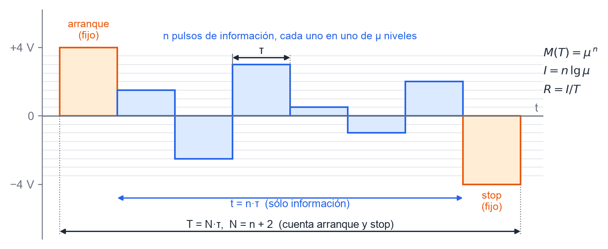

# Transmisión multinivel — apunte del podcast 2

> **CD · final · episodio 02 de 8.** Lo que cuenta el podcast, pasado en limpio y en el orden en que conviene estudiarlo. Sale en casi todos los finales: en 8 de las 9 hojas de práctica de 2020 a 2025.
>
> Para practicar: `banco-ejercicios.md` §1. Para el detalle: `resumen-final.md` §2.6 y §3.

## 1. La idea en una frase

**Si cada pulso puede tomar más niveles, cada pulso lleva más información, y en el mismo tiempo pasa más información.**

Un ejemplo concreto. Tenés 6 pulsos:

| Niveles por pulso | Mensajes distintos | Información por grupo |
|---|---|---|
| 2 (+2 V o −2 V) | $2^6 = 64$ | $6 \log_2 2 = 6$ bit |
| 7 (de −3 V a +3 V) | $7^6 = 117\,649$ | $6 \log_2 7 = 16{,}84$ bit |

Son los mismos 6 pulsos y tardan lo mismo, pero el grupo lleva casi el triple de información. Es la misma idea que después usan los módems para ir más rápido: subir los niveles y no los baudios.

## 2. Las tres velocidades

| Magnitud | Qué mide | Fórmula | Unidad |
|---|---|---|---|
| **Tasa de información** $R$ | bits **de información** por segundo, en **promedio** | $R = I/T$ | bps |
| **Tasa de dígitos** $r$ | pulsos transmitidos por segundo, informen o no | $r = N/T$ | dígitos/s (binits/s) |
| **Velocidad de señalización** $s$ | inversa del pulso **más corto** | $s = 1/\tau_{min}$ | baudios |

**El ejemplo de Baró: la teleimpresora.** Cada letra va en 7 pulsos: 1 de arranque, 5 de información y 1 de parada. El arranque y los de información duran 20 ms; la parada dura 30 ms. Entonces $T = 6 \cdot 20 + 30 = 150$ ms.

- $s = 1/20\ \text{ms} = 50$ baudios. Manda el pulso más corto.
- $r = 7/150\ \text{ms} \approx 46{,}7$ dígitos/s. Cuentan todos los pulsos.
- $R = 5/150\ \text{ms} \approx 33{,}3$ bps. Cuentan sólo los 5 pulsos binarios de la letra.

En este caso, binario y con pulsos de control, queda $R < r < s$.

> **Ojo:** $R < r$ vale sólo si los pulsos son binarios. Con pulsos multinivel cada dígito lleva $\log_2 \mu$ bits, así que **$R$ puede superar a $r$**. En el final de 2025, $R = 651{,}7$ kbps y $r = 100\,000$ dígitos/s. No es un error de cuenta.

> **Ojo:** la definición de $R$ lleva la palabra "**promedio**". En el multiple choice la usan para distinguirla de $r$.

## 3. La receta del problema de final

| Magnitud | Fórmula |
|---|---|
| Mensajes distintos | $M(T) = \mu^n$ |
| Información | $I = \log_2 M(T) = n \log_2 \mu$ |
| Tasa de información | $R = I/T$ |

$\mu$ = niveles por pulso · $n$ = pulsos **de información** · $N$ = pulsos **totales** · $T$ = duración **total** del grupo.

**Los cinco pasos:**

1. **Separá los pulsos.** El arranque y el stop tienen un solo valor posible, así que **no aportan información** ($\log_2 1 = 0$). Pero **sí suman tiempo y dígitos**: el receptor tiene que esperarlos igual.
2. **Contá los niveles.** "Entre +4 V y −4 V, incluido el 0" son **9**.
3. **Sumá el tiempo de todos los pulsos.** Ojo cuando mezclan μs y ms.
4. **Calculá** $M(T)$, $I$ y $R$. Si te piden, también $r$ y $s$. Si hay bloques con distintos niveles, la información se suma: $I = n_1 \log_2 \mu_1 + n_2 \log_2 \mu_2$.
5. **Graficá.** Pulsos uno al lado del otro, el arranque y el stop en su valor fijo, los de información con alturas variables. Marcá $\tau$ y $T$.

## 4. El problema del final 2025, resuelto

> Una transmisión multinivel usa grupos de **27 pulsos de 128 niveles** cada uno, con un pulso fijo de arranque de **+4 V** y uno de stop de **−4 V**. Cada pulso dura **10 μs**. Calcular a) $M(T)$ e $I_x$, b) $R$ y c) la gráfica.

**Datos:** $n = 27$, $\mu = 128 = 2^7$, $N = 27 + 2 = 29$, $\tau = 10\ \mu\text{s}$.

1. **Tiempo del grupo:** $T = 29 \cdot 10\ \mu\text{s} = 290\ \mu\text{s}$.
2. **Mensajes:** $M(T) = 128^{27} = 2^{189} \approx$ **7,85 × 10⁵⁶ mensajes**.
3. **Información:** $I_x = 27 \cdot \log_2 128 = 27 \cdot 7 =$ **189 bit**.
4. **Tasa de información:** $R = 189\ \text{bit} / 290\ \mu\text{s} \approx$ **651,7 kbps**.
5. **Extra:** $r = 29 / 290\ \mu\text{s} = 100\,000$ dígitos/s y $s = 1/10\ \mu\text{s} = 100$ kbaudios.

*Figura 1. Cómo se dibuja la gráfica (inciso c). El arranque y el stop van fijos; los pulsos de información, a cualquiera de los μ niveles.*

**Declará el criterio.** Acá se tomó que los 27 pulsos son todos de información y que el arranque y el stop se suman aparte, como en el apunte resuelto de la cátedra. Si los 27 incluyeran el arranque y el stop, quedaría $n = 25$, $T = 270\ \mu\text{s}$, $I = 175$ bit y $R \approx 648{,}1$ kbps. En el examen escribí qué supuesto tomás.

## 5. La variante: duplicar R sin tocar los tiempos

Si los tiempos no cambian, lo único que podés mover son los niveles. Hay que duplicar $I$:

$$2 \cdot 189 = 27 \log_2 \mu' \;\Rightarrow\; \log_2 \mu' = 14 \;\Rightarrow\; \mu' = 2^{14} = 16\,384 \text{ niveles}$$

Si no da entero, se redondea **para arriba**, porque con menos niveles no llegás. $r$ y $s$ no cambian: son los mismos pulsos con la misma duración.

## 6. Errores típicos

- Contar el arranque y el stop como información. Ponen tiempo, no bits.
- Olvidarse de sumar su tiempo en $T$.
- Contar mal los niveles porque te olvidás del 0.
- Redondear $I$. La información no se redondea: con 13 pulsos de 58 niveles da $I = 76{,}15$ bit, no 77.
- Usar en $s$ la duración promedio en vez del pulso más corto. Si el arranque dura menos, manda él, aunque no informe.
- Copiar el error del apunte resuelto: el ejercicio 2 escribe $I = 6 \log_2 7 = 2{,}81$ bit, pero 2,81 es $\log_2 7$. Lo correcto es 16,84 bit.

## 7. Autoevaluación

**1) ¿Por qué el pulso de arranque no aporta información?**
Porque siempre vale lo mismo. Un pulso con un solo valor posible tiene $\log_2 1 = 0$ bit. Sirve para sincronizar, no para informar.

**2) ¿Puede la tasa de información superar a la tasa de dígitos?**
Sí, si los pulsos son multinivel. Cada dígito lleva $\log_2 \mu$ bits, así que $R$ puede ser mayor que $r$. Sólo con pulsos binarios se cumple $R \le r$.

**3) ¿Qué es la velocidad de señalización y de qué pulso depende?**
Es la inversa de la duración del pulso más corto, $s = 1/\tau_{min}$, y se mide en baudios. Depende del pulso más corto aunque sea de control.

**4) Querés duplicar $R$ sin cambiar las duraciones. ¿Qué tocás?**
La cantidad de niveles. Despejás $\mu'$ de $2I = n \log_2 \mu'$ y redondeás para arriba. $r$ y $s$ quedan igual.

**5) ¿Por qué subir los niveles no es gratis?**
Porque con más niveles quedan más pegados entre sí, y el ruido hace que el receptor los confunda más. El límite lo pone la relación señal/ruido del canal: es la idea de Shannon. *(Conocimiento general; el episodio 5 lo retoma con QAM.)*
