# Comunicación de Datos — Resumen para el final

> **CD · UTN FRRo · ISI 3° año · final · teoría Ing. Jorge A. Campanaro, práctica Ing. Germán Baró**
>
> Este resumen junta todo lo que entra en el final, ordenado para estudiar: primero el mapa general y después los temas, del que más se toma al que menos. Cada tema arranca con un ejemplo concreto y cada ejercicio de examen está resuelto paso a paso. Al lado de cada sección dice de qué apunte sale. Las trampas típicas están marcadas con **Ojo**.
>
> Para practicar: `banco-ejercicios.md` (práctica) y `banco-preguntas-teoria.md` (teoría), en esta misma carpeta. Para el desarrollo largo: la wiki (`CD.md`).

**Notación.** La cátedra escribe $\lg x$ para el logaritmo en base 2; acá va como $\log_2 x$. En la calculadora, $\log_2 x = \ln x / \ln 2$. Lo que no está en el material de la cátedra va marcado como *(conocimiento general)*.

## 0. Qué entra y cómo se toma

### 0.1 El formato del final

El último final disponible es el del **04/04/2025**, el único del plan actual:

| Parte | Qué se tomó en 2025 | Dónde |
|---|---|---|
| **Práctica**: 3 problemas | Multinivel: 27 pulsos de 128 niveles, arranque +4 V y stop −4 V, 10 μs por pulso | §3.2 |
| | Trama PCM: 25 + 2 muestras, señales de 400 a 3500 Hz, 7 dígitos por muestra | §7.4 |
| | Cola M/M/1: sala de emergencias, un paciente cada 30 min, atención de 20 min | §9.3 |
| **Teoría**: 3 preguntas para desarrollar | Mensajes digitales por una red analógica: modulaciones, cómo aumentar la velocidad, aplicación y gráficas | §6.3 |
| | Propiedades de los códigos: unívoco, instantáneo, compacto, Kraft, cota inferior de la longitud media | §4 |
| | Medios de acceso: ventajas y desventajas, y cuál elegir según zona y velocidad | §8 |

En 2020–2021 la teoría era *multiple choice*. En 2025 pasó a desarrollo, pero repitió los mismos bloques, y dos de los tres problemas repiten números exactos de 2021.

### 0.2 Qué sale más

Síntesis de los dos bancos: 9 hojas de práctica y 6 finales de teoría de 2020–2025.

| Tema | Parte | Cuánto sale | Sección |
|---|---|---|---|
| **Transmisión multinivel** | práctica | 8 de 9 hojas | §3 |
| **TDM-PCM** (ancho de banda de la trama) | práctica | 8 de 9 | §7 |
| **Cola M/M/1** | práctica | 5 de 9 | §9 |
| **Canal binario simétrico** | práctica | 4 de 9 | §2 |
| **Kraft**, **cota inferior de la longitud media**, **elección del medio de acceso** | teoría | 6 de 6 | §4, §8 |
| Código unívoco, compacto, bloque; distancia de un código; tasa de información; FDM, TDM, muestreo, AM | teoría | 5 de 6 | §2, §4–§7 |
| Modulación digital por red analógica; código instantáneo; información mutua; familia de errores; medios | teoría | 4 de 6 | §2, §4–§6, §8 |
| FDM numérico, Hamming, Huffman, códigos lineales | práctica | casi sólo antes de 2020 | §4, §5, §7 |
| Asignación de capacidad, OSI y TCP/IP, CDM y WDM | — | nunca en 2020–2025 | §9.6, §10 |

**Lectura rápida.** La práctica es casi siempre **multinivel + PCM + (colas o canal binario)**. La teoría, **códigos + medio de acceso + modulación o multiplexado**.

### 0.3 Reglas para el examen

1. **Si hay ambigüedad, escribí el criterio que usás.** Los casos conocidos:
   - ancho de banda de la trama: $B_w = 1/\tau$ (el de la cátedra) o $B = s/2$ (§7.3);
   - muestrear con $2f_{max}$ o con $2(f_{max} - f_{min})$ (§7.4);
   - si los pulsos de arranque y stop están dentro del total o se suman aparte (§3.2);
   - en colas, qué inciso es tiempo en cola y cuál tiempo en el sistema (§9.3);
   - en el medio de acceso, si hay espacio físico y si hace falta segurización (§8.2).
2. **En PCM y FDM piden siempre tres cosas**: la técnica, los gráficos y los cálculos con unidades.
3. **No redondees la información** $I$. Los niveles se redondean **para arriba**; la cantidad de señales que entran en un canal, **para abajo**.
4. **En colas, definí cada término** antes de calcularlo.
5. **En teoría vale la definición textual del apunte.** En los *multiple choice* las opciones difieren en una palabra.

## 1. El mapa: el sistema de comunicación de punta a punta

*Fuentes: apuntes 1 y 5 de teoría y El Santo Resumen.*

Pensá en una videollamada. Tu voz es analógica: la computadora la muestrea y la pasa a bits, los comprime, les agrega bits de control y los convierte en una señal que el cable o el aire puedan llevar. Del otro lado se deshace todo en orden inverso. Cada bloque de esa cadena es un tema de la materia.

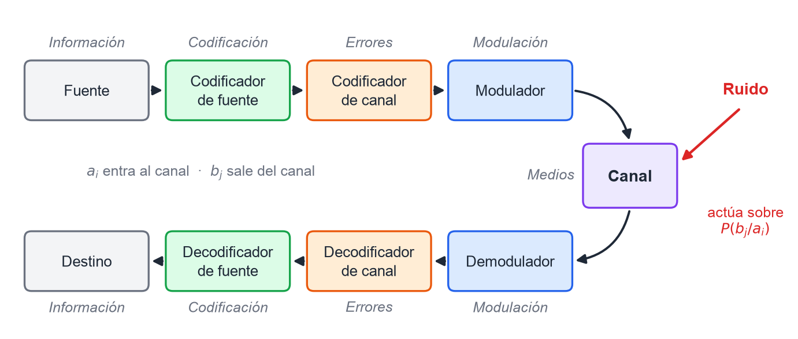
*Figura 1. El sistema de comunicación completo. El ruido entra sólo en el canal; los demás bloques están para aprovecharlo mejor o para defenderse de él.*

| Bloque | Qué hace | Sección |
|---|---|---|
| **Fuente** | emite símbolos con ciertas probabilidades: información, entropía | §2 |
| **Codificador de fuente** | achica el mensaje: menos dígitos por símbolo (Kraft, Huffman) | §4 |
| **Codificador de canal** | agrega redundancia para detectar y corregir errores | §5 |
| **Modulador y multiplexor** | adapta la señal al medio y reparte el canal (AM, ASK, PCM, FDM, TDM) | §6, §7 |
| **Canal y medio** | lleva la señal; ahí aparece el ruido | §2, §8 |
| **Red** | los mensajes esperan su turno en los nodos | §9 |

**Bit y binit.** El **bit** es la unidad de **información**; el **binit** es un **dígito binario**. Un binit lleva como máximo un bit, y menos si los dígitos no son equiprobables.

**Modular** es usar el mensaje para variar un parámetro de una **portadora**, de modo que su espectro se traslade a otra zona de frecuencias. Siempre **el mensaje modula a la portadora**. Mensaje y portadora pueden ser analógicos o digitales, y con eso la cátedra arma tres casos:

| Caso | Mensaje | Portadora | Técnicas | Multiplexado |
|---|---|---|---|---|
| I | analógico | analógica | AM, FM, PM | FDM |
| II | **digital** | **analógica** | **ASK, FSK, PSK** (el módem) | FDM |
| III | analógico | digital (tren de pulsos) | PAM, PDM, PPM, **PCM** | TDM |

## 2. Teoría de la información

*Fuentes: apunte 1 (Información, Codificación y Canales), Errores en Canales y Práctica N°1 resuelta.*

### 2.1 Información y entropía

Si te dicen "mañana sale el sol", no te enterás de nada: era seguro. Si te dicen "nieva en Rosario en enero", te enterás de muchísimo. **La información de un suceso crece cuando su probabilidad baja.** La cátedra pide que valga 0 si $p = 1$, que tienda a infinito si $p \to 0$ y que se sume para sucesos independientes. La única función que cumple las tres condiciones es el logaritmo:

$$I(A) = \log_2 \frac{1}{p(A)} \quad [\text{bit}]$$

La **entropía** $H(S)$ es la **esperanza matemática de la información por símbolo de la fuente**:

$$H(S) = \sum_i p_i \log_2 \frac{1}{p_i} \quad [\text{bit/símbolo}]$$

- Es **máxima** cuando los $q$ símbolos son **equiprobables**: $H_{max} = \log_2 q$. Vale 0 si un símbolo es seguro.
- Fuente binaria: $H(p) = p \log_2 \frac{1}{p} + (1-p) \log_2 \frac{1}{1-p}$, con máximo de 1 bit en $p = 0{,}5$.
- Ejemplos: 1/2, 1/4, 1/8, 1/8 da 1,75 bit; 0,75 / 0,25 da 0,811 bit.
- La cátedra trabaja con fuentes **de memoria nula** (cada símbolo es independiente de los anteriores).

> **Ojo:** en el *multiple choice* la correcta es "la esperanza matemática de la información por símbolo **de la fuente**", y la fórmula correcta usa $\log_2$ y $1/p_i$. Con $\ln$ da *nats*; con $\log p_i$ sin el signo da negativo.

### 2.2 El canal y el canal binario simétrico

Un canal sin memoria queda definido por su entrada $A = \{a_i\}$, su salida $B = \{b_j\}$ y la **matriz del canal** con las probabilidades $P(b_j/a_i)$: una fila por entrada, y cada fila suma 1. Un canal **transparente** no introduce errores y su matriz es diagonal.

El **canal binario simétrico** (BSC) tiene dos entradas, dos salidas y la misma probabilidad de error $p$ en los dos sentidos: $P(b_2/a_1) = P(b_1/a_2) = p$.

$$P = \begin{pmatrix} 1-p & p \\ p & 1-p \end{pmatrix}$$

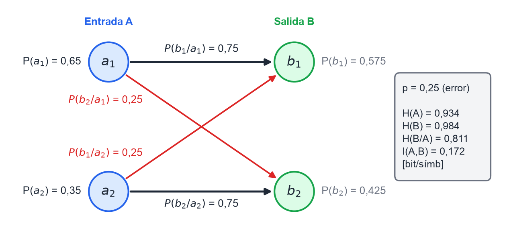
*Figura 2. El BSC de los finales: P(a₁) = 0,65 y P(b₁/a₁) = 0,75. Las flechas rectas son aciertos; las cruzadas, errores con probabilidad p = 0,25. El recuadro adelanta los resultados de §2.5.*

| Cuenta | Fórmula |
|---|---|
| Conjunta | $P(a_i, b_j) = P(a_i)\,P(b_j/a_i)$ |
| Salida | $P(b_j) = \sum_i P(a_i)\,P(b_j/a_i)$ |
| Hacia atrás (Bayes) | $P(a_i/b_j) = P(a_i, b_j) / P(b_j)$ |

$P(a_i)$ es la probabilidad **a priori**; $P(a_i/b_j)$, la **a posteriori**, la que tenés después de ver la salida.

> **Ojo:** la simetría es del **canal**, no de la fuente: el BSC no exige entradas equiprobables. En el *multiple choice*: "posee **dos** entradas y $P(b_1/a_2) = P(b_2/a_1)$".

### 2.3 Las entropías del sistema

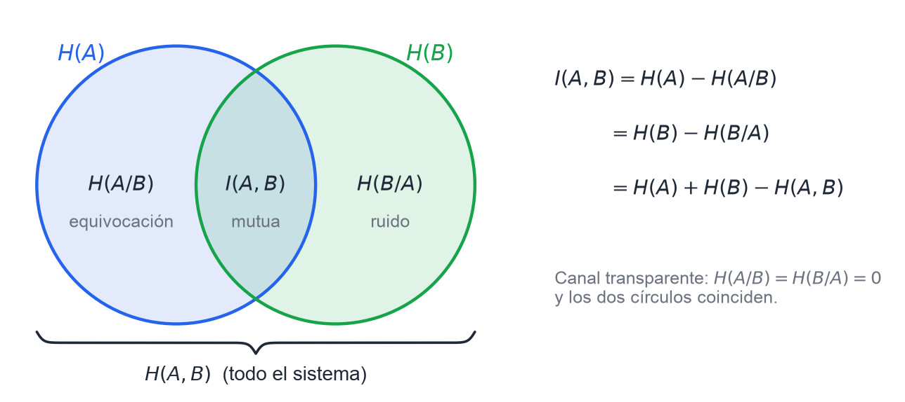
*Figura 3. Las entropías como áreas. Lo compartido entre entrada y salida es la información mutua; lo que queda afuera de la intersección es lo que el ruido tapa o agrega.*

| Entropía | Nombre de la cátedra | Qué mide |
|---|---|---|
| $H(A)$ | a priori | incertidumbre de la entrada |
| $H(B)$ | de salida | incertidumbre de la salida |
| $H(A/B)$ | a posteriori, **equivocación de A respecto de B** | lo que no se sabe de la fuente después de recibir: lo que el canal "bloquea" |
| $H(B/A)$ | **entropía del canal**, equivocación de B respecto de A | lo que agrega el ruido |
| $H(A,B)$ | del sistema | información media de emitir $a_i$ y recibir $b_j$ |

Todas se calculan con la misma forma, $\sum (\text{probabilidad}) \log_2 \frac{1}{\text{probabilidad}}$. La más usada es:

$$H(B/A) = \sum_{i,j} P(a_i)\,P(b_j/a_i) \log_2 \frac{1}{P(b_j/a_i)}$$

En el BSC vale $H(p)$, sea cual sea la fuente. Para verificar *(conocimiento general)*: $H(A,B) = H(A) + H(B/A) = H(B) + H(A/B)$.

> **Ojo:** la "entropía del canal" es $H(B/A)$, no $H(A/B)$. Unas "Preguntas frecuentes" de alumnos la definen como "la probabilidad de aparición de $b_j$ cuando se envió $a_i$": eso es $P(b_j/a_i)$, una probabilidad.

### 2.4 Información mutua y capacidad

La **información mutua** es la **información transferida desde la fuente al receptor a través del canal**: la información real que llega, en promedio. Es lo que emite la fuente menos lo que el canal bloquea:

$$I(A,B) = H(A) - H(A/B) = H(B) - H(B/A)$$

- Es **simétrica**: $I(A,B) = I(B,A)$.
- Se calcula como $H(B) - H(B/A)$, porque $H(B/A)$ sale directo de la matriz.
- Canal transparente: $I(A,B) = H(A)$. Si la fuente emite siempre lo mismo, $I = 0$.

La **capacidad** es el máximo de la información mutua sobre todas las fuentes posibles: $C = \max I(A,B)$. **Depende sólo del canal.** Canal transparente de $n$ símbolos: $C = \log_2 n$. BSC: $C = 1 - H(p)$, con entrada equiprobable *(conocimiento general)*.

| Concepto | Fórmula |
|---|---|
| Eficiencia y redundancia del canal | $FF = I(A,B)/C$; $RED = 1 - FF$ |
| Teorema del canal (Shannon) | si $R \le C$ se puede transmitir con error tan chico como se quiera; si $R > C$, no |
| Shannon–Hartley (ruido blanco) | $C = B \log_2 (1 + S/N)$ [bps] |

Ejemplo: con $B = 1000$ Hz y $S/N = 3$, $C = 1000 \cdot \log_2 4 = 2000$ bps. **El ruido limita la capacidad.**

### 2.5 Ejercicio resuelto: el canal binario de los finales

**Enunciado** (18/12/2015, 23/10/2020, 10/09/2021, 17/12/2021). Canal binario simétrico con $P(a_1) = 0{,}65$ y $P(b_1/a_1) = 0{,}75$. Calcular a) la entropía a la salida, b) la entropía del canal y c) la información mutua, explicando el concepto.

**Datos.** $P(a_2) = 0{,}35$. El canal es simétrico, así que $p = 1 - 0{,}75 = 0{,}25$.

1. **Conjuntas:** $P(a_1,b_1) = 0{,}4875$; $P(a_1,b_2) = 0{,}1625$; $P(a_2,b_1) = 0{,}0875$; $P(a_2,b_2) = 0{,}2625$.
2. **Salidas:** $P(b_1) = 0{,}4875 + 0{,}0875 = 0{,}575$; $P(b_2) = 0{,}425$.
3. **a)** $H(B) = 0{,}575 \log_2 \frac{1}{0{,}575} + 0{,}425 \log_2 \frac{1}{0{,}425} = 0{,}4591 + 0{,}5246 =$ **0,9837 bit/símbolo**.
4. **b)** $H(B/A) = 0{,}75 \log_2 \frac{1}{0{,}75} + 0{,}25 \log_2 4 = 0{,}3113 + 0{,}5 =$ **0,8113 bit/símbolo**. Es $H(0{,}25)$: no depende de la fuente.
5. **c)** $I(A,B) = 0{,}9837 - 0{,}8113 =$ **0,1724 bit/símbolo**.
6. **Concepto.** La fuente emite $H(A) = 0{,}934$ bit por símbolo, pero al receptor llegan en promedio 0,172. El resto lo tapa el ruido, que invierte uno de cada cuatro símbolos.
7. **Verificación.** Con Bayes, $H(A/B) = 0{,}7616$ y $H(A) - H(A/B) = 0{,}1725$ ✓.

Extra *(conocimiento general)*: $C = 1 - 0{,}8113 = 0{,}1887$ bit/símbolo y $FF = 0{,}914$.

> **Ojo:** $H(B/A)$ se pondera con $P(a_i)$; sin los pesos da $2H(p)$. $I(A,B)$ nunca es negativa. Y la Práctica N°1 resuelta calcula $H(A,B)$ **sumando probabilidades**: está mal, hay que sumar $p \log_2 (1/p)$.

### 2.6 Las velocidades: R, r y s

| Magnitud | Definición de la cátedra | Fórmula | Unidad |
|---|---|---|---|
| **Tasa de información** $R$ | información **promedio** que produce la fuente **por unidad de tiempo** | $R = r \cdot H$ | bps |
| **Tasa de dígitos** $r$ | **dígitos transmitidos por segundo**, informen o no | $r = N/T$ | dígitos/s |
| **Velocidad de señalización** $s$ | inversa de la duración del pulso **más corto** | $s = 1/\tau_{min}$ | baudios |

Ejemplo: pulsos de 1 ms con 4 niveles equiprobables dan $s = 1000$ baudios, $r = 1000$ dígitos/s y, como cada dígito lleva $\log_2 4 = 2$ bit, $R = 2000$ bps. Con pulsos **binarios** equiprobables, $R = s$: la capacidad coincide con la velocidad de señalización, y el ancho de banda mínimo es $B = s/2$.

> **Ojo:** $R = r \cdot H$, o sea $r = R/H$. Un resumen de alumnos escribe "$r = H(A)/R$": está mal. En el *multiple choice*, la tasa de información lleva la palabra "**promedio**".

## 3. Transmisión multinivel

*Fuentes: Principios Básicos (práctica), Transmisión Multinivel resuelta y "Fórmulas y pasos". Sale en 8 de cada 9 finales.*

### 3.1 La idea y la receta

Tenés 6 pulsos y cada uno vale +2 V o −2 V: hay $2^6 = 64$ mensajes y cada grupo lleva $\log_2 64 = 6$ bit. Si cada pulso puede tomar 7 niveles (de −3 V a +3 V), con los **mismos** 6 pulsos en el **mismo** tiempo hay $7^6 = 117\,649$ mensajes y $6 \log_2 7 = 16{,}84$ bit. **Más niveles por pulso es más información en el mismo tiempo.** Es la idea que después acelera los módems (§6.3).

| Magnitud | Fórmula | Unidad |
|---|---|---|
| Mensajes distintos | $M(T) = \mu^n$ | mensajes |
| Información | $I = \log_2 M(T) = n \log_2 \mu$ | bit |
| Tasa de información | $R = I/T$ | bps |
| Tasa de dígitos | $r = N/T$ | dígitos/s |
| Velocidad de señalización | $s = 1/\tau_{min}$ | baudios |

$\mu$ son los niveles por pulso, $n$ los pulsos **de información**, $N$ los pulsos **totales** y $T$ la duración **total** del grupo. Con mensajes equiprobables, $I = \log_2 M(T)$ sin calcular entropías.

**Pasos:**

1. **Separá los pulsos.** Los fijos (arranque, parada, sincronismo) tienen un solo nivel posible: **no aportan información** ($\log_2 1 = 0$), pero **sí suman tiempo** y dígitos. El receptor tiene que esperar el grupo entero para tener un mensaje, pero el arranque y el stop no le dicen nada nuevo.
2. **Contá los niveles.** "Entre +4 y −4 incluido el 0" son **9**.
3. **Sumá el tiempo de todos los pulsos.** Cuidado si mezclan μs y ms.
4. **Calculá** $I$, $R$, $r$ y $s$. Si hay bloques con distinta cantidad de niveles, las informaciones se suman: $I = n_1 \log_2 \mu_1 + n_2 \log_2 \mu_2$.
5. **Graficá**: pulsos uno al lado del otro, arranque y parada en su valor fijo, los de información con alturas variables. Marcá $\tau$ y $T$.

### 3.2 Ejercicio resuelto: final 2025

**Enunciado.** Una transmisión multinivel usa grupos de 27 pulsos de 128 niveles cada uno, con un pulso fijo de arranque de +4 V y uno fijo de stop de −4 V. Cada pulso dura 10 μs. Calcular a) $M(T)$ e $I_x$, b) $R$ y c) graficar.

**Datos.** $n = 27$, $\mu = 128 = 2^7$, $\tau = 10\ \mu\text{s}$, $N = 29$.

1. **Tiempo del grupo:** $T = 29 \cdot 10\ \mu\text{s} = 290\ \mu\text{s}$.
2. **a)** $M(T) = 128^{27} = 2^{189} \approx$ **7,85 × 10⁵⁶ mensajes**.
3. **a)** $I_x = 27 \cdot \log_2 128 = 27 \cdot 7 =$ **189 bit**.
4. **b)** $R = \dfrac{189\ \text{bit}}{290\ \mu\text{s}} =$ **651,7 kbps**.
5. **Extra**: $r = 29/290\ \mu\text{s} = 100\,000$ dígitos/s; $s = 1/10\ \mu\text{s} = 100$ kbaudios.
6. **c) Gráfica:**

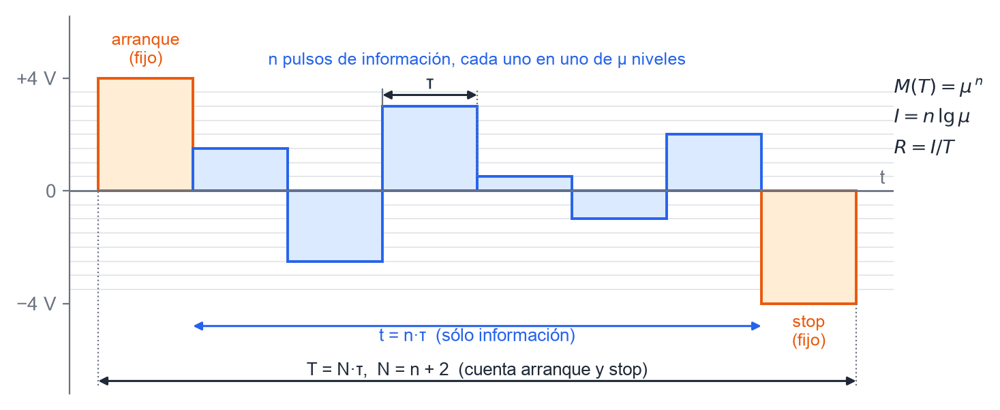
*Figura 4. Un grupo del final 2025. Los 27 pulsos del medio pueden caer en cualquiera de los 128 niveles; el primero y el último siempre valen lo mismo, por eso ocupan tiempo pero no llevan información.*

**Criterio a declarar.** Se tomó que los 27 pulsos son de datos y se suman los 2 de control, como en el ejercicio 11 del apunte resuelto. Si los 27 incluyeran arranque y stop: $n = 25$, $T = 270\ \mu\text{s}$, $I = 175$ bit y $R = 648{,}1$ kbps.

**Variante: duplicar $R$ sin tocar los tiempos.** Lo único libre es $\mu$:

$$2 \cdot 189 = 27 \log_2 \mu' \;\Rightarrow\; \log_2 \mu' = 14 \;\Rightarrow\; \mu' = 16\,384 \text{ niveles}$$

Si no da entero, se redondea **para arriba**. $r$ y $s$ no cambian: son los mismos pulsos con las mismas duraciones.

### 3.3 Otras variantes

| Final | Qué cambia | Resultado |
|---|---|---|
| 10/09/2021 | 1 arranque, 10 datos de 128 niveles, 1 stop; todos de 5 ms salvo el stop, de 7 ms | $T = 62$ ms, $I = 70$ bit, $R = 1129$ bps. Con datos binarios: $R = 161{,}3$ bps |
| 15/02/2017 | el arranque dura 0,5 μs y es el más corto | $s = 2$ Mbaudios, aunque ese pulso no informe |
| 23/10/2020 | 13 pulsos de 58 niveles, $T = 150\ \mu\text{s}$ | $I = 76{,}15$ bit, $R = 507{,}7$ kbps. El apunte redondea a 77 bit: la información no se redondea |
| 18/12/2020 | no dan $\tau$ | dejá $R$ en función de $\tau$ y aclaralo |

> **Ojo:** el ejercicio 2 del apunte resuelto escribe $I = 6 \log_2 7 = 2{,}81$ bit, pero 2,81 es $\log_2 7$. Lo correcto es 16,84 bit.

## 4. Codificación de fuente

*Fuentes: apunte 2 (Codificación), Ejercitación Codificación y "Fórmulas y pasos". Kraft y la cota inferior salieron en los 6 finales de teoría.*

### 4.1 La jerarquía de códigos

**Codificar** es poner en correspondencia las secuencias del **alfabeto fuente** $S = \{s_1, \dots, s_q\}$ con secuencias del **alfabeto código** $Z = \{z_1, \dots, z_r\}$ ($r = 2$: binario).

- **Código bloque**: asigna a **cada símbolo del alfabeto fuente una secuencia fija de símbolos del alfabeto código**.
- **Palabra código**: cada una de esas **secuencias fijas de símbolos código**.

Las clases se van anidando, cada una más exigente que la anterior:

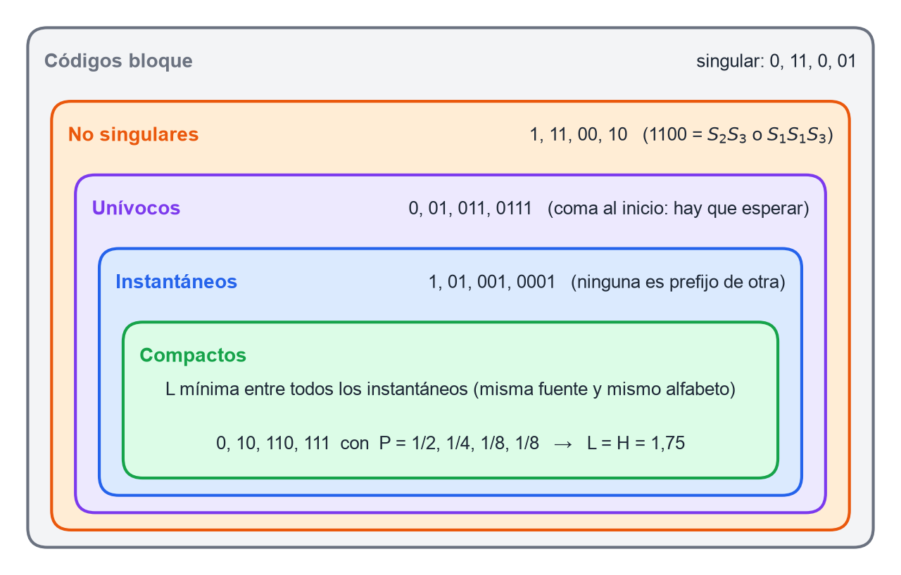
*Figura 5. La jerarquía de códigos. Cada clase está dentro de la anterior: todo compacto es instantáneo, todo instantáneo es unívoco, y así.*

| Clase | Definición del apunte | Ejemplo | Por qué |
|---|---|---|---|
| **No singular** | **todas sus palabras son distintas** | 1, 11, 00, 10 | no es unívoco: `1100` puede ser $s_2 s_3$ o $s_1 s_1 s_3$ |
| **Unívoco** | **a cualquier secuencia de palabras código le corresponde una y sólo una secuencia de símbolos fuente** | 0, 01, 011, 0111 | no es instantáneo: al recibir `01` hay que esperar el dígito siguiente |
| **Instantáneo** | cada palabra se decodifica **sin esperar la llegada de la próxima palabra código** | 1, 01, 001, 0001 | ninguna palabra es prefijo de otra |
| **Compacto** | instantáneo de longitud media mínima (§4.4) | 0, 10, 110, 111 para 1/2, 1/4, 1/8, 1/8 | $L = H$ |

- **Condición necesaria y suficiente de instantáneo**: **ninguna palabra es prefijo de otra**.
- Todo código no singular de **longitud constante** es unívoco (y también instantáneo: 00, 01, 10, 11).

> **Ojo:** "a cualquier **palabra** código le corresponde un único símbolo" define un código **no singular**; el unívoco habla de **secuencias**. La condición de instantáneo es "prefijo", no "terminación". En el examen, poné un ejemplo distinto para cada clase.

### 4.2 Inecuación de Kraft (y McMillan)

**Teorema de Kraft.** La inecuación

$$\sum_{i=1}^{q} r^{-l_i} \le 1$$

es condición **necesaria y suficiente** para que **exista al menos un** código instantáneo $r$-ario con palabras de longitudes $l_1, \dots, l_q$.

Para entenderla, pensá el código binario como un árbol. Cada palabra es un camino desde la raíz, y una palabra de longitud $l$ "ocupa" la fracción $2^{-l}$ del árbol. En un código instantáneo ninguna palabra cuelga de otra: son todas hojas. Kraft dice que **las hojas no pueden ocupar más que el árbol entero**. Con 0, 10 y 110 la suma da $1/2 + 1/4 + 1/8 = 7/8$: sobra la hoja 111.

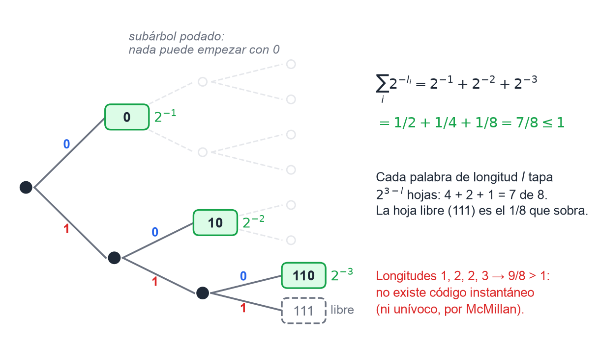
*Figura 6. Kraft en un árbol. Al elegir la palabra 0 se poda todo lo que empieza con 0. El código 0, 10, 110 usa 7/8 del árbol; con longitudes 1, 2, 2, 3 haría falta 9/8, más de lo que hay.*

**El matiz que se toma: el teorema habla de longitudes, no de un código concreto.**

- `0, 00, 11` (longitudes 1, 2, 2): $2^{-1} + 2^{-2} + 2^{-2} = 1$. **Cumple Kraft y no es instantáneo**, porque `0` es prefijo de `00`.
- `0, 10, 11` tiene **las mismas longitudes** y sí es instantáneo. Kraft garantiza que existe uno, no que el que te dieron lo sea.
- Si las longitudes **no** cumplen Kraft, no hay ningún instantáneo con ellas. Ejemplo: 1, 2, 2, 3 da $9/8 > 1$.

**McMillan.** La misma inecuación es condición necesaria y suficiente para que exista un código **unívoco**. Consecuencia: pasar de instantáneo a unívoco no permite acortar las palabras.

> **Ojo:** en el *multiple choice*, "un código que cumple Kraft **puede ser** instantáneo". No "es instantáneo", ni "es unívoco", ni "es compacto". Un resumen de alumnos la llama "condición necesaria" a secas: el apunte dice **necesaria y suficiente** para la existencia.

### 4.3 Longitud media y su cota inferior

La **longitud media** es el promedio de dígitos por símbolo:

$$L = \sum_i P_i\, l_i \quad [\text{dígitos } r\text{-arios por símbolo}]$$

Para achicarla, **a mayor probabilidad, menor longitud**.

**Teorema de la cota inferior.** Para todo código instantáneo (y, por McMillan, todo unívoco) de una fuente de memoria nula:

$$L \;\ge\; H_r(S) = \frac{H(S)}{\log_2 r} \qquad (r = 2:\ L \ge H(S))$$

$H_r(S)$ es la entropía medida en dígitos $r$-arios. **Ningún código usa menos dígitos por símbolo que la información que trae cada símbolo.**

- **Igualdad** sólo si las probabilidades son potencias de $1/r$: $P_i = r^{-l_i}$. Ejemplo del apunte: 1/2, 1/8, 1/8, 1/8, 1/8 con 0, 100, 101, 110, 111 da $L = H = 2$.
- **Si no son potencias**, se codifica la **extensión de orden $n$** (los símbolos de a $n$). Es el **primer teorema de Shannon**: $H_r(S) \le L_n/n < H_r(S) + 1/n$. El costo es la complejidad. Ejemplo: fuente 0,7 / 0,3 ($H = 0{,}881$); de a uno, $L = 1$; de a dos, $L_2/2 = 0{,}905$.

**Idea de la demostración**: con $\ln z \le z - 1$ se llega a $H(S) \le L \log_2 r + \log_2 \sum_j r^{-l_j}$, y por Kraft el último término es $\le 0$. El desarrollo completo está en la wiki.

> **Ojo:** en el *multiple choice*, la cota "expresa el límite **inferior** de la longitud media, que es igual o mayor a la entropía **$r$-aria** de la fuente". "Límite superior" es falso.

### 4.4 Código compacto y método de Huffman

**Código compacto** (definición del apunte): un código **instantáneo** cuya longitud media es **igual o menor que la de todos los códigos instantáneos que puedan aplicarse a la misma fuente y al mismo alfabeto**. Su ventaja: transmite la menor cantidad de dígitos por símbolo, y eso ahorra tiempo, ancho de banda y costo.

**Método de Huffman** (construye un compacto):

1. Ordená los símbolos de mayor a menor probabilidad.
2. Fundí los dos menos probables en uno, con la suma de sus probabilidades, y reordená. Repetí hasta que queden dos.
3. Asigná 0 y 1 a esos dos.
4. Volvé hacia atrás: cada símbolo que venía de una fusión le pasa su palabra a sus dos componentes, que agregan un 0 y un 1.

**Ejemplo de la cátedra:** 0,4 / 0,3 / 0,1 / 0,1 / 0,06 / 0,04.

| Paso | Probabilidades (entre paréntesis, lo fundido) |
|---|---|
| Fuente | 0,4 · 0,3 · 0,1 · 0,1 · 0,06 · 0,04 |
| Reducción 1 | 0,4 · 0,3 · 0,1 · 0,1 · (0,1 = $s_5 + s_6$) |
| Reducción 2 | 0,4 · 0,3 · (0,2 = $s_3 + s_4$) · 0,1 |
| Reducción 3 | 0,4 · 0,3 · (0,3 = 0,2 + 0,1) |
| Reducción 4 | (0,6 = 0,3 + 0,3) → **0** · 0,4 → **1** |

Hacia atrás, el 0,6 se abre en $s_2$ = 00 y 0,3 = 01; ese 01 se abre en 0,2 = 010 y 0,1 = 011; y así:

| $s_i$ | $s_1$ | $s_2$ | $s_3$ | $s_4$ | $s_5$ | $s_6$ |
|---|---|---|---|---|---|---|
| $P_i$ | 0,4 | 0,3 | 0,1 | 0,1 | 0,06 | 0,04 |
| Palabra | 1 | 00 | 0100 | 0101 | 0110 | 0111 |

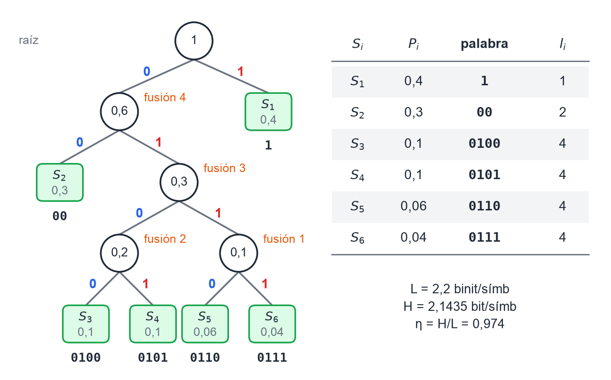
*Figura 7. El árbol de Huffman del ejemplo. Los símbolos más probables quedan cerca de la raíz y tienen palabras cortas.*

$$L = 0{,}4 \cdot 1 + 0{,}3 \cdot 2 + (0{,}1 + 0{,}1 + 0{,}06 + 0{,}04) \cdot 4 = 2{,}2 \text{ binit/símbolo}$$

Con $H = 2{,}1435$ bit, el rendimiento es $\eta = 0{,}974$. El apunte demuestra por inducción que Huffman es compacto: si una reducción es compacta, la anterior también, y la última (0 y 1) lo es trivialmente.

**Huffman $r$-ario.** Se funden los $r$ menos probables en cada paso, así que cada reducción tiene $r - 1$ símbolos menos. Para terminar con exactamente $r$, la cantidad de símbolos $\omega$ tiene que cumplir $\omega = r + \alpha (r - 1)$ con $\alpha$ entero. Si no, se agregan **símbolos falsos de probabilidad 0** y al final se descartan. Ejemplo: 6 símbolos en ternario dan $\alpha = 1{,}5$; con un falso son 7 y $\alpha = 2$. En binario no hacen falta nunca.

**Rendimiento y redundancia:**

$$\eta = \frac{H_r(S)}{L} \le 1 \qquad \text{redundancia} = 1 - \eta$$

> **Ojo:** "¿puede haber otro instantáneo con menor longitud media?": **no**, Huffman es compacto; puede haber otro distinto con la **misma** $L$ si hay empates. En $r$-ario, $\eta$ se calcula con $H_r$, no con $H$ en bits. Y el apunte tiene una errata en la reducción 1: imprime "0,1 − 001" donde va **011**.

**Ejercicio tipo** (final 09/03/2012, código dado). Para A = 0 (27/64); B, C, D = 100, 101, 110 (9/64); E, F, G = 11100, 11101, 11110 (3/64); H = 11111 (1/64): es **instantáneo** (ninguna palabra es prefijo de otra); $L = 158/64 = 2{,}469$; Kraft da exactamente **1** (árbol completo); $H = 2{,}434$, así que $\eta = 0{,}986$; y es **compacto**, porque Huffman da las mismas longitudes.

### 4.5 Cómo contestar "propiedades de los códigos" (final 2025)

1. Definí código bloque y palabra código.
2. Recorré la jerarquía (Figura 5) con un ejemplo por clase y la condición de prefijo.
3. Kraft: enunciado, el matiz de "existe" con `0, 00, 11` contra `0, 10, 11`, y McMillan en una línea.
4. Longitud media y cota inferior: $L \ge H_r(S)$, cuándo vale la igualdad y la extensión de orden $n$.
5. Compacto: definición textual, ventaja, y que Huffman lo construye.

## 5. Detección y corrección de errores

*Fuentes: apuntes 3 (Detección y Corrección de errores), 4 (Ejemplos de Códigos Lineales) y 2 (Hamming posicional).*

**Notación de esta sección**: $m$ dígitos de información, $k$ de control y $n = m + k$ en total. Los apuntes cambian de letras según el tema; acá va siempre igual.

### 5.1 Distancia y redundancia

La **distancia** (de Hamming) es la **cantidad de dígitos en que difiere una palabra código de otra palabra del mismo código**: $d(100, 101) = 1$, $d(011, 100) = 3$. La **distancia mínima** $d_{min}$ es la menor entre todos los pares.

**El inconveniente de $d_{min} = 1$.** Un código de 3 dígitos que usa las 8 combinaciones tiene $d_{min} = 1$. Si mandás `100` y llega `101`, el receptor no se entera: `101` también es válida. **Ante un error simple, una palabra se convierte en otra del mismo código.** Ese código es compacto pero no detecta nada.

**La solución es la redundancia**: usar menos palabras que combinaciones, para que las sobrantes "absorban" los errores. El precio es rendimiento.

| $d_{min}$ | Detecta | Corrige | Ejemplo |
|---|---|---|---|
| 1 | nada | nada | las $2^n$ palabras |
| 2 | error simple | nada | **bit de paridad**: detecta todo error impar, no sabe dónde; $\eta = 3/4$ con 3 + 1 |
| 3 | hasta 2 errores | error simple | **Hamming (7,4)** |

Regla general *(conocimiento general)*: se detectan $d_{min} - 1$ errores y se corrigen $\lfloor (d_{min} - 1)/2 \rfloor$.

### 5.2 Hamming

Hamming reparte la paridad **por zonas**, de modo que cada error simple altera una combinación distinta de controles. Con $k$ controles hay $2^k$ combinaciones, que tienen que alcanzar para cada uno de los $n$ dígitos más el caso "sin error":

$$2^k \ge m + k + 1$$

Con $m = 4$, $k = 3$ ($8 \ge 8$): palabra de 7 dígitos y $\eta = 4/7 = 0{,}571$. Para 9 a 16 mensajes siempre sale así.

**Versión de zonas (diagrama de Venn, apunte 3).** Cada control es la paridad par de los dígitos de información de su zona, y cada dígito de información está en una intersección distinta:

$$C_1 = I_0 \oplus I_1 \oplus I_2 \qquad C_2 = I_1 \oplus I_2 \oplus I_3 \qquad C_3 = I_0 \oplus I_2 \oplus I_3$$

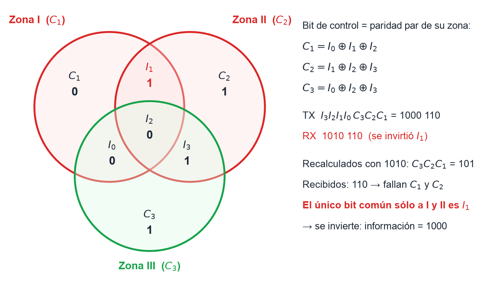
*Figura 8. Hamming (7,4) por zonas. El error en I₁ altera las zonas I y II; el único dígito común sólo a esas dos zonas es I₁, así que se invierte.*

**Ejemplo del apunte.** Se transmite $I_3 I_2 I_1 I_0\, C_3 C_2 C_1$ = `1000 110` y llega `1010 110`. Con la información recibida, 1010, los controles recalculados dan $C_3 C_2 C_1 = 101$; los recibidos eran 110. Fallan $C_1$ y $C_2$: el error está en $I_1$, y la información correcta es 1000. Si falla **un solo** control, el error está en ese control y la información está bien. Si no falla ninguno, la palabra es correcta.

**Versión posicional (apunte 2).** Los controles van en las posiciones 1, 2 y 4; cada uno mira las posiciones que tienen un 1 en su bit ($C_1$: {1, 3, 5, 7}; $C_2$: {2, 3, 6, 7}; $C_3$: {4, 5, 6, 7}). La ventaja es que **$C_3 C_2 C_1$, con 1 en cada zona alterada, da en binario la posición del error.** Ejemplo: se manda `1100110`, se invierte la posición 5 y llega `1100010`; fallan $C_1$ y $C_3$, y $101 = 5$.

| Posición | 1 | 2 | 3 | 4 | 5 | 6 | 7 |
|---|---|---|---|---|---|---|---|
| Dígito | $C_1$ | $C_2$ | $i_0$ | $C_3$ | $i_1$ | $i_2$ | $i_3$ |

> **Ojo:** en la posicional se lee $C_3 C_2 C_1$, con $C_3$ como bit más significativo. Las dos versiones son de la cátedra y los finales piden "aplicando Hamming" sin decir cuál: decí cuál usás. Además, el apunte llama $n$ a los controles en Hamming y a la longitud total en códigos lineales: fijá la notación al empezar.

### 5.3 Códigos lineales: G y H

Las $2^n$ palabras de $n$ dígitos forman un espacio vectorial con la suma sin acarreo ($1 + 1 = 0$). Un **código lineal** o **de grupo** $V$ es un **subespacio** de $2^m$ palabras. A diferencia de Hamming, no hay un campo de control separado: todos los dígitos viajan juntos.

| Objeto | Qué es | Tamaño |
|---|---|---|
| $V$ | código de grupo | $2^m$ palabras de $n$ dígitos |
| $G$ | **matriz generadora**: base de $V$ | $m \times n$ |
| $H$ | **matriz de control de paridad**: base del espacio ortogonal a $V$ | $k \times n$ |
| $S$ | síndrome | $1 \times k$ |

- Para que $G$ sea generadora, sus filas deben ser **linealmente independientes** y **generar $V$**. Toda palabra es una combinación $c_1 g_1 + \dots + c_m g_m$, con $c_j \in \{0, 1\}$. **La base no es única.**
- **Ortogonalidad**: $v \cdot H^T = 0$ para toda $v \in V$; equivale a $G\,H^T = 0$.

> **Ojo:** en el *multiple choice*, "linealmente independientes y generar **el** espacio vectorial". "Generar **todos** los espacios" es falso.

### 5.4 El síndrome

El **síndrome** es el **resultado de multiplicar la palabra recibida, posiblemente con error, por la matriz de control de paridad transpuesta**: $S = v' \cdot H^T$. Si $S = 0$, la palabra está en el código: es correcta o tiene un error no detectable. Si $S \ne 0$, hubo error.

**Por qué el síndrome depende sólo del error.** Modelá el error como un vector $e$ con unos donde se invirtieron dígitos. Llega $v' = v \oplus e$:

$$S = (v \oplus e)\,H^T = \underbrace{v\,H^T}_{=\,0} \oplus\; e\,H^T = e\,H^T$$

No importa qué palabra se mandó: **el mismo error da siempre el mismo síndrome**. Por eso se arma una tabla síndrome → error y se corrige sumando el error.

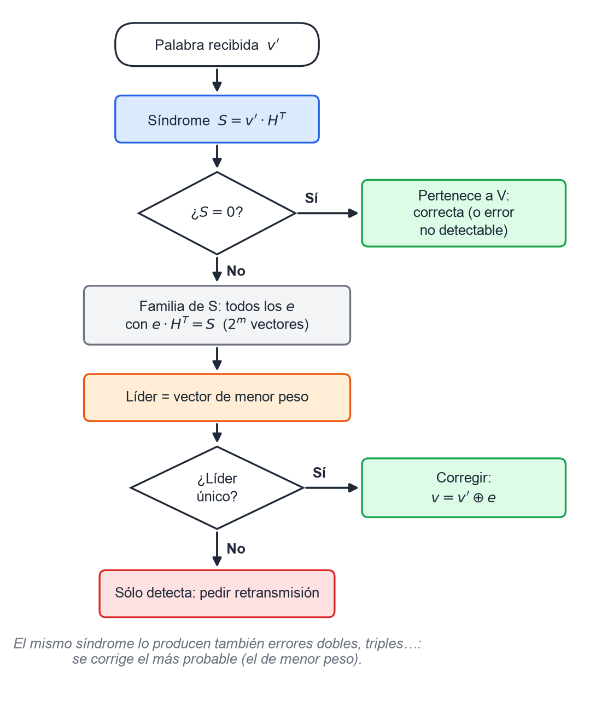
*Figura 9. Cómo se usa el síndrome en recepción. El líder es el error de menor peso, el más probable. Si hay un único líder se corrige; si hay varios empatados, sólo se detecta.*

**Condición para corregir error simple en los $n$ dígitos.** El error en el dígito $i$ da como síndrome la **columna $i$ de $H$**. Cada uno necesita un síndrome propio:

- hacen falta al menos $n$ síndromes no nulos: $2^k - 1 \ge n$;
- o sea, **las columnas de $H$ tienen que ser distintas y no nulas**.

Dos columnas iguales: ese síndrome **detecta pero no corrige**. Una columna nula: el error en ese dígito **no se detecta**.

### 5.5 Familia de errores y errores no detectables

**Errores no detectables**: los que **coinciden con palabras del código**. Si $e \in V$, entonces $v \oplus e$ también está en $V$, el síndrome da 0 y el receptor acepta una palabra equivocada.

**Familia de un síndrome**: **todos los patrones de error que lo producen**, de cualquier orden. Son $2^m$ por síndrome, y se obtienen resolviendo $x \cdot H^T = S$. El decodificador elige el de **menor peso**, porque un error simple es mucho más probable que uno doble. Si en la familia hay un único vector de peso 1, se corrige; si hay varios de peso 2 y ninguno de peso 1, sólo se detecta.

**Ejemplo del apunte.** $G$ con filas 100011, 101101 y 111000 ($n = 6$, $m = 3$). Se calcula $V$, después el espacio ortogonal, y se elige $H$ con filas 011100, 011011 y 110110:

| Síndrome | 001 | 111 | 110 | 101 | 011 | 010 | 100 |
|---|---|---|---|---|---|---|---|
| Menor peso en la familia | 100000 | 010000 | 001000 | 000100 | 000010 | 000001 | 100100, 010010, 001001 |
| Qué hace | corrige $x_1$ | corrige $x_2$ | corrige $x_3$ | corrige $x_4$ | corrige $x_5$ | corrige $x_6$ | **sólo detecta** error doble |

Si llega `111011`, el síndrome es 001: el error está en $x_1$ y la palabra correcta es `011011`. La familia de 001 tiene 8 vectores: el simple en $x_1$, dobles, triples, cuádruples y un quíntuple.

> **Ojo:** en el *multiple choice*, la familia tiene "**todos** los errores de las palabras código asociadas a ese síndrome". Dos resúmenes de alumnos dicen "sólo simples y dobles": está mal. Y el apunte 4 rotula mal cuatro síndromes de este ejemplo (dice que 100 corrige $x_4$ y que 101 sólo detecta). La tabla de arriba está verificada enumerando los 64 vectores.

## 6. Modulación

*Fuentes: apunte 5 (Comunicaciones Digitales), apunte 6 (ADSL) y El Santo Resumen.*

### 6.1 Qué es modular

**Modular** es adaptar el mensaje al medio y **trasladarlo en frecuencia** a una portadora de alta frecuencia ($f_m \ll f_c$). La portadora es $A_c \cos(2\pi f_c t + \varphi_c)$, y se varía **un** parámetro por vez: la amplitud, la frecuencia o la fase.

### 6.2 Modulación de amplitud (AM)

En AM, **la información del mensaje queda en las variaciones de amplitud de una onda senoidal de muy alta frecuencia llamada portadora**. Con un mensaje $A_m \cos 2\pi f_m t$:

$$x_{AM} = A_c \cos 2\pi f_c t + \frac{A_m}{2} \cos 2\pi (f_c - f_m) t + \frac{A_m}{2} \cos 2\pi (f_c + f_m) t$$

Aparecen la portadora y **dos bandas laterales**, inferior y superior, cada una con una copia del mensaje. Ejemplo: una emisora en 1230 kHz con una componente en 1260 kHz lleva un tono de 30 kHz.

| Variante | Qué se transmite | Ancho de banda | Para qué |
|---|---|---|---|
| **DSB** (doble banda lateral) | portadora + dos bandas | $2W$ | receptor barato: radiodifusión |
| **DSB-SC** (portadora suprimida) | dos bandas | $2W$ | ahorra potencia |
| **SSB** o BLU (banda lateral única) | una banda | $W$ | ahorra la mitad del espectro |
| **SSB-SC** | una banda, sin portadora | $W$ | máximo ahorro: móviles, punto a punto |

$W$ es el ancho del mensaje: $W = f_{max} - f_{min} \approx f_{max}$. Una sola banda alcanza para recuperarlo.

> **Ojo:** en el *multiple choice*, el mensaje queda "en la banda lateral **superior** y en la **inferior**". Portadora suprimida es "una AM donde **el espectro de la portadora no aparece después de modular**": la portadora sí se usa en el proceso.

### 6.3 Mensajes digitales por una red analógica

Es la pregunta 1 de teoría del final 2025, con cuatro incisos.

**a) Los tipos.** Los bits **modulan una portadora analógica senoidal de alta frecuencia**:

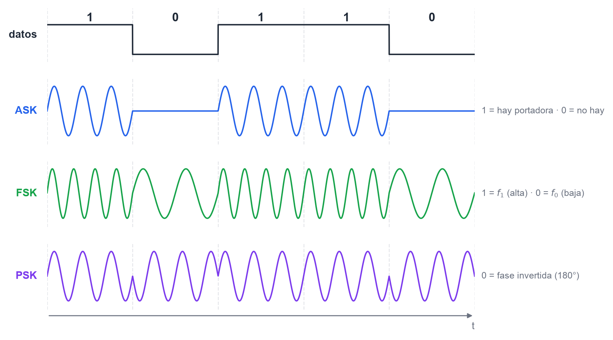
*Figura 10. Los mismos bits en ASK, FSK y PSK. Fijate qué parámetro cambia en cada fila y cuáles quedan constantes.*

| Técnica | Qué varía | "1" y "0" | Lo que dice la cátedra |
|---|---|---|---|
| **ASK** | amplitud | hay portadora / no hay | "**actualmente no se usa**": muy sensible al ruido |
| **FSK** | frecuencia | $f_1$ / $f_0$ | equivale a dos ASK superpuestas |
| **PSK** | fase | salto de 180° en cada transición | da más información que FSK en el mismo ancho de banda |

**Demodulación.** La **coherente** (sincrónica) genera en el receptor una portadora de igual frecuencia y fase, multiplica, filtra y regenera los pulsos; es más cara, y en FSK necesita las dos portadoras. La **incoherente** (detección de envolvente) existe para ASK y FSK. **PSK sólo se demodula en forma coherente.**

**b) Cómo aumentar la velocidad sin aumentar el ancho de banda: modulación multinivel.** Volvé a la fórmula de §3:

$$R = s \cdot \log_2 \mu$$

El ancho de banda depende de la velocidad de señalización $s$ (los baudios), así que el canal no deja subirla. Lo que sí se puede subir es la cantidad de **estados** por símbolo, $\mu$: cada símbolo pasa a llevar $\log_2 \mu$ bits.

- **FSK multinivel**: 2 frecuencias × 2 amplitudes = 4 estados → **2 bits por símbolo**.
- **PSK multinivel (QAM o APSK)**: fase y amplitud combinadas. **4 fases × 2 amplitudes = 8 estados → 3 bits por símbolo**.

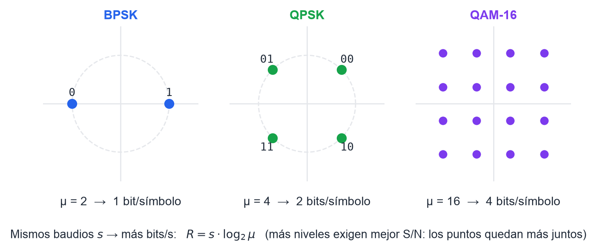
*Figura 11. Mismos baudios, más bits por segundo. Cada punto es un estado: con más puntos hay más bits por símbolo, pero quedan más juntos y el ruido los confunde con más facilidad.*

Ejemplo *(QPSK y QAM-16 son conocimiento general; la cátedra usa el caso de 8 estados)*: a 2400 baudios, BPSK da 2400 bps, QPSK 4800 bps y QAM-16 9600 bps, **en el mismo ancho de banda**. El techo lo pone Shannon, $C = B \log_2 (1 + S/N)$: más estados exigen menos ruido. Subir la frecuencia de la portadora no sirve, porque sólo traslada el espectro.

**c) La aplicación: el MODEM.** Llevar los datos de una **computadora** (digital) por la **línea telefónica** (pensada para voz analógica). Hay un MODEM (MOdulador-DEModulador) en cada punta:

```
PC ── digital ──► MODEM ── analógica ──► red telefónica ── analógica ──► MODEM ── digital ──► PC
                  (D/A)                                                 (A/D)
```

El caso actual es **ADSL** *(conocimiento general, más allá del apunte)*: divide el par de cobre en unas 256 subportadoras y modula cada una en QAM con tantos bits como le permita su ruido. Es la modulación multinivel llevada a la práctica. Las bandas están en §7.5.

**d) Las gráficas que hay que hacer:**

1. ASK, FSK y PSK para una misma secuencia de bits (Figura 10).
2. El espectro ASK: la sinc del tren de pulsos (§7.3) trasladada a ambos lados de $f_c$, con un ancho de unos $2/\tau$. FSK son dos espectros ASK, en $f_0$ y en $f_1$.
3. La tabla de estados de FSK multinivel o la constelación de 8 puntos.
4. El esquema PC → MODEM → red → MODEM → PC.

> **Ojo:** en el *multiple choice*, "modular en amplitud, frecuencia o fase una **portadora analógica de alta frecuencia**", y para acelerar sin más ancho de banda, "**aumentar el número de niveles**". Un resumen de alumnos dice que PSK se demodula en forma asincrónica y que la PSK multinivel tiene "dos fases y cuatro amplitudes": las dos cosas están al revés en el apunte.

## 7. Muestreo, PCM y multiplexado

*Fuentes: apunte 5 (Comunicaciones Digitales, págs. 9–10 y 21–24), apunte 6 (ADSL), Ejercitación Comunicación Digital y "Fórmulas y pasos". El ejercicio de PCM sale en 8 de cada 9 finales.*

### 7.1 Muestreo y PCM

Para digitalizar un mensaje analógico, **el primer paso es muestrearlo** con un tren de pulsos: quedarse con su valor cada $T_s = 1/f_s$. Al muestrear, el espectro del mensaje (de ancho $w$) se **repite** alrededor de $f_s$, $2f_s$, etc. Para recuperarlo, la primera copia no puede pisar al original:

$$f_s - w \ge w \;\Rightarrow\; f_s \ge 2w \approx 2 f_{max} \qquad \text{(teorema de Nyquist)}$$

Si no, las copias se superponen (*aliasing*). Conviene la $f_s$ **mínima**: un $T_s$ más largo deja lugar para más muestras de otros mensajes.

Con portadora digital, el mensaje modula un parámetro del pulso: la amplitud (**PAM**), la duración (**PDM**) o la posición (**PPM**). **PCM** va un paso más allá: cuantifica y codifica cada muestra.

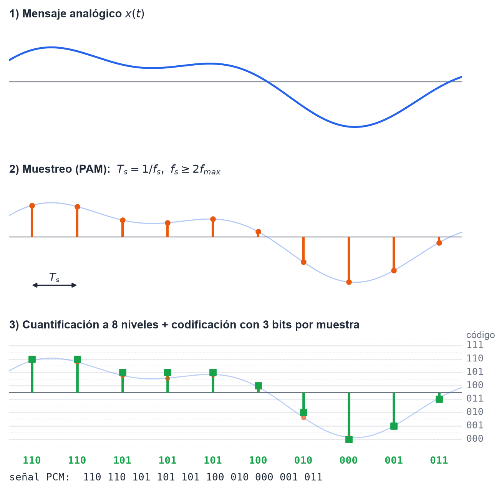
*Figura 12. Cómo se arma una señal PCM: muestreo cada Tₛ, cuantificación a 8 niveles y 3 bits por muestra. La cuantificación es el único paso que pierde información: el redondeo al nivel más cercano.*

1. **Muestreo** a $f_s \ge 2 f_{max}$.
2. **Cuantificación**: cada muestra se redondea al **nivel cuántico** más cercano. El intervalo de cada nivel es el **cuanto**. Ejemplo del apunte: de −4,5 a 4,5 con 7 niveles separados 1,5.
3. **Codificación**: cada nivel se escribe con $n$ dígitos binarios (con 7 u 8 niveles, $n = 3$).
4. **Multiplexado TDM** de varias señales en una trama, con sincronismo y señalización.

Ejemplo real: la **PCM 30 + 2** lleva 30 canales de voz y 2 de sincronismo y señalización: $32 \cdot 8 \cdot 8000 = 2{,}048$ Mbps *(conocimiento general: es el E1)*.

> **Ojo:** en el *multiple choice*, "muestrear el mensaje con un tren de pulsos digital con una frecuencia **mínima** igual al **doble de la frecuencia máxima** del mensaje". No una portadora analógica, ni el doble de la mínima, ni codificar primero.

### 7.2 TDM y la trama

**TDM** (multiplexación por división de tiempo) reparte el canal **en el tiempo**. Entre dos muestras de un mensaje queda un tiempo muerto, y ahí se intercalan las de los otros. **Durante su ranura, cada muestra ocupa todo el ancho de banda del canal.** Un conmutador en el emisor toma las muestras y otro en el receptor, **sincronizado**, las reparte.

La **trama** es una muestra de cada mensaje más las de control, y dura un período de muestreo:

| Símbolo | Qué es | Relación |
|---|---|---|
| $N$ | muestras por trama, **incluidas las de control** | — |
| $n$ | bits por muestra | — |
| $T_s$ | duración de la trama | $T_s = 1/f_s = N \cdot T_M$ |
| $T_M$ | duración de una muestra | $T_M = n \cdot \tau$ |
| $\tau$ | ancho de cada pulso | $\tau = 1/(N\, n\, f_s)$ |
| $B_w$ | ancho de banda | $B_w = 1/\tau = N \cdot n \cdot 2 f_{max}$ |

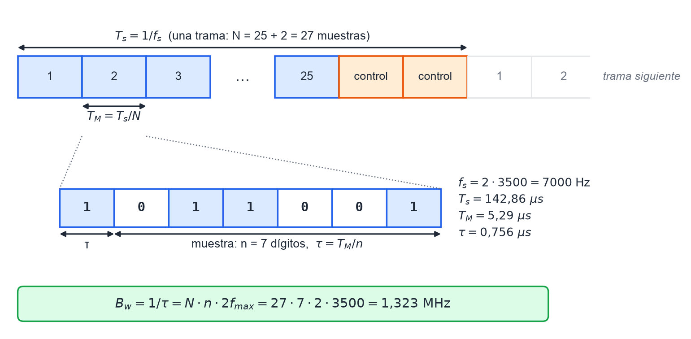
*Figura 13. La trama del final 2025: 27 ranuras en Ts = 142,86 μs, cada una con 7 pulsos de τ = 0,756 μs. Bw = 1/τ = 1,323 MHz.*

### 7.3 El ancho de banda de un tren de pulsos

Un pulso rectangular de ancho $\tau$ tiene un espectro con forma de **sinc**. En teoría es infinito, pero casi toda la energía está antes del **primer cruce por cero**, en $1/\tau$, y en la práctica se recorta ahí.

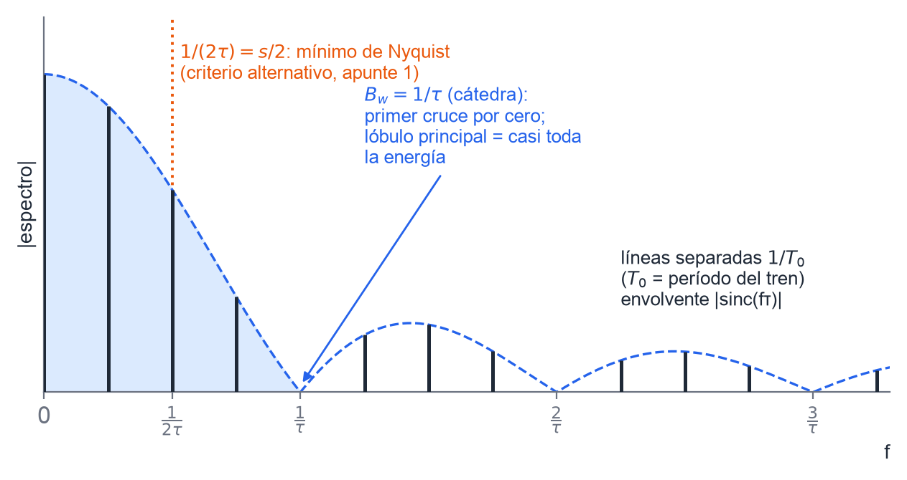
*Figura 14. Los dos criterios de ancho de banda: el primer cero en 1/τ, que usa la cátedra para la trama PCM, y el mínimo de Nyquist s/2 = 1/2τ, que da el apunte 1 para el canal binario.*

| Criterio | Fórmula | De dónde sale | Cuándo |
|---|---|---|---|
| Primer cruce por cero | $B_w = 1/\tau$ | apunte 5, pág. 24 | **ejercicio de PCM/TDM** (guía y resoluciones) |
| Mínimo de Nyquist | $B = s/2 = 1/(2\tau)$ | apunte 1, pág. 12 | canal binario, $C = s$ |

**En el examen usá $1/\tau$ y escribí que es el primer cruce por cero de la sinc.** Con el otro criterio todos los anchos se dividen por 2. Modulada en ASK, la señal ocupa unos $2/\tau$.

### 7.4 Ejercicio resuelto: final 2025

**Enunciado** (04/04/2025, igual al 19/11/2021). Una trama PCM tiene 25 muestras de información y 2 de control. Las señales van de 400 a 3500 Hz y cada muestra se codifica con 7 dígitos. Calcular el ancho de banda para transmitir la trama, graficar e indicar la técnica.

**Datos.** $N = 25 + 2 = 27$ (las de control también ocupan ranura); $n = 7$; $f_{max} = 3500$ Hz.

1. **Técnica**: **multiplexado TDM con modulación PCM** (muestreo, cuantificación y codificación binaria).
2. **Nyquist**: $f_s = 2 f_{max} = 7000$ Hz, así que la trama dura $T_s = 1/7000 = 142{,}86\ \mu\text{s}$.
3. **Una muestra**: $T_M = T_s/N = 142{,}86/27 = 5{,}291\ \mu\text{s}$.
4. **Un pulso**: $\tau = T_M/n = 5{,}291/7 = 0{,}756\ \mu\text{s}$.
5. **Ancho de banda**:
$$B_w = \frac{1}{\tau} = N \cdot n \cdot 2 f_{max} = 27 \cdot 7 \cdot 7000 = \mathbf{1\,323\,000\ \text{Hz} \approx 1{,}323\ \text{MHz}}$$
6. **Gráficos**: el mensaje con los instantes de muestreo; el espectro muestreado con las réplicas en $f_s$ y la condición $f_s \ge 2 f_{max}$; la trama de 27 ranuras (Figura 13); una muestra de 7 pulsos de ancho $\tau$; la sinc con el primer cero en $1/\tau$ (Figura 14).

**Criterios a declarar.** Se muestreó con $2 f_{max}$, como el apunte y la guía, porque $f_{min} = 400$ Hz es chica. Con $w = 3100$ Hz daría 1,172 MHz, pero muestrear a $2w$ sólo funciona en casos particulares *(conocimiento general)*. Con el criterio $s/2$ daría 661,5 kHz.

**Otras variantes:**

| Final | Qué piden | Resultado |
|---|---|---|
| 18/12/2015, 21/02/2020, 28/08/2020 | 32 señales de 4 kHz, 8 bits | $B_w = 32 \cdot 8 \cdot 8000 =$ **2,048 MHz** |
| 10/09/2021 (inverso) | 900 señales en 2 MHz, 7 bits: ¿$W$ de cada una? | $W = B_w/(2Nn) =$ **158,7 Hz** |
| 09/03/2012 | canal de 100 a 300 MHz, $f_s = 8$ kHz, 8 bits: ¿cuántas señales? | $N = 200 \times 10^6/(8 \cdot 8000) =$ **3125** |
| 03/03/2006 | 6 señales de distinta $f_{max}$ (la mayor, 20 kHz) en 2,4 MHz: ¿bits por muestra? | todas a la $f_s$ de la más rápida (40 kHz): $n =$ **10 bits** |

> **Ojo:** en $N$ van **todas** las muestras ("25 + 2" son 27). Si piden cuántas señales entran, se redondea **para abajo**. Si no dan bits por muestra, no es TDM: es FDM.

### 7.5 FDM y ADSL

**FDM** (multiplexación por división de frecuencia): cada señal **modula una portadora distinta**, así que todas **viajan simultáneamente** y cada una ocupa **una banda determinada dentro del ancho de banda del canal**. En recepción, filtros pasabanda separan cada canal.

$$\text{DSB: } B_w = N \cdot 2W \qquad\qquad \text{SSB: } B_w = N \cdot W$$

**Para duplicar la cantidad de señales en el mismo canal hay que transmitir en banda lateral única.** Suprimir la portadora ahorra potencia, no espectro.

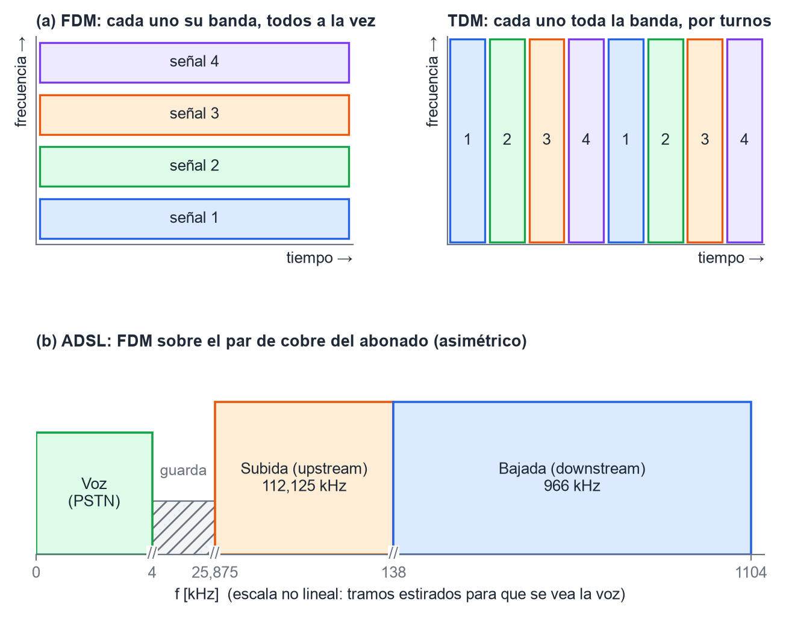
*Figura 15. FDM reparte la frecuencia; TDM, el tiempo. ADSL es un FDM sobre el par telefónico: tres bandas en el mismo cable al mismo tiempo.*

| | FDM | TDM |
|---|---|---|
| Qué se reparte | la **frecuencia**: cada señal tiene su banda | el **tiempo**: cada señal tiene su ranura |
| Simultaneidad | todas a la vez | una muestra por vez |
| Ancho de cada señal | sólo su banda ($2W$ o $W$) | **todo** el canal, en su ranura |
| Portadora | analógica, una por señal | tren de pulsos, único |
| Separación | filtros pasabanda | conmutador sincronizado |
| Ejemplos | radio AM y FM, ADSL | PCM 30 + 2 |

**"¿Cada mensaje ocupa un lugar determinado del ancho de banda?"** En FDM sí: su banda. En TDM no: usa todo el canal, y lo que tiene asignado es un lugar en el **tiempo**.

**Ejercicio tipo FDM.** Cuatro señales telefónicas de 300 a 3400 Hz por un canal que arranca en 400 kHz. En DSB cada una ocupa 6,8 kHz y $B_w = 4 \cdot 6{,}8 =$ **27,2 kHz**: el canal va de 400 a 427,2 kHz, con las portadoras en el centro de cada banda (403,4; 410,2; 417 y 423,8 kHz). En SSB, **13,6 kHz**.

> **Ojo:** con señales que no arrancan en 0, la respuesta oficial del final 18/02/2011 usa $2 f_{max}$ por señal, no $2W$; El Santo Resumen usa $N \cdot 2W$. Seguí la oficial y aclaralo.

**ADSL: el reparto del par de cobre** (apunte 6).

| Banda | Rango | Ancho | Uso |
|---|---|---|---|
| Voz | 0 – 4 kHz | 4 kHz | telefonía, en banda base |
| Guarda | 4 – 25,875 kHz | — | separa voz y datos |
| Subida | 25,875 – 138 kHz | 112,1 kHz | cliente → red |
| Bajada | 138 – 1104 kHz | 966 kHz | red → cliente |

Es **asimétrico**: la bajada tiene unas 8,6 veces más espectro que la subida, porque el usuario típico descarga mucho más de lo que sube.

**Cómo reconocer el ejercicio.** Si dan bits por muestra o hablan de trama o canal digital → **TDM-PCM**. Si piden señales analógicas simultáneas por un canal analógico y no dan bits → **FDM con AM**.

## 8. Medios de transmisión y elección del medio de acceso

*Fuentes: Elección medio de acceso V03, Medios de transmisión (práctica) y El Santo Resumen. Salió en los 6 finales de teoría.*

### 8.1 Los medios

| Medio | Cómo funciona | Lo que hay que saber |
|---|---|---|
| **Par trenzado** | dos conductores de cobre trenzados para cancelar interferencias | barato y ya tendido; la atenuación depende mucho de la frecuencia |
| **Coaxil** | núcleo, aislante, malla y cubierta | mejor blindaje que el par; hoy queda para **cablemodem residencial** |
| **Fibra óptica** | **pulsos de luz** por reflexión interna total | enorme ancho de banda; repetidores cada unos 50 km (cobre: unos 5 km); **inmune a la interferencia electromagnética**; frágil |
| **Microondas** (radioenlace) | haz concentrado con antena parabólica | **visión directa** y torres altas; la lluvia las absorbe desde unos 4 GHz; multitrayecto |
| **Satélite** | repetidor de microondas en el cielo | llega a cualquier lado; el GEO, a unos 36 000 km, tiene latencia alta (unos 270 ms según el apunte) |

> **Ojo:** "el ruido eléctrico y las interferencias afectan a la fibra" es **falso**: lleva luz. "La atenuación de las ondas de radio depende de la frecuencia y la distancia" es **verdadero**. La ventaja del satélite es "llegar a lugares lejanos e inaccesibles". Una empresa urbana con gran ancho de banda **no** contrata cablemodem: el coaxil es residencial.

### 8.2 Elegir el medio de acceso

El **medio de acceso** ("última milla") conecta la organización con la red del **operador de comunicaciones**, que cubre las grandes distancias con sus troncales. Hoy hay cuatro:

| Medio | Ventajas | Desventajas | Uso típico |
|---|---|---|---|
| **Par telefónico** (+ HDSL o xDSL) | barato; ya tendido en zona urbana; se habilita rápido | poco ancho de banda; se degrada con la distancia, el ruido y la diafonía | organización chica, urbana, con poco ancho de banda |
| **Fibra óptica** | enorme ancho de banda; baja atenuación; inmune a interferencias; difícil de intervenir; escalable | costo de tendido y obra civil; frágil; personal especializado; sólo llega donde hay red | alto ancho de banda en zona urbana o suburbana; anillo para segurizar |
| **Radioenlace** | sin obra de tendido; más barato que la fibra en zonas difíciles; rápido | **visión directa**; mástil y espacio físico; lluvia; multitrayecto; licencias | suburbana con ancho de banda bajo o medio y espacio para el mástil; respaldo de la fibra |
| **Satélite** (VSAT) | llega a cualquier lado; se instala y se muda fácil; no necesita mástil | latencia alta; caro por Mbps; ancho de banda limitado | zona inaccesible, ubicación transitoria; respaldo |

La cátedra decide con siete variables: **ubicación**, **permanencia** (definitiva o transitoria), **espacio físico**, **ancho de banda** (bajo de 4 a 8 M, medio de 10 a 50 M, alto de más de 100 M), **madurez** de la organización, **segurización** y **recursos económicos**.

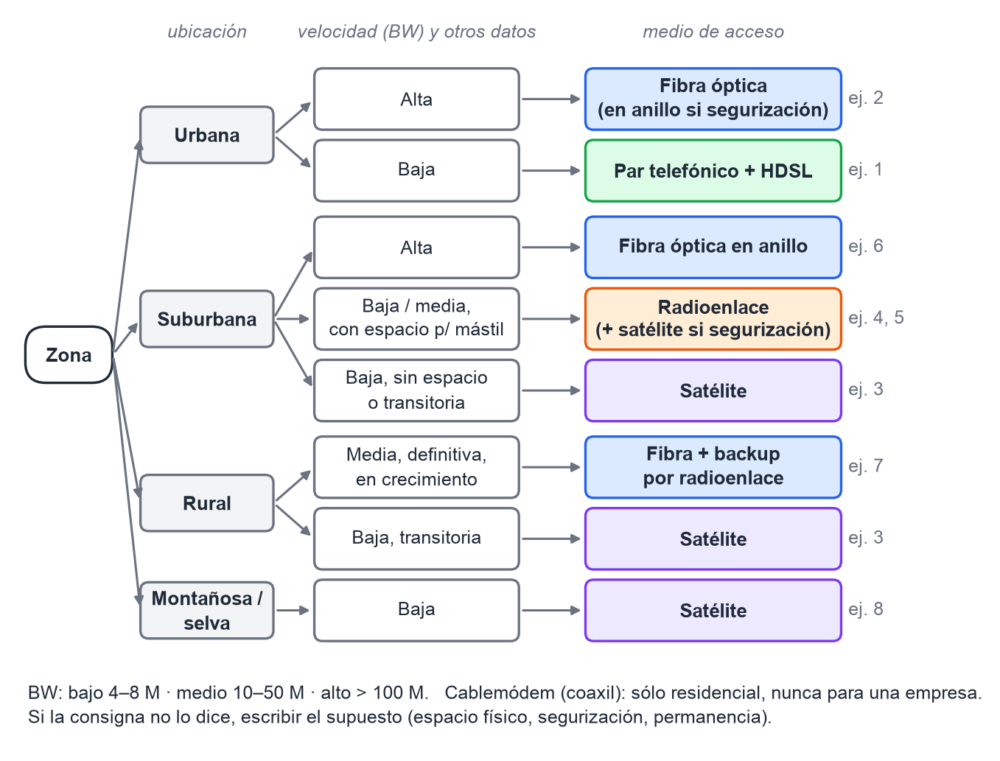
*Figura 16. La elección como árbol, con el número de ejemplo del apunte en cada hoja. La velocidad alta lleva a fibra; la zona inaccesible o transitoria, a satélite; lo suburbano con poca velocidad y espacio, a radioenlace. El cablemódem queda sólo como nota: es residencial.*

| Caso | Medio | Por qué |
|---|---|---|
| **Montaña o selva, baja velocidad** | **Satélite** | no hay red tendida, y el relieve o la vegetación impiden la visión directa |
| **Urbana, alta velocidad** | **Fibra** (en anillo si pide segurización) | sólo la fibra da más de 100 M; en la ciudad el operador la tiene cerca |
| **Urbana, baja velocidad** | **Par + HDSL** | la infraestructura ya está y es lo más barato |
| **Suburbana, alta velocidad** | **Fibra en anillo** | el ancho de banda manda |
| **Suburbana, baja velocidad** | **Radioenlace**, si hay espacio para el mástil | sin obra de tendido; con segurización, radioenlace + satélite |
| Suburbana, baja, **sin espacio** o **transitoria** | **Satélite** | no se justifica un mástil ni una obra si se va a mudar |
| Suburbana, media, **con espacio físico** | **Radioenlace** | el dato del espacio apunta al mástil |
| Industria sobre la ruta 9, alta velocidad | **Fibra** | el satélite no da gran velocidad |

**Segurización.** Si el servicio no admite cortes, se agrega un segundo acceso con recursos **disjuntos**. Dos fibras no pueden compartir ningún tramo hasta la sala de equipos: una retroexcavadora corta las dos. Y conviene que el respaldo lo dé **otro operador con infraestructura propia**: si alquila la del primero, cuando cae uno caen los dos.

**El espacio para el radioenlace.** El pie de cada rienda del mástil está al **60 % de su altura**. Un mástil de 30 m necesita un terreno libre de unos 36 × 36 m.

**Para la pregunta del final 2025:** definí medio de acceso; tabla de al menos tres medios; para cada caso, el medio y la variable que decide (montañosa baja → satélite; urbana alta → fibra; suburbana alta → fibra en anillo; suburbana baja → radioenlace); y **escribí los supuestos** que el enunciado no da.

## 9. Teoría de colas

*Fuentes: apunte Teoría de Colas, Ejercitación Teoría de cola y El Santo Resumen. Sale en 5 de cada 9 finales.*

### 9.1 Elementos y notación

Pensá en una guardia con un solo médico. Los pacientes llegan al azar, esperan en la sala si el médico está ocupado, se atienden por orden de llegada y se van. Un sistema de colas tiene una **fuente** de usuarios, un **proceso de arribo** (Poisson: intervalos exponenciales), un **tiempo de servicio** (exponencial), una **capacidad**, una cantidad de **servidores** y una **disciplina** (FIFO, LIFO, prioridades).

**Kendall**: $A/B/c/k/n/Z$. $A$ es la distribución de los arribos, **$B$ la del servicio**, $c$ los servidores, $k$ la capacidad, $n$ la población y $Z$ la disciplina. **M** quiere decir exponencial. La forma corta $A/B/c$ supone cola sin límite, población infinita y FIFO.

> **Ojo:** la **segunda** M de M/M/1 es el **tiempo de servicio** exponencial. Lo decide la posición de la letra.

### 9.2 M/M/1: fórmulas

| Símbolo | Significado | Fórmula |
|---|---|---|
| $\lambda$ | frecuencia media de arribos | $\lambda = 1/E[\tau]$ |
| $E[s]$ | tiempo medio de servicio | $E[s] = 1/\mu$ |
| $u$ | **intensidad de tráfico** [Erlang] | $u = E[s]/E[\tau] = \lambda E[s]$ |
| $\rho$ | **factor de utilización**: probabilidad de que el servidor esté ocupado | $\rho = u/c$; con un servidor, $\lambda E[s]$ |
| $W_q$ | tiempo medio **en cola** | $W_q = \rho\, E[s]/(1 - \rho)$ |
| $W$ | tiempo medio **en el sistema** | $W = W_q + E[s] = E[s]/(1 - \rho)$ |
| $L_q$, $L$ | usuarios medios en cola y en el sistema | $L_q = \lambda W_q$; $L = \lambda W$ (**Little**) |
| $\pi_q(90)$ | tiempo de cola que no supera el 90 % de los usuarios | $W \ln(10\rho)$ |

**Condición de estabilidad: $\rho < 1$.** Si no, la cola crece sin límite y las fórmulas no se aplican. La intensidad de tráfico da la **cantidad mínima de servidores**: con $E[s] = 15$ s y $E[\tau] = 10$ s, $u = 1{,}5$ Erlang, y hacen falta al menos 2.

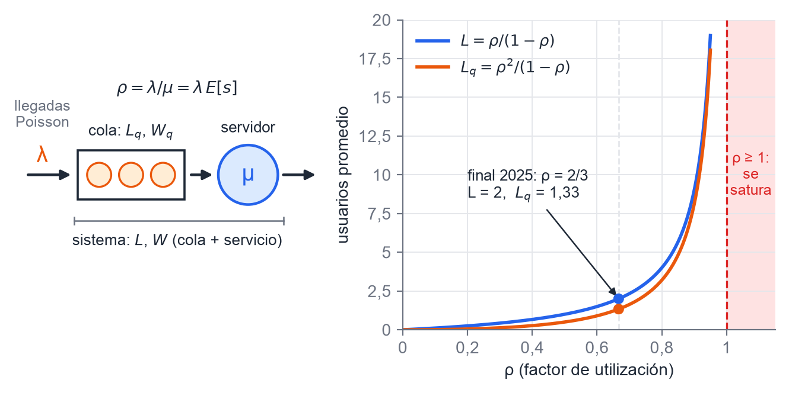
*Figura 17. Por qué ρ < 1. Con ρ = 0,667 (el final 2025) hay en promedio L = 2 pacientes en la guardia y Lq = 1,33 esperando; cerca de ρ = 1 las curvas explotan.*

Como $W = E[s]/(1 - \rho)$, la espera explota cuando $\rho \to 1$. Con $\rho = 0{,}5$ la espera en cola iguala al servicio; con $\rho = 0{,}9$ es 9 veces el servicio.

**Procedimiento:**

1. **Pasá $\lambda$ y $E[s]$ a la misma unidad.** "100 personas por día" se divide por los minutos **de atención**, no por 1440.
2. **Verificá $\rho < 1$.** Si no, decilo: hacen falta más servidores.
3. **Calculá** $W_q$, $W$, $L_q$ y $L$, **definiendo cada término**, con unidades.
4. **Concluí**: ¿la espera es aceptable?

> **Ojo:** la cátedra usa $\mu$ para la tasa de servicio y también para los niveles del multinivel. En colas trabajá con $E[s]$, que es lo que dan los enunciados.

### 9.3 Ejercicio resuelto: final 2025

**Enunciado** (04/04/2025, igual al 20/11/2020 y al 17/12/2021). Una sala de emergencias es atendida por un doctor. Los pacientes llegan según un proceso de Poisson, uno cada media hora, y la atención es exponencial, de 20 minutos en promedio. Calcular a) el tiempo promedio que el paciente espera para ser atendido, b) el tiempo promedio en la sala de emergencias, c) el número promedio de pacientes en cola y d) el número promedio de pacientes en la sala.

**Datos**, en minutos: $\lambda = 1/30$ paciente/min; $E[s] = 20$ min.

1. **Utilización**: $\rho = \lambda E[s] = 20/30 = 0{,}667 < 1$. El sistema es estable y el doctor está ocupado el 66,7 % del tiempo.
2. **a) Tiempo en cola**:
$$W_q = \frac{\rho\, E[s]}{1 - \rho} = \frac{0{,}667 \cdot 20}{0{,}333} = \mathbf{40\ min}$$
3. **b) Tiempo en el sistema**, espera más atención: $W = 40 + 20 =$ **60 min**.
4. **c) Pacientes en cola**: $L_q = \lambda W_q = 40/30 =$ **1,33 pacientes**.
5. **d) Pacientes en el sistema**: $L = \lambda W = 60/30 =$ **2 pacientes**.
6. **Conclusión.** Con dos tercios de ocupación, la espera ya duplica el tiempo de atención. Extra: $\pi_q(90) = 60 \ln 6{,}67 = 113{,}8$ min.

**Criterio a declarar.** a) y b) se parecen mucho en la redacción. Se tomó a) como tiempo en cola y b) como tiempo total en emergencias; lo mismo para c) y d).

### 9.4 Otras variantes

| Final | Qué cambia | Resultado |
|---|---|---|
| 19/11/2021, 18/12/2020 | caja única de 7 a 14 h, 100 personas por día, servicio de 3 min | $\lambda = 100/420 = 0{,}238$/min; $\rho = 0{,}714$; $W_q = 7{,}5$ min; $W = 10{,}5$ min; $L_q = 1{,}79$; $L = 2{,}5$ |
| 18/02/2011 (inverso) | $\lambda = 0{,}2$/min, $\mu = 0{,}25$/min, $W_q = 16$ min | $E[s] = 4$ min; $\rho = 0{,}8$ |
| Finales viejos (inverso) | dan $L_q$, $W$ y $\rho$ | sólo con Little: $\lambda W = L_q + \rho$ (esos datos no siempre son M/M/1) |
| Práctica (trampa) | 60 personas de 10 a 15 h, servicio de 5 min | $\rho = 1$: **saturado**, hacen falta 2 cajas |

### 9.5 Punto de saturación (modelo cerrado)

Salió en dos finales de teoría. $N$ terminales comparten una CPU, y cada usuario alterna entre **pensar** (tiempo medio $E[t]$) y **ser atendido** ($E[s]$). Si se grafica el tiempo de respuesta $W$ contra $N$, con pocas terminales $W \approx E[s]$, y con muchas $W \approx N\,E[s] - E[t]$. Las dos asíntotas se cortan en el **punto de saturación**:

$$N^* = \frac{E[s] + E[t]}{E[s]}$$

Es el **número máximo de terminales que se pueden conectar sin interferencia mutua**. Ejemplo del apunte: $E[s] = 0{,}2$ s y $E[t] = 3$ s dan $N^* = 16$.

> **Ojo:** en el *multiple choice*, "el número **máximo** de usuarios con una **mínima** interferencia mutua". Un resumen de alumnos dice "número máximo de **servidores**": son terminales.

### 9.6 Por las dudas: asignación de capacidad

No salió desde 2020. Hay una capacidad total $C$ (en bps) para repartir entre los enlaces de una red en estrella, buscando el menor retardo promedio (Kleinrock). Cada enlace es una **M/M/1** que recibe $\lambda_i$ mensajes/s de $1/\eta_i$ bits en promedio, con retardo $T_i = 1/(\eta_i C_i - \lambda_i)$: si $\lambda_i \to \eta_i C_i$, **el retardo crece sin límite**. La **regla de la raíz cuadrada** le da a cada enlace su tráfico mínimo $\lambda_i/\eta_i$ y reparte lo que sobra en proporción a $\sqrt{\lambda_i/\eta_i}$. La fórmula y un ejemplo resuelto están en `banco-ejercicios.md` (§9).

## 10. Por las dudas: lo que casi no se toma

*Nunca salieron en los finales de teoría 2020–2025; sí en el 2° parcial.*

### 10.1 Modelo OSI y TCP/IP

*Fuente: apunte OSI, TCP/IP y Hardware de Redes (Tanenbaum).*

**OSI** es un **modelo de referencia** de 7 capas: dice qué hace cada una, no qué protocolos usar. De arriba abajo: **aplicación** (HTTP, correo), **presentación** (sintaxis de los datos), **sesión** (diálogo y sincronización), **transporte** (extremo a extremo, entrega en orden), **red** (enrutamiento, congestión), **enlace** (tramas, errores, flujo) y **física** (bits por el medio: tensiones, duración del bit, conectores).

**Capa 1 y capa 2** (2° parcial 2025). La física manda bits crudos y no garantiza que lleguen bien. La de enlace los **organiza en tramas**, **detecta y corrige errores** (ahí viven los códigos de §5) y **regula el flujo**, para que la capa de red vea una línea libre de errores. Todo lo de §6 a §8 es capa 1.

**TCP/IP** tiene 4 capas: host a red, interred (IP, sin conexión), transporte (TCP confiable y con conexión; UDP sin conexión) y aplicación. Sus protocolos son anteriores al modelo.

### 10.2 CDM y WDM

| Técnica | Qué se reparte | Medio |
|---|---|---|
| **CDM** | **códigos** pseudoaleatorios: todos a la vez en toda la banda, con **espectro ensanchado** casi a nivel de ruido | **no guiado** (CDMA); origen militar |
| **WDM** | **longitudes de onda** (colores de luz) | **sólo fibra**; DWDM: más de 4 λ, hasta 80 o más |

WDM resuelve una fibra saturada sin tender otra: se ponen multiplexores ópticos en las puntas y la misma fibra lleva muchas λ *(conocimiento general: es un FDM óptico)*. FSK y PSK son **modulación**, no multiplexado.

### 10.3 Errores de canal

El **ruido blanco** (agitación térmica) es imposible de eliminar y limita la capacidad. El **ruido impulsivo** es la **principal** causa de error: picos que alteran **varios binits seguidos (ráfaga)**. Las otras causas son modulaciones espurias, desvanecimiento y distorsión.

## 11. Hoja de fórmulas

**Teoría de la información (§2)**

| Qué | Fórmula |
|---|---|
| Información y entropía | $I = \log_2 (1/p)$; $H = \sum p_i \log_2 (1/p_i)$, máxima $\log_2 q$ |
| Salida y Bayes | $P(b_j) = \sum_i P(a_i) P(b_j/a_i)$; $P(a_i/b_j) = P(a_i) P(b_j/a_i)/P(b_j)$ |
| Entropía del canal | $H(B/A) = \sum_{i,j} P(a_i) P(b_j/a_i) \log_2 \frac{1}{P(b_j/a_i)}$; BSC: $H(p)$ |
| Información mutua | $I(A,B) = H(B) - H(B/A) = H(A) - H(A/B)$ |
| Verificación | $H(A,B) = H(A) + H(B/A)$ |
| Capacidad | $C = \max I(A,B)$; BSC: $1 - H(p)$; Shannon–Hartley: $B \log_2 (1 + S/N)$ |
| Velocidades | $R = r \cdot H$; $s = 1/\tau_{min}$; binario: $C = s$, $B = s/2$ |

**Multinivel (§3)**

| Qué | Fórmula |
|---|---|
| Mensajes e información | $M(T) = \mu^n$; $I = n \log_2 \mu$ |
| Tasas | $R = I/T$; $r = N/T$; $s = 1/\tau_{min}$; pulsos iguales: $R = s \log_2 \mu$ |
| Duplicar $R$ | $2RT = n \log_2 \mu'$; $\mu'$ redondeado para arriba |

**Codificación de fuente (§4)**

| Qué | Fórmula |
|---|---|
| Kraft y McMillan | $\sum r^{-l_i} \le 1$ ⇔ existe un instantáneo (y un unívoco) con esas longitudes |
| Longitud media y cota | $L = \sum P_i\, l_i \ge H_r(S) = H(S)/\log_2 r$; igualdad sii $P_i = r^{-l_i}$ |
| Primer teorema de Shannon | $H_r \le L_n/n < H_r + 1/n$ |
| Huffman $r$-ario | $\omega = r + \alpha(r-1)$ con $\alpha$ entero; si no, símbolos falsos |
| Rendimiento | $\eta = H_r(S)/L$; redundancia $1 - \eta$ |

**Detección y corrección (§5)**: $m$ información, $k$ control, $n = m + k$

| Qué | Fórmula |
|---|---|
| Hamming | $2^k \ge m + k + 1$; con $m = 4$, $k = 3$ y $\eta = 4/7$ |
| Distancia | detecta $d_{min} - 1$; corrige $\lfloor (d_{min}-1)/2 \rfloor$ |
| Tamaños | $G$: $m \times n$; $H$: $k \times n$; $V$: $2^m$ palabras |
| Ortogonalidad y síndrome | $v H^T = 0$; $G H^T = 0$; $S = v' H^T = e H^T$ |
| Corregir error simple en todo | columnas de $H$ distintas y no nulas; $2^k - 1 \ge n$ |

**Muestreo, TDM y FDM (§7)**: $N$ muestras por trama, $n$ bits por muestra

| Qué | Fórmula |
|---|---|
| Nyquist | $f_s \ge 2 f_{max}$ |
| Trama | $T_s = 1/f_s = N T_M$; $T_M = n \tau$ |
| Ancho de banda TDM | $B_w = 1/\tau = N \cdot n \cdot 2 f_{max}$ (con $s/2$, la mitad) |
| FDM | DSB: $N \cdot 2W$; SSB: $N \cdot W$ |
| ASK | $B_w \approx 2/\tau$ |

**Colas (§9)**

| Qué | Fórmula |
|---|---|
| Intensidad y utilización | $u = \lambda E[s]$; $\rho = u/c < 1$ |
| M/M/1 | $W_q = \rho E[s]/(1-\rho)$; $W = E[s]/(1-\rho) = W_q + E[s]$ |
| Little | $L = \lambda W$; $L_q = \lambda W_q$ |
| Otros | $\pi_q(90) = W \ln(10\rho)$; $N^* = (E[s] + E[t])/E[s]$; enlace: $T_i = 1/(\eta_i C_i - \lambda_i)$ |

## Fuentes

- **Wiki**: `materias/CD/CD.md`, unidades 1 a 7, con las erratas de los apuntes en Dudas.
- **Bancos**: `estudio/final/banco-ejercicios.md` y `estudio/final/banco-preguntas-teoria.md`.
- **Apuntes de la cátedra** (`fuentes/teoria/` y `fuentes/practica/`), **resúmenes de alumnos** ("Para rendir el final", El Santo Resumen) y **finales** 2011–2025 (`fuentes/finales/`).
