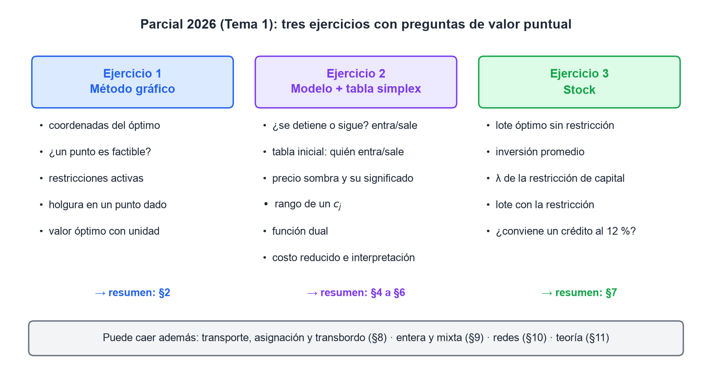
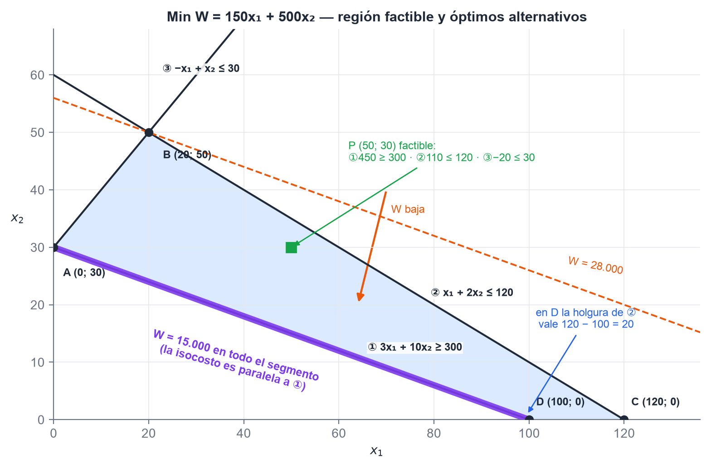
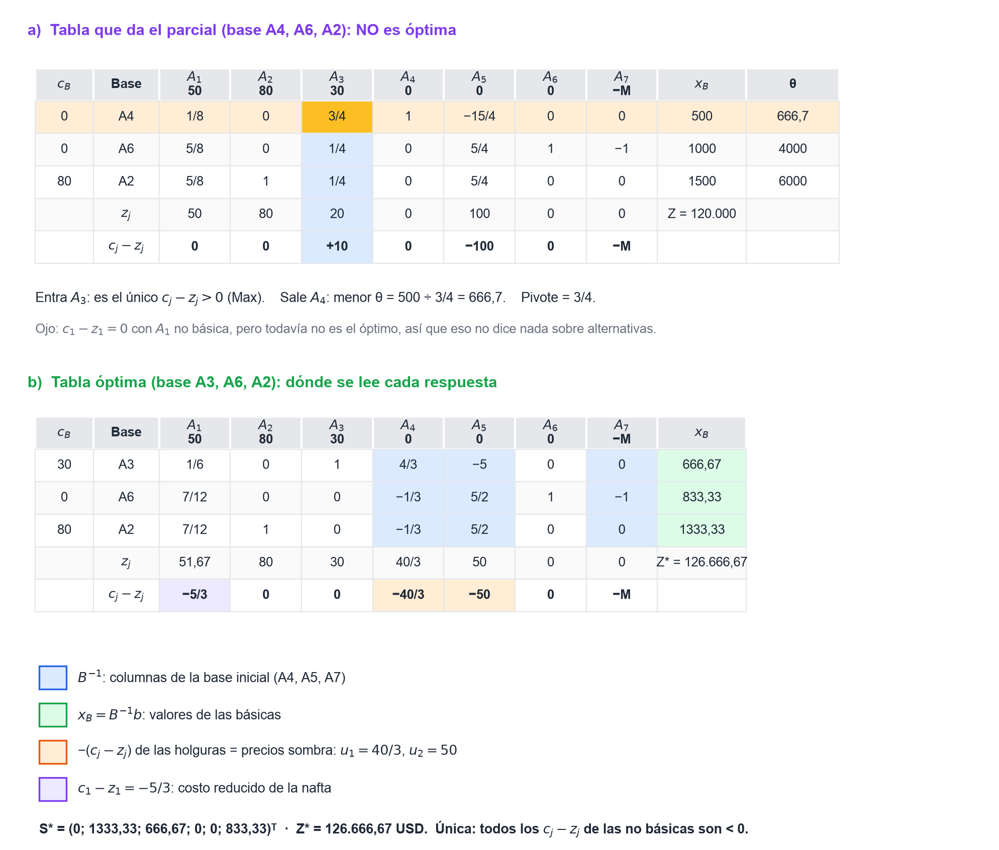
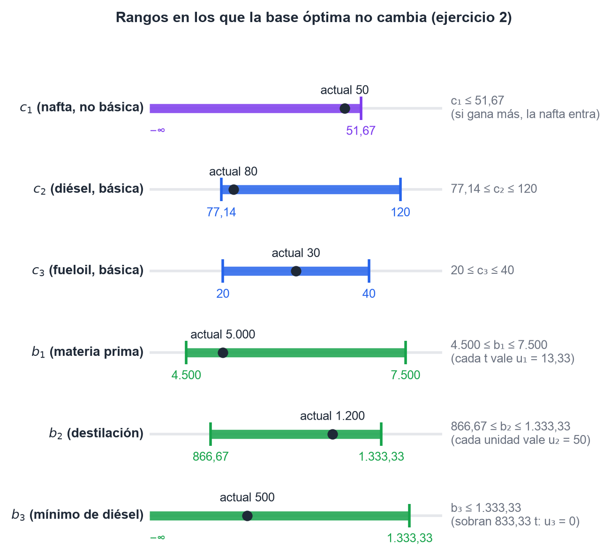
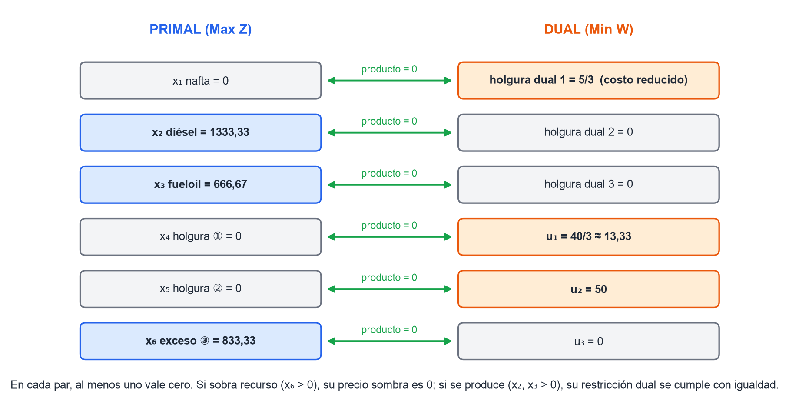
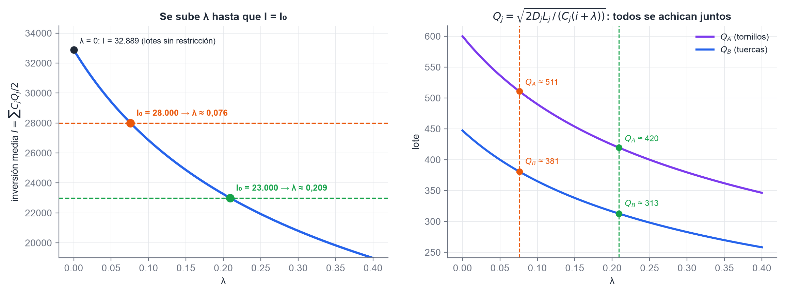

# Investigación Operativa — Parcial del 3/10/2026, resuelto

> Tema 1. Las preguntas pedían "el valor más cercano", así que fue de opción múltiple. Todos los números se verificaron por cálculo exacto. La teoría de cada ejercicio está en el resumen del recuperatorio (`resumen-recuperatorio.md`).

*Figura 1. Los tres ejercicios y en qué sección del resumen se estudia cada uno.*

## 1. Ejercicio 1: método gráfico

$$\text{Min } W = 150x_1 + 500x_2 \quad \text{s.a.} \quad
\begin{cases}
① \;\; 3x_1 + 10x_2 \geq 300\\
② \;\; x_1 + 2x_2 \leq 120\\
③ \;\; -x_1 + x_2 \leq 30\\
x_1, x_2 \geq 0
\end{cases}$$

*Figura 2. La RF es el cuadrilátero ABCD. La isocosto es paralela a ①, así que todo el segmento AD es óptimo.*

Los vértices de la RF y el valor de $W$ en cada uno:

| Vértice | Rectas que se cortan | $W$ |
|---|---|---|
| A $(0; 30)$ | ① ∩ ③ ∩ eje $x_2$ | **15.000** |
| B $(20; 50)$ | ② ∩ ③ | 28.000 |
| C $(120; 0)$ | ② ∩ eje $x_1$ | 18.000 |
| D $(100; 0)$ | ① ∩ eje $x_1$ | **15.000** |

**1) Coordenadas de la solución óptima.** Hay **óptimos alternativos**: todo el segmento entre A $(0; 30)$ y D $(100; 0)$. Se ve sin dibujar porque $W = 50 \cdot (3x_1 + 10x_2)$: la función objetivo es proporcional a la restricción ①. Si la opción pide un solo punto, tanto A como D son correctos.

**2) ¿$(50; 30)$ es factible?** Sí. ① da $150 + 300 = 450 \geq 300$; ② da $50 + 60 = 110 \leq 120$; ③ da $-20 \leq 30$.

**3) Restricciones activas en el óptimo.** **①** en todo el segmento. En el vértice A también ③ ($-0 + 30 = 30$). ② no es activa en ningún punto del segmento.

**4) Holgura de ② en $(100; 0)$.** $120 - (100 + 0) = 20$.

**5) Costo óptimo.** $W^* =$ **\$ 15.000**.

> **Ojo:** el que no ve el paralelismo elige A o D y cree que la solución es única. Ante una opción que dice "infinitas soluciones", revisá siempre las pendientes.

## 2. Ejercicio 2: la refinería (simplex, sensibilidad y dual)

### 2.1 El enunciado y el modelo

Una refinería produce nafta ($x_1$), diésel ($x_2$) y fueloil ($x_3$), medidos en toneladas, y quiere maximizar la ganancia en USD.

$$\text{Max } Z = 50x_1 + 80x_2 + 30x_3 \quad \text{s.a.}\quad
\begin{cases}
① \;\; 2x_1 + 3x_2 + 1{,}5x_3 \leq 5000 & \text{(materia prima: petróleo crudo)}\\
② \;\; 0{,}5x_1 + 0{,}8x_2 + 0{,}2x_3 \leq 1200 & \text{(capacidad de destilación)}\\
③ \;\; x_2 \geq 500 & \text{(contrato mínimo de diésel)}\\
x_j \geq 0
\end{cases}$$

En forma estándar, con Gran M: $x_4$ es la holgura de ①, $x_5$ la holgura de ②, $x_6$ el exceso de ③ y $x_7$ la ficticia de ③.

$$\text{Max } Z = 50x_1 + 80x_2 + 30x_3 + 0x_4 + 0x_5 + 0x_6 - Mx_7$$

### 2.2 La tabla dada y la óptima

*Figura 3. a) La tabla del parcial no es óptima: entra $A_3$ y sale $A_4$. b) Dónde se lee cada respuesta en la tabla óptima.*

### 2.3 Las ocho preguntas

**1) ¿Se detiene o sigue? ¿Quién entra y quién sale?** **Sigue.** Con $c_B = (0; 0; 80)$, los $z_j$ son $(50; 80; 20; 0; 100; 0; 0)$, y $c_3 - z_3 = 30 - 20 = +10 > 0$. **Entra $A_3$** (fueloil). Los cocientes son $500/(3/4) = 666{,}7$, $1000/(1/4) = 4000$ y $1500/(1/4) = 6000$: **sale $A_4$**, la holgura de la materia prima.

**2) Precio sombra de la capacidad de destilación en el óptimo.** $u_2 =$ **50 USD por unidad de capacidad**. Se lee como $-(c_5 - z_5) = 50$.

**3) Rango de $c_2$ (diésel) para que la base no cambie.** La fila de $A_2$ tiene $y_{21} = 7/12$, $y_{24} = -1/3$, $y_{25} = 5/2$ en las no básicas, con $c_j - z_j$ iguales a $-5/3$, $-40/3$ y $-50$:

$$\max\left\{\frac{-5/3}{7/12};\ \frac{-50}{5/2}\right\} = \max\{-2{,}86;\ -20\} = -2{,}86 \;\leq\; \Delta c_2 \;\leq\; \frac{-40/3}{-1/3} = 40$$

$$\boxed{77{,}14 \leq c_2 \leq 120}$$

**4) Función dual.** Armada directamente (la ③ es $\geq$ en un Max, así que $u_3 \leq 0$):

$$\text{Min } W = 5000u_1 + 1200u_2 + 500u_3 \quad \text{s.a.}\quad
\begin{cases}
2u_1 + 0{,}5u_2 \geq 50\\
3u_1 + 0{,}8u_2 + u_3 \geq 80\\
1{,}5u_1 + 0{,}2u_2 \geq 30\\
u_1, u_2 \geq 0;\;\; u_3 \leq 0
\end{cases}$$

La solución es $u^* = (40/3;\ 50;\ 0)$ y $W^* = 5000 \cdot 40/3 + 1200 \cdot 50 = 126.666{,}67 = Z^*$ ✓.

> **Ojo:** la consigna decía "$y_j \geq 0$". Si te piden todas las duales $\geq 0$, hay que escribir la ③ como $-x_2 \leq -500$: el término del funcional pasa a ser $-500u_3$, con $u_3 \geq 0$. El valor óptimo es el mismo.

**5) Holguras que no son básicas en el óptimo.** **$x_4$ y $x_5$**: valen cero, así que la materia prima y la capacidad de destilación se usan completas. El exceso $x_6 = 833{,}33$ es básico: se producen 833,33 t de diésel por encima del mínimo del contrato.

**6) Significado económico del precio sombra de la primera restricción.** $u_1 = 40/3 \approx 13{,}33$: **cada tonelada adicional de petróleo crudo aumenta la ganancia en 13,33 USD**, mientras $b_1$ se mantenga entre 4.500 y 7.500. Es lo máximo que conviene pagar por una tonelada más.

**7) En la tabla inicial, ¿qué variables entran a la base y cuál sale en la primera iteración?** La base inicial es $\{x_4, x_5, x_7\}$: las dos holguras y la **ficticia** de la ③, no el exceso. En la primera iteración, $c_2 - z_2 = 80 + M$ es el mayor, así que **entra $x_2$**. Los cocientes son $5000/3 = 1666{,}7$, $1200/0{,}8 = 1500$ y $500/1 = 500$: **sale la ficticia $x_7$**.

**8) Costo reducido de la nafta en el óptimo.** $c_1 - z_1 = -5/3 \approx -1{,}67$ **USD/t**. Producir una tonelada de nafta bajaría la ganancia en 1,67 USD. Para que convenga producirla, su ganancia tendría que subir más de 1,67, es decir **$c_1 > 51{,}67$**.

### 2.4 La solución completa y los rangos de $b$

$$S^* = (0;\ 1333{,}33;\ 666{,}67;\ 0;\ 0;\ 833{,}33)^T \qquad Z^* = 126.666{,}67 \text{ USD}$$

Se producen 1.333,33 t de diésel y 666,67 t de fueloil, y no se produce nafta. Se usan completos el crudo y la capacidad de destilación. El diésel supera el mínimo del contrato en 833,33 t. La solución es **única**: todos los $c_j - z_j$ de las no básicas son negativos.

Las columnas de $B^{-1}$ son las de $A_4$, $A_5$ y $A_7$, y $x_B = (666{,}67;\ 833{,}33;\ 1333{,}33)$:

| Restricción | Columna de $B^{-1}$ | Rango de $\Delta b$ | Rango de $b$ |
|---|---|---|---|
| ① crudo | $(4/3;\ -1/3;\ -1/3)$ | $-500 \leq \Delta b_1 \leq 2500$ | $4.500 \leq b_1 \leq 7.500$ |
| ② destilación | $(-5;\ 5/2;\ 5/2)$ | $-333{,}33 \leq \Delta b_2 \leq 133{,}33$ | $866{,}67 \leq b_2 \leq 1.333{,}33$ |
| ③ diésel mínimo | $(0;\ -1;\ 0)$ | $\Delta b_3 \leq 833{,}33$ | $b_3 \leq 1.333{,}33$ |

Rango de $c_3$ (fueloil): $20 \leq c_3 \leq 40$. Todos los rangos se verificaron re-resolviendo el problema con el dato apenas adentro y apenas afuera de cada extremo.

*Figura 4. Los rangos del ejercicio 2. Dentro de cada barra, la base óptima no cambia.*

*Figura 5. Las holguras complementarias en el óptimo: ningún par tiene los dos lados distintos de cero.*

## 3. Ejercicio 3: stock con restricción de capital

Una ferretería mayorista gestiona tornillos (A) y tuercas (B), con $i = 20\,\%$ anual y un capital máximo para invertir en stock $I_0$:

| | $D$ (u/año) | $L$ (\$/orden) | $C$ (\$/u) |
|---|---|---|---|
| A (tornillos) | 12.000 | 150 | 50 |
| B (tuercas) | 8.000 | 200 | 80 |

*Figura 6. Se sube $\lambda$ hasta que la inversión media iguala a $I_0$. Los dos lotes bajan juntos.*

> **Ojo:** en la foto del enunciado, $I_0$ se lee como **\$ 23.000**, pero el 3 podría ser un 8. Abajo están las dos versiones.

**2) Lote óptimo de A sin la restricción.**

$$Q_A^* = \sqrt{\frac{2 \cdot 12.000 \cdot 150}{50 \cdot 0{,}20}} = \sqrt{360.000} = \textbf{600}$$

Para B: $Q_B^* = \sqrt{2 \cdot 8.000 \cdot 200/(80 \cdot 0{,}20)} = 447{,}2$.

**3) Inversión promedio con los dos lotes óptimos.**

$$I = \frac{50 \cdot 600}{2} + \frac{80 \cdot 447{,}2}{2} = 15.000 + 17.889 = \textbf{32.889}$$

Supera a $I_0$, así que la restricción es **efectiva**.

**1) Valor de $\lambda$.** Con el atajo del resumen (§7.7):

| | $I_0 = 23.000$ | $I_0 = 28.000$ |
|---|---|---|
| $\lambda = 0{,}20\,[(32.889/I_0)^2 - 1]$ | **$\approx 0{,}209$** | $\approx 0{,}076$ |
| $Q_A$ con la restricción | 420 | 511 |
| **4)** $Q_B$ con la restricción | **$\approx 313$** | $\approx 381$ |

**5) ¿Conviene un crédito al 12 % anual?** **Sí.** Según el apunte, la tasa límite es $i_1 + \lambda$, que es por lo menos $\lambda$ y, si todo el 20 % es costo del capital, llega a $0{,}20 + 0{,}209 \approx 41\,\%$. Con la comparación simplificada también conviene, porque $\lambda = 20{,}9\,\% > 12\,\%$.

> **Ojo:** si $I_0$ fuera 28.000, $\lambda = 7{,}6\,\%$. Con la comparación simplificada **no** convendría, y con la del apunte ($20\,\% + 7{,}6\,\% = 27{,}6\,\%$), sí. Es otra razón para escribir el criterio completo y aclarar el supuesto.

## 4. Cómo responder "el valor más cercano"

1. **Primero el diagnóstico, después la cuenta.** ¿La tabla es óptima? ¿Es Max o Min? ¿Hay una restricción $\geq$? En este parcial, la tabla del ejercicio 2 no era óptima, y quien no lo vio respondió todo lo demás sobre la tabla equivocada.
2. **Verificá con $z^* = W^*$.** Si el valor del dual no da igual al del primal, hay un error de signo.
3. **Un precio sombra vale dentro de su rango.** "Si se agregan 1000 unidades de recurso" puede caer fuera del rango, y entonces no alcanza con multiplicar.
4. **Cuidado con las unidades.** El precio sombra está en \$ por unidad **de recurso**, el costo reducido en \$ por unidad **de producto** y $\lambda$ en tasa (1/tiempo).
5. **En stock, cantidades y tasas en la misma unidad de tiempo.** Las cantidades se multiplican (de por día a por año); las tasas se dividen.
6. **Si dos opciones están muy cerca**, rehacé la cuenta con fracciones o con más decimales. Un tanteo de $\lambda$ puede dar 0,18 cuando el valor exacto es 0,170.
7. **Si sale una opción "trampa" conocida**, como el óptimo de una tabla que no es óptima o el rango de $b$ calculado con la columna equivocada de $B^{-1}$, desconfiá y revisá.
