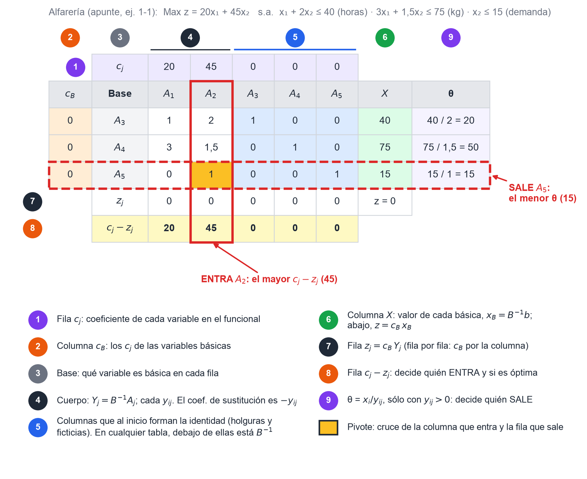
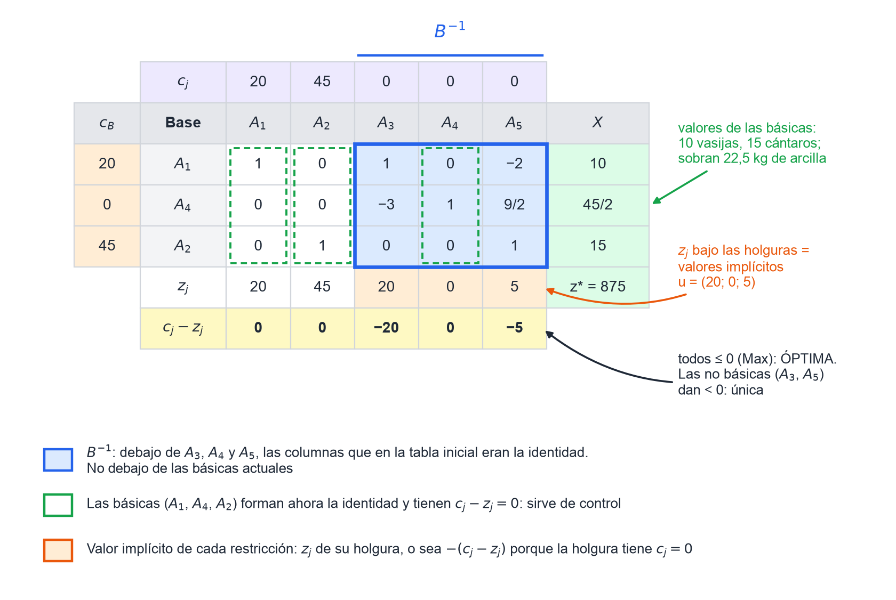

# Investigación Operativa — Resumen para el Recuperatorio

## 1. Modelización y formas del modelo

*Fuentes: apunte PLC1 (Torrent), Práctica 2 y la resolución de Vaccaro del parcial 2025.*

### 1.1 Cómo se modeliza

Un programa lineal tiene una **función objetivo** que se maximiza o minimiza y un conjunto de **restricciones**, todas lineales. Los pasos son cuatro:

1. **Definir las variables con precisión**: qué miden, en qué unidad y en qué período. "$x_1$: toneladas de nafta producidas por día" está bien; "$x_1$: nafta" está mal.
2. Escribir la **función objetivo**: se maximiza si son ganancias o contribuciones, se minimiza si son costos.
3. Escribir `s.a.` y todas las restricciones, numeradas $1), 2), 3)\dots$
4. No olvidar la **no negatividad**: $x_j \geq 0$. La cátedra la numera como una restricción más.

Los parámetros tienen nombre propio y conviene usarlo al interpretar:

| Símbolo | Nombre | Qué representa |
|---|---|---|
| $c_j$ | coeficiente económico | cuánto aporta al objetivo cada unidad de $x_j$ |
| $b_i$ | término independiente | cantidad disponible de un recurso, o cantidad exigida de un requerimiento |
| $a_{ij}$ | coeficiente tecnológico | cuánto del recurso $i$ consume cada unidad de $x_j$ |

### 1.2 Forma canónica y forma estándar

- **Forma canónica**: Max con todas las restricciones $\leq$, o Min con todas $\geq$, y variables $\geq 0$. Es la que se usa para armar el dual.
- **Forma estándar**: todas las restricciones son **ecuaciones**, con $b_i \geq 0$ y variables $\geq 0$. Es la que necesita el simplex.

| Situación | Qué se hace |
|---|---|
| Restricción $\leq$ | Se **suma** una variable de **holgura** |
| Restricción $\geq$ | Se **resta** una variable de **exceso** (y, para el simplex, se suma una **ficticia**) |
| Restricción $=$ | Para el simplex, se suma una **ficticia** |
| $b_i < 0$ | Se multiplica toda la restricción por $-1$ **antes** de lo demás |
| Variable libre $x_k$ | $x_k = x_k' - x_k''$, con las dos $\geq 0$ |
| Min $W$ | Equivale a Max $Z = -W$: cambia el signo del valor, no las variables |

Las holguras y los excesos entran en la función objetivo con coeficiente **cero**. Las ficticias entran con $-M$ en Max y con $+M$ en Min (§4.5).

**Qué significan:**

- **Holgura**: cantidad de recurso que **sobra** en la solución.
- **Exceso**: cuánto **supera** el lado izquierdo al mínimo exigido.
- **Ficticia**: no significa nada; sólo sirve para armar la base inicial. En el óptimo tiene que valer cero.

> **Ojo:** la cátedra dice "variables **ficticias**", no "artificiales", y "recta de **isobeneficio**" (o isocosto), no "recta de nivel".

## 2. Método gráfico

*Fuentes: PLC1, Práctica 1, parcial 2025.*

### 2.1 El procedimiento

Sirve con dos variables:

1. Graficar cada restricción como recta. Las intersecciones con los ejes salen de poner $x_1 = 0$ y después $x_2 = 0$.
2. Elegir el semiplano de cada una probando un punto, típicamente el $(0; 0)$: si cumple, el semiplano es el que lo contiene.
3. La **región factible (RF)** es la intersección de todos los semiplanos dentro del primer cuadrante.
4. Trazar la recta de isobeneficio $c_1x_1 + c_2x_2 = z$. Su vector normal $(c_1; c_2)$ apunta hacia donde crece $z$.
5. Desplazarla hasta el último punto de la RF: en el sentido de la normal si es Max, en el sentido opuesto si es Min.
6. Calcular el vértice resolviendo el sistema de las dos rectas que se cortan ahí.

La alternativa es el **método de los vértices**: calcular todos los vértices de la RF, evaluar $z$ en cada uno y quedarse con el mejor. Funciona porque, si hay óptimo, está en al menos un vértice (§3). En un examen de opción múltiple suele ser lo más rápido.

### 2.2 Tipos de solución


*Figura 1. Los casos posibles del método gráfico y la clasificación de restricciones.*

| Caso | Cómo se reconoce en el gráfico | Frase de la cátedra |
|---|---|---|
| **Única** | La isobeneficio toca la RF en un solo vértice | — |
| **Alternativas** | La isobeneficio es **paralela a una restricción activa** | "El óptimo se da en un segmento, no en un solo punto." |
| **No acotada** | La RF está abierta en la dirección en que mejora $z$ | "La solución es no acotada." |
| **No factible** | Los semiplanos no se cortan: $\text{RF} = \emptyset$ | "La región factible es nula." |

Con óptimos alternativos, cada vértice del segmento es una solución básica y todo punto intermedio también es óptimo:

$$P = \alpha\,P_1 + (1-\alpha)\,P_2, \qquad 0 \leq \alpha \leq 1$$

> **Ojo:** **región factible no acotada no es lo mismo que solución no acotada.** Un Min sobre una RF abierta hacia arriba puede tener un óptimo finito (panel d). El profesor lo escribió en la resolución del parcial 2025: "No confundir región factible no acotada con solución no acotada".

**Para detectar alternativas sin dibujar:** compará pendientes. Si $c_1/c_2$ es igual a $a_{i1}/a_{i2}$ de alguna restricción que pasa por el óptimo, hay alternativas. Por ejemplo, con $W = 150x_1 + 500x_2$ y la restricción activa $3x_1 + 10x_2 \geq 300$, las dos dan $3/10$: la función objetivo es 50 veces la restricción y todo el lado de la RF sobre esa recta es óptimo.

### 2.3 Clasificación de restricciones

- **Activa** (u obligatoria): pasa por el óptimo. Su holgura o exceso vale **cero**.
- **Pasiva** (o no obligatoria): su holgura o exceso es **positivo**. Puede ser de dos tipos:
  - **necesaria**: si se la saca, la RF cambia;
  - **redundante**: si se la saca, la RF no cambia. Es *geométricamente redundante* si ni toca la RF, y *analíticamente redundante* si toca un vértice y es combinación lineal de las que pasan por él.

### 2.4 Las preguntas puntuales y cómo se contestan

| Pregunta | Cómo se responde |
|---|---|
| ¿Un punto es factible? | Reemplazarlo en **todas** las restricciones, incluida la no negatividad. Si falla una, no es factible |
| ¿Cuánto vale la holgura de la restricción $i$ en un punto? | Holgura $= b_i - a_i x$ en una $\leq$; exceso $= a_i x - b_i$ en una $\geq$ |
| ¿Qué restricciones son activas en el óptimo? | Las que dan holgura o exceso **cero** en el punto óptimo |
| ¿Cuál es el valor óptimo? | $z^*$ con la unidad y el período: "el costo mínimo diario es de \$ 320" |
| ¿Cuántas soluciones tiene? | Una, infinitas (alternativas), ninguna (no factible) o no acotada |

> **Ojo:** "estar sobre la recta $i$" es lo mismo que "su holgura o exceso vale 0". Por eso cruzar dos rectas para encontrar un vértice equivale a anular dos variables y resolver el resto. Es el puente con el simplex (§3).

### 2.5 Cómo se escribe la respuesta

La cátedra escribe la solución como **vector columna con todas las variables**, incluidas holguras y excesos, y el valor del funcional aparte:

```
         40
          0
S*  =     0          W* = 320
         50
          0
```

Después interpreta línea por línea: qué se produce, qué **no** se produce (se dice explícitamente), cuánto sobra de cada recurso con su unidad y el valor óptimo con unidad y período. Con alternativas va un vector por vértice: $S^*_A$, $S^*_D$.

## 3. Conceptos básicos: convexidad, soluciones básicas y teoremas

*Fuentes: PLC2 y las diapositivas "Cap. 2 – Conceptos básicos" del Classroom.*

### 3.1 Las definiciones

- **Conjunto convexo**: el segmento que une dos puntos cualesquiera del conjunto queda entero adentro.
- **Punto extremo** (vértice): no se puede escribir como combinación lineal convexa de otros dos puntos del conjunto.
- **Combinación lineal convexa**: $x = \sum \lambda_i x_i$, con $\lambda_i \geq 0$ y $\sum \lambda_i = 1$.
- **Polítopo**: intersección de un número finito de semiespacios cerrados. Acotado, se llama poliedro. La RF de un PL es un polítopo, y por eso es **convexa**.
- **Solución básica**: con $m$ restricciones y $n$ variables en forma estándar, se anulan $n - m$ variables (las **no básicas**) y se resuelve para las $m$ **básicas**: $x_B = B^{-1}b$.
- **Solución básica factible (SBF)**: todas sus básicas son $\geq 0$.
- **SBF degenerada**: alguna variable **básica** vale cero (tiene menos de $m$ componentes positivas).

### 3.2 Los teoremas

1. El conjunto de soluciones factibles es **convexo y cerrado**.
2. **Teorema fundamental de la PL**: si hay una solución factible, hay una SBF; si hay una solución óptima, hay una **SBF óptima**.
3. **Teorema de equivalencia**: $x$ es punto extremo **si y sólo si** es una SBF. Une la geometría (vértices) con el álgebra (bases).
4. El óptimo se alcanza en **al menos un punto extremo**. Si se alcanza en más de uno, también en toda combinación convexa de ellos.

Consecuencia: **aunque la RF tenga infinitos puntos, alcanza con mirar un número finito**, los vértices. Como mucho hay

$$\binom{n}{m} = \frac{n!}{m!\,(n-m)!}$$

La **solución conceptual** recorre todas esas bases. Su problema es la escala: con 20 variables y 10 restricciones son 184.756 sistemas. Por eso existe el simplex, que va de vértice en vértice sin recorrerlos todos.

> **Ojo:** la cátedra no pide demostrar los teoremas, sí enunciarlos y explicar qué consecuencia tienen.

## 4. Método simplex

*Fuentes: PLC3, pizarras de clase "Factibilidad", "Pasos del simplex" y "Coeficientes de sustitución" (Classroom 2026).*

### 4.1 La tabla y sus partes

El ejemplo que sigue en §4, §5 y §6 es el **taller de alfarería** del apunte (ejemplo 1-1): $x_1$ son vasijas y $x_2$ cántaros por día.

$$\text{Max } z = 20x_1 + 45x_2 \quad \text{s.a.}\quad
\begin{cases}
① \;\; x_1 + 2x_2 \leq 40 & \text{(horas de mano de obra)}\\
② \;\; 3x_1 + 1{,}5x_2 \leq 75 & \text{(kg de arcilla)}\\
③ \;\; x_2 \leq 15 & \text{(demanda máxima de cántaros)}\\
x_1, x_2 \geq 0
\end{cases}$$

En forma estándar se suman las holguras $x_3$, $x_4$ y $x_5$, una por restricción. Sus columnas forman la identidad y dan la base inicial.


*Figura 2. La tabla inicial, parte por parte. Entra $A_2$ porque tiene el mayor $c_j - z_j$; sale $A_5$ porque da el menor θ. El pivote es el cruce.*

Cómo se lee, de arriba hacia abajo:

- **Arriba van los $c_j$** de todas las variables. A la izquierda, en cada fila, la variable básica (**Base**) y su $c_j$ (**$c_B$**).
- **El cuerpo** tiene los $y_{ij}$: cuánto de la básica de la fila $i$ "contiene" la columna $j$. En la tabla inicial son los coeficientes de las restricciones tal cual.
- **La columna $X$** da el valor de cada básica. Las que no están en la base valen cero. Al empezar, $x_3 = 40$, $x_4 = 75$, $x_5 = 15$: no se produce nada y sobran todos los recursos.
- **Abajo se calculan dos filas.** Primero $z_j$, multiplicando la columna $c_B$ por la columna $j$ y sumando. Después $c_j - z_j$, restando. Esa última fila decide.
- **A la derecha, θ**, que sólo se usa para elegir quién sale.

### 4.2 La notación de la cátedra

| Símbolo | Qué es | Cómo se calcula |
|---|---|---|
| $B$ | la base: las $m$ columnas de las variables básicas | — |
| $Y_j$ | columna de $A_j$ escrita en la base actual | $Y_j = B^{-1}A_j$ (en la tabla, la columna $j$) |
| $z_j$ | lo que se pierde en el funcional al hacer entrar una unidad de $x_j$ | $z_j = c_B\,Y_j = \sum_i c_i\,y_{ij}$ |
| $c_j - z_j$ | **costo reducido**: cuánto cambia $z$ por unidad de $x_j$ que entra | fila de abajo de la tabla |
| $\theta_j$ | cuánto puede crecer $x_j$ sin que ninguna básica se vuelva negativa | $\min\{x_i/y_{ij} : y_{ij} > 0\}$ |
| $-y_{ij}$ | **coeficiente de sustitución**: cuánto cambia la básica $x_i$ por unidad de $x_j$ | $\partial x_i/\partial x_j = -y_{ij}$ |

La tabla de la cátedra tiene columnas $c_i$ | $A_i$ (base) | $A_1 \dots A_n$ | $x_i$ | $x_i/y_{ij}$, y abajo las filas $z_j$ y $c_j - z_j$. Se trabaja con **$c_j - z_j$**, no con $z_j - c_j$.

### 4.3 Las dos condiciones

**Condición de factibilidad: quién sale.** Si entra $x_j$ con valor $\theta_j$, cada básica pasa a valer $x_i' = x_i - \theta_j\,y_{ij}$. Para que ninguna quede negativa,

$$\theta_j = \min_i \left\{ \frac{x_i}{y_{ij}} \;:\; y_{ij} > 0 \right\}$$

Sale la básica que da el mínimo, porque queda exactamente en cero. **Sólo se divide por $y_{ij} > 0$.**

**Condición de optimización: quién entra.** Con esa nueva solución, el funcional queda

$$z' = z + \theta_j\,(c_j - z_j)$$

Como $\theta_j \geq 0$, en **Max** conviene que entre una $x_j$ con $c_j - z_j > 0$. La tabla es óptima cuando **todos los $c_j - z_j \leq 0$**. En **Min** todo se da vuelta: entra el más negativo y es óptima cuando todos son $\geq 0$.

| | Max | Min |
|---|---|---|
| Entra | el mayor $c_j - z_j > 0$ | el menor $c_j - z_j < 0$ |
| Óptimo cuando | todos los $c_j - z_j \leq 0$ | todos los $c_j - z_j \geq 0$ |
| Ficticia en el funcional | $-M$ | $+M$ |

### 4.4 El algoritmo


*Figura 3. El simplex como diagrama de flujo, con los dos puntos donde termina: óptimo o no acotada.*

El pivoteo, con la tabla: la fila del pivote se divide por el pivote, y en las demás filas se resta un múltiplo de la fila nueva para que la columna entrante quede con ceros. Con fórmulas: $x_j' = \theta_j$, $x_r' = 0$ y $x_i' = x_i - \theta_j\,y_{ij}$ para las demás básicas.

**Desempates** (apunte, §3.2): si empatan dos entradas, entra la de menor subíndice; si empatan dos salidas, sale la de mayor subíndice. Un empate en la salida anuncia una **solución degenerada**.

### 4.5 Variables ficticias y Gran M

Las restricciones $\geq$ y $=$ no traen una columna de la identidad, así que se agrega una **ficticia** para completar la base inicial. Para que el simplex la expulse, se la castiga en el funcional: **"MAX −, MIN +"**, es decir $-M\,x_f$ en Max y $+M\,x_f$ en Min, con $M$ muy grande. En las cuentas manda el término en $M$: $30 + 2M$ le gana a $40 - 2M$.

- Una ficticia que sale de la base no vuelve a entrar.
- **Efecto espejo**: en una $\geq$, la columna del exceso es siempre la de su ficticia multiplicada por $-1$, y lo mismo pasa con sus $z_j$. Sirve para controlar la tabla.
- En 2026 la cátedra usó sólo Gran M. El método de las dos fases (minimizar la suma de las ficticias y después reciclar la tabla) está en el apunte, pero no apareció en clase.

### 4.6 Diagnóstico en la tabla óptima

| Caso | Señal en la tabla | Frase de la cátedra |
|---|---|---|
| **Única** | Todos los $c_j - z_j$ de las **no básicas** son estrictamente negativos (Max) | "La solución es única ya que todos los $c_j - z_j$ son nulos para las básicas y negativos para las no básicas." |
| **Alternativas** | Una **no básica** tiene $c_j - z_j = 0$ en el óptimo | "El óptimo se da en un segmento." Haciéndola entrar sale otra SBF con el mismo $z$ |
| **Degenerada** | Una **básica** vale 0 | — |
| **No acotada** | Un $c_j - z_j$ mejora y su columna no tiene ningún $y_{ij} > 0$ | "No puede salir ninguna variable, por lo tanto el problema tiene solución no acotada." |
| **No factible** | En el óptimo queda una **ficticia básica con valor > 0** | "Hay variables ficticias en la base, por lo tanto el problema es no factible ($\text{RF} = \emptyset$)." |

> **Ojo:** degenerada y alternativas son cosas distintas. **Degenerada**: una **básica** vale 0. **Alternativas**: una **no básica** tiene $c_j - z_j = 0$. Pueden darse juntas.

> **Ojo:** un $c_j - z_j = 0$ en una no básica sólo indica alternativas **si la tabla ya es óptima**. En una tabla intermedia, con otro $c_j - z_j$ que todavía mejora, ese cero no dice nada.

### 4.7 Dónde se lee cada cosa

Después de dos iteraciones (entra $A_2$ y sale $A_5$; después entra $A_1$ y sale $A_3$), la alfarería llega al óptimo:


*Figura 4. La tabla óptima: 10 vasijas y 15 cántaros por día, $z^* = 875$. Cada respuesta tiene un lugar fijo.*

- **$x_B$**: la columna $X$. Las variables que no están en la base valen cero.
- **$z$**: abajo de la columna $X$, $z = c_B\,x_B$.
- **$B^{-1}$**: debajo de las columnas que en la **tabla inicial formaban la identidad**, es decir las holguras y, si hubo, las ficticias. No debajo de las básicas actuales.
- **Control rápido**: bajo cada columna básica, $z_j = c_j$ y $c_j - z_j = 0$.

> **Ojo:** si vas a hacer sensibilidad o dualidad, **no borres la columna de la ficticia** aunque haya salido de la base. Es la columna de $B^{-1}$ que corresponde a esa restricción.

### 4.8 "¿Se detiene o sigue?" en treinta segundos

Cuando dan una tabla intermedia y preguntan si es óptima:

1. Calcular la fila $z_j = c_B Y_j$. Muchas veces la tabla viene **sin** esa fila.
2. Mirar los $c_j - z_j$ de las no básicas. En Max, si alguno es $> 0$, **sigue** y entra el mayor.
3. En la columna que entra, dividir $x_i / y_{ij}$ sólo donde $y_{ij} > 0$. Sale la fila del menor cociente.

## 5. Análisis de sensibilidad

*Fuentes: PLC4, Práctica 4 y `estudio/parcial/teoria-sensibilidad-dualidad.md` (los fundamentos con el ejemplo de la alfarería).*

### 5.1 La idea

Sensibilidad (o postoptimización) estudia cómo cambia el óptimo cuando cambia **un** dato, **sin volver a resolver**. Funciona porque toda la tabla óptima es $B^{-1}$ aplicada a los datos originales:

- **Si cambia un $c_j$**, cambian los $c_j - z_j$ y las restricciones siguen iguales. Lo que puede romperse es la **optimalidad**.
- **Si cambia un $b_i$**, cambia $x_B = B^{-1}b$ y los $c_j - z_j$ siguen iguales. Lo que puede romperse es la **factibilidad**.

**Hipótesis**: cambia un solo coeficiente por vez y los demás quedan como en la formulación original.

### 5.2 Cambio en un coeficiente económico $c_k$

**Si $x_k$ es no básica**, sólo cambia su propio $c_k - z_k$. Para que siga sin entrar:

$$\text{Max: } \Delta c_k \leq -(c_k - z_k) \qquad\qquad \text{Min: } \Delta c_k \geq -(c_k - z_k)$$

Dentro del rango no cambian ni el punto óptimo ni $z^*$, porque $x_k$ vale cero.

**Si $x_k$ es básica**, cambian **todos** los $c_j - z_j$ de las no básicas: el nuevo valor es $(c_j - z_j) - \Delta c_k\,y_{kj}$. En Max:

$$\max_{y_{kj} > 0} \frac{c_j - z_j}{y_{kj}} \;\leq\; \Delta c_k \;\leq\; \min_{y_{kj} < 0} \frac{c_j - z_j}{y_{kj}}$$

En Min se invierten los grupos: el máximo se toma sobre los $y_{kj} < 0$ y el mínimo sobre los $y_{kj} > 0$.

**Paso a paso** (Max):

1. Ir a la **fila** de $x_k$ en la tabla óptima.
2. Tomar los $y_{kj}$ de las columnas **no básicas**, sin contar las ficticias.
3. Dividir cada $c_j - z_j$ por su $y_{kj}$ y separar los cocientes según el signo de $y_{kj}$.
4. Cota inferior: el **mayor** de los cocientes con $y_{kj} > 0$. Cota superior: el **menor** de los cocientes con $y_{kj} < 0$. Si un grupo está vacío, esa cota es infinita.

Dentro del rango, el punto óptimo **no cambia** y $z^{*\prime} = z^* + \Delta c_k \cdot x_k^*$.

**Ejemplo (alfarería, rango de $c_1$).** En la fila de $A_1$, las no básicas son $A_3$ y $A_5$, con $y_{13} = 1$ e $y_{15} = -2$, y $c_j - z_j$ iguales a $-20$ y $-5$. Cota inferior: $-20/1 = -20$. Cota superior: $-5/(-2) = 2{,}5$. Entonces $-20 \leq \Delta c_1 \leq 2{,}5$, es decir $0 \leq c_1 \leq 22{,}5$: mientras la vasija deje entre \$ 0 y \$ 22,50, el plan sigue siendo 10 vasijas y 15 cántaros.

### 5.3 Cambio en un término independiente $b_k$

Geométricamente, la restricción $k$ se desplaza en paralelo. Las básicas pasan a valer $x_i^* + r_{ik}\,\Delta b_k$, donde $r_{ik}$ es la columna $k$ de $B^{-1}$. Para que sigan siendo $\geq 0$:

$$\max_{r_{ik} > 0} \frac{-x_i^*}{r_{ik}} \;\leq\; \Delta b_k \;\leq\; \min_{r_{ik} < 0} \frac{-x_i^*}{r_{ik}}$$

La fórmula es la misma para Max y para Min. Dentro del rango la base sigue siendo óptima, los **valores** de las básicas cambian y

$$z^{*\prime} = z^* + u_k\,\Delta b_k$$

donde $u_k$ es el valor implícito de la restricción $k$ (§5.5).

**Ejemplo (alfarería, rango de $b_1$).** $x_B = (10;\ 22{,}5;\ 15)$ y la columna de $B^{-1}$ de las horas (la de $A_3$) es $(1;\ -3;\ 0)$. Con $r > 0$: $-10/1 = -10$. Con $r < 0$: $-22{,}5/(-3) = 7{,}5$. El 0 no restringe. Entonces $-10 \leq \Delta b_1 \leq 7{,}5$, es decir $30 \leq b_1 \leq 47{,}5$. Es la letra chica del precio sombra: "la hora vale \$ 20" es cierto para las primeras 7,5 horas extra, no para 100.

**¿Qué columna de $B^{-1}$ uso?** La de la variable que en la tabla inicial tenía el 1 en la fila $k$: la **holgura** si la restricción es $\leq$, la **ficticia** si es $\geq$ o $=$. Si borraste la ficticia, en una $\geq$ sirve la columna del exceso **cambiada de signo**.

### 5.4 Cambio tecnológico, variable nueva y restricción nueva

- **Cambia $a_{ij}$ de una no básica**, o **aparece una variable nueva**: se calcula su columna en la base óptima, $Y_k = B^{-1}A_k$, después $z_k = c_B\,Y_k$ (o directamente $z_k = u \cdot A_k$) y se mira $c_k - z_k$. En Max: si es $\leq 0$, el óptimo no cambia; si es $> 0$, la variable entra y hay que iterar. Si da exactamente 0, aparece un óptimo alternativo que la incluye.
- **Restricción nueva**: se reemplaza el óptimo actual en ella. Si la cumple, no cambia nada. Si no la cumple, hay que agregarla e iterar (con el simplex dual).
- **Cambia $a_{ij}$ de una básica**: puede alterar toda la tabla. La cátedra no lo toma.

> **Ojo:** "¿conviene fabricar un producto nuevo?" se responde en una línea con el dual: $z_k = \sum_i u_i\,a_{ik}$ es lo que valen los recursos que consume. Si su contribución $c_k$ supera ese valor, conviene.

### 5.5 Valor implícito, precio sombra y costo reducido

**Primero el ejemplo.** En la alfarería, $z^* = 875$. Si se cambia el término independiente de una restricción en una unidad y se vuelve a resolver:

| Si… | el nuevo óptimo es | $z^*$ cambia en | Por qué |
|---|---|---|---|
| hay 41 horas en lugar de 40 | 11 vasijas y 15 cántaros, $z^* = 895$ | **+20** | las horas se usaban todas: una más permite otra vasija |
| hay 76 kg de arcilla en lugar de 75 | el mismo, $z^* = 875$ | **0** | ya sobraban 22,5 kg: un kilo más no sirve de nada |
| la demanda admite 16 cántaros en lugar de 15 | 8 vasijas y 16 cántaros, $z^* = 880$ | **+5** | se cambian dos vasijas por un cántaro, que deja más |

Esos tres números (20, 0 y 5) son los **valores implícitos** $u_1$, $u_2$ y $u_3$. En la tabla óptima no hace falta re-resolver nada: son los $z_j$ de las tres holguras (Figura 4).

**La definición.** El **valor implícito** $u_i$ de una restricción es cuánto cambia $z^*$ por cada unidad que aumenta su $b_i$, con todo lo demás fijo. Tres cosas que se ven en el ejemplo:

- **Vale "al margen".** Mide el efecto de la próxima unidad, y de las siguientes sólo mientras $b_i$ quede dentro de su rango (§5.3). Las horas valen 20 cada una entre 30 y 47,5 horas; con 48 horas, $z^*$ ya no sube, porque la arcilla pasa a ser lo que falta.
- **Si sobra, vale cero.** Una restricción pasiva (con holgura) tiene $u_i = 0$: agregar algo que ya sobra no cambia nada.
- **Si vale algo, la restricción está agotada.** Es la misma idea dicha al revés, y es la base de las holguras complementarias (§6.3).

**Los nombres.** Es el mismo número con distintos nombres, según qué representa la restricción:

- **Recurso disponible** ($\leq$ en un Max, como las horas o la arcilla): se llama **precio sombra**, costo marginal o costo de oportunidad. Es **lo máximo que conviene pagar** por una unidad más del recurso. Si la hora extra cuesta menos de \$ 20, conviene; si cuesta más, no.
- **Requerimiento mínimo** ($\geq$, como "fabricar al menos 12 vasijas"): se llama **valor marginal**. En un Max sale **negativo**, porque exigir más nunca mejora el óptimo. Si a la alfarería se le agrega $x_1 \geq 12$, el óptimo es 12 vasijas y 14 cántaros con $z^* = 870$; exigiendo 13 vasijas baja a 867,5. Cada vasija más exigida **cuesta \$ 2,50**, así que $u = -2{,}5$.

La cátedra lo lee así: **costo marginal $= c_B\,B^{-1} = z_j$** en las columnas de la base inicial. Para una holgura, como $c_j = 0$, eso es $-(c_j - z_j)$.

| | Costo reducido | Precio sombra |
|---|---|---|
| Se asocia a | una **variable** (un producto) | una **restricción** (un recurso) |
| Se lee en | $c_j - z_j$ de la columna de $x_j$ | $z_j$ de la columna de la holgura (o la ficticia) |
| Qué dice | cuánto hay que **mejorar** $c_j$ para que $x_j$ entre a la base | cuánto vale, al margen, una unidad más del recurso |
| Vale 0 cuando | $x_j$ es básica (se produce) | la restricción es **pasiva** (sobra recurso) |
| Unidad | \$ por unidad de producto | \$ por unidad de recurso |

**El signo del valor implícito** depende del tipo de problema y de restricción:

| Problema | $\leq$ | $\geq$ | $=$ |
|---|---|---|---|
| Max | $u_i \geq 0$ | $u_i \leq 0$ | cualquier signo |
| Min | $u_i \leq 0$ | $u_i \geq 0$ | cualquier signo |

La regla detrás de la tabla: aflojar una restricción nunca empeora el óptimo y ajustarla nunca lo mejora. Subir el $b_i$ de una $\leq$ la afloja; subir el $b_i$ de una $\geq$ la ajusta.


*Figura 5. Los rangos de la alfarería. Dentro de cada barra la base óptima no cambia, y cada valor implícito vale lo que indica.*

## 6. Dualidad

*Fuentes: PLC5, diapositivas "IO 2025 – Dualidad" del Classroom y Práctica 4.*

### 6.1 Cómo se arma el dual

A todo programa lineal (el **primal**) le corresponde otro (el **dual**). En forma canónica:

$$\text{Primal: } \text{Max } z = c\,x \;\; \text{s.a. } A\,x \leq b,\; x \geq 0
\qquad\qquad
\text{Dual: } \text{Min } w = b^T u \;\; \text{s.a. } A^T u \geq c^T,\; u \geq 0$$

Las reglas mecánicas:

- Max pasa a Min, y al revés.
- Cada **restricción** del primal da una **variable** del dual, y cada **variable** del primal da una **restricción** del dual.
- Los $b_i$ pasan a ser los coeficientes del funcional dual, y los $c_j$, los términos independientes.
- La matriz se **transpone**: la fila $i$ del primal es la columna $i$ del dual.

Los signos, cuando el primal no está en forma canónica (primal Max):

| Primal (Max) | Dual (Min) |
|---|---|
| Restricción $i$ con $\leq$ | $u_i \geq 0$ |
| Restricción $i$ con $\geq$ | $u_i \leq 0$ |
| Restricción $i$ con $=$ | $u_i$ libre |
| $x_j \geq 0$ | Restricción $j$ con $\geq$ |
| $x_j$ libre | Restricción $j$ con $=$ |

Para un primal Min se lee la misma tabla de derecha a izquierda: restricción $\geq$ da $u_i \geq 0$, restricción $\leq$ da $u_i \leq 0$, y cada $x_j \geq 0$ da una restricción $\leq$ en el dual (Max).

> **Ojo:** hay otra forma de hacerlo: multiplicar las $\geq$ por $-1$ para dejar todo en forma canónica. Así todas las $u_i$ quedan $\geq 0$, pero el $b_i$ de esa restricción entra al funcional con signo cambiado. Las dos formas son correctas. Elegí una y no las mezcles, porque el signo de $u_i$ depende de cuál uses.

### 6.2 El teorema fundamental

**Si el primal tiene solución óptima finita, los valores de $u$ que minimizan el dual son los costos marginales del primal, y $w^* = z^*$.** En fórmula, $u^{*T} = c_B\,B^{-1}$.

Las relaciones entre los dos problemas:

| Si uno tiene… | el otro tiene… |
|---|---|
| óptimo finito | óptimo finito, con el mismo valor |
| solución no acotada | ninguna solución factible |
| soluciones múltiples | solución degenerada |
| solución degenerada | soluciones múltiples |
| ninguna solución factible | ninguna solución factible, o una solución no acotada |

### 6.3 Holguras complementarias

Las variables del primal y del dual se aparean:

| Primal | ↔ | Dual |
|---|---|---|
| variable de decisión $x_j$ | ↔ | exceso de la restricción dual $j$ (es el costo reducido de $x_j$, cambiado de signo) |
| holgura o exceso de la restricción $i$ | ↔ | variable dual $u_i$ (el precio sombra) |

**En el óptimo, en cada par al menos uno vale cero.** Leído en criollo:

- Si sobra un recurso, su precio sombra es **cero**.
- Si un recurso tiene precio sombra positivo, está **agotado**.
- Si un producto se fabrica ($x_j > 0$), lo que valen los recursos que consume es **exactamente** su contribución.
- Si los recursos que consume un producto valen más que lo que aporta, ese producto **no se fabrica**.


*Figura 6. Los cinco pares de la alfarería. Ningún par tiene los dos lados distintos de cero.*

### 6.4 El dual sin resolverlo: lectura en la tabla óptima del primal

| Valor del dual | Dónde se lee (primal Max) |
|---|---|
| $u_i$ de una restricción $\leq$ | $z_j$ de su holgura, que es igual a $-(c_j - z_j)$ |
| $u_i$ de una restricción $\geq$ o $=$ | $z_j$ de su ficticia, que es igual a $-z_j$ de su exceso |
| exceso dual $j$ (de una $x_j$) | $-(c_j - z_j)$ de la columna de $x_j$ |
| $w^*$ | $= z^*$ |

### 6.5 La interpretación económica

El primal pregunta **cuánto producir**. El dual pregunta **cuánto vale cada recurso**. El dual busca el valor total mínimo de los recursos disponibles, con la condición de que los recursos que consume cada producto valgan por lo menos lo que ese producto aporta. Que $w^* = z^*$ quiere decir que **la ganancia máxima coincide con el valor mínimo de los recursos**: nada se crea ni se pierde.

El apunte lo explica como un **seguro**: el dual es la prima mínima que habría que cobrar por "alquilar" todos los recursos de modo que al dueño le dé igual producir o alquilar.

## 7. Gestión de stocks

*Fuentes: apunte de Mascó y Torrent (`STOCK16Transp.pdf`), Práctica 7 y su resolución en Excel (`RESOLSTOCK.xlsx`, Classroom), y finales y parciales viejos.*

### 7.1 Por qué existe el stock

Para la cátedra el stock es un **desperdicio**: no agrega valor, inmoviliza capital, genera costos y **oculta problemas** de producción. El ideal sería no tenerlo, pero en la práctica es un **desperdicio inevitable**.

**Causas que lo generan**: aleatoriedad de la demanda y de los aprovisionamientos, tiempos de preparación de máquinas altos, paradas no programadas, equipos o personal poco versátiles y fallas de calidad.

**Objetivos de la gestión de existencias**: reducir los niveles al mínimo y asegurar el suministro en el momento adecuado. Los dos tiran para lados opuestos, y los modelos buscan el equilibrio.

**Cómo se reducen las existencias**: primero se eliminan las causas con mejora continua y después se achican los lotes y los plazos. Achicar los lotes sin atacar las causas sólo traslada el problema.

**La tasa de mantenimiento $i$** suma los costos anuales que dependen del stock: capital inmovilizado (costo de oportunidad), espacio, personal, riesgos (deterioro, obsolescencia, robo, seguros), administración e impuestos. Típicamente va del 15 % al 40 % anual del valor invertido.

### 7.2 La fórmula general del costo

Para un lote de $Q$ unidades, el costo **por unidad** en el momento de usarla es

$$CT(Q) = C(Q) + \frac{L}{Q} + \frac{C(Q)\, i\, A(Q)}{Q}$$

| Letra | Qué es | Unidad |
|---|---|---|
| $D$ | demanda | unidades/tiempo |
| $C$ | costo unitario de compra o fabricación | \$/unidad |
| $L$ | costo fijo de lanzar una orden; no depende de $Q$ | \$/orden |
| $i$ | tasa de mantenimiento | 1/tiempo |
| $A(Q)$ | área bajo la curva de existencias en un ciclo | unidades·tiempo |
| $LT$ | plazo de provisión (*lead time*) | tiempo |

> **Ojo:** $C$ es el precio, un dato. $CT$ es el costo real por unidad (precio, más pedir, más mantener), un resultado. Siempre $CT > C$. El costo del período es $CT \cdot D$. Para comparar alternativas se compara $CT$, nunca el precio solo.

### 7.3 Modelo básico

**Supuestos**: $C$ constante, demanda continua y uniforme, el lote entra de golpe, $LT$ constante y conocido, sin faltantes.


*Figura 7. Cada ciclo dura $T = Q/D$ y el stock promedio es $Q/2$. El pedido se emite cuando el stock toca PP.*

Como el stock baja en línea recta de $Q$ a 0 en $T = Q/D$, el área es $A(Q) = Q^2/(2D)$, y

$$CT(Q) = C + \frac{L}{Q} + \frac{C\,i\,Q}{2D}$$

Derivando e igualando a cero se obtiene el lote óptimo:

$$\boxed{Q^* = \sqrt{\frac{2\,D\,L}{C\,i}}} \qquad T^* = \frac{Q^*}{D} \qquad n^* = \frac{D}{Q^*} \qquad PP = D \cdot LT$$


*Figura 8. El mínimo está donde se cruzan el costo de pedir y el de mantener.*

- **Control**: en $Q^*$, el costo de pedir es igual al de mantener, $L/Q^* = C\,i\,Q^*/(2D)$.
- La curva es **plana cerca del mínimo**: redondear $Q^*$ a un **período práctico** cómodo (cada mes, cada 20 días) casi no cambia el costo.
- **¿Cómo se baja el costo?** Bajando $L$, por ejemplo con SMED en las preparaciones. Pedir lotes más chicos sin bajar $L$ **sube** el costo.
- Si se compra por cajas de $k$ unidades, se evalúa $CT$ en los múltiplos de $k$ más cercanos a $Q^*$ y se elige el menor.

### 7.4 Consumo durante el ingreso

Sirve cuando el lote **se fabrica** a una velocidad $V$ mientras se sigue consumiendo a ritmo $D$.


*Figura 9. Mientras entra el lote, también se consume: el pico es $M$, no $Q$.*

$$\theta = \frac{Q}{V} \qquad M = Q\left(1 - \frac{D}{V}\right) \qquad \boxed{Q^* = \sqrt{\frac{2\,D\,L}{C\,i\,(1 - D/V)}}}$$

- Hace falta **$V > D$**. Si $V$ se acerca a $D$, el denominador tiende a cero y $Q^* \to \infty$: habría que producir sin parar. Con $V < D$ el modelo no tiene sentido, porque la producción no alcanza a cubrir el consumo.
- Como el stock promedio es menor, mantener sale más barato, y por eso **el lote óptimo es más grande** que en el modelo básico.
- El $LT$ del punto de pedido incluye sólo la organización y la puesta a punto, no el tiempo de fabricar el lote.

### 7.5 Descuentos por cantidad


*Figura 10. Izquierda: con escalón, el candidato suele ser el borde $a$. Derecha: con excedente, el precio medio se acerca a $C_2$ sin alcanzarlo. Datos ilustrativos.*

**Escalón**: si $Q \geq a$, **todo el lote** se paga a $C_2 < C_1$.

1. Calcular $Q_2^* = \sqrt{2DL/(C_2\,i)}$. Si $Q_2^* \geq a$, ése es el óptimo.
2. Si no, comparar $CT_1(Q_1^*)$ con $CT_2(a)$ y quedarse con el menor.

El mínimo siempre está en un punto de derivada nula ($Q^*$ de algún tramo) o en un salto ($a$).

**Excedente**: las primeras $a$ unidades se pagan a $C_1$ y sólo **lo que excede** a $a$ se paga a $C_2$. El precio medio es

$$C(Q) = \frac{C_1\,a + C_2\,(Q - a)}{Q} = C_2 + \frac{(C_1 - C_2)\,a}{Q} \qquad \lim_{Q \to \infty} C(Q) = C_2$$

Es continuo en $a$, porque $C(a) = C_1$, y baja hacia $C_2$ **sin alcanzarlo nunca**. El término $k = (C_1 - C_2)\,a$ funciona como un costo fijo más:

$$Q^* = \sqrt{\frac{2D\,(L + k)}{C_2\,i}} \quad (\text{vale si da mayor que } a)$$

**Excedente con mínimo de compra y $L = 0$**: en el tramo a precio $C_1$ queda $CT_1(Q) = C_1 + C_1\,i\,Q/(2D)$, una **recta** creciente. Su mínimo está en la compra mínima. En el tramo con descuento, $k$ hace el papel de $L$ y sigue habiendo un mínimo interior. Se comparan los dos.

### 7.6 Período común y clasificación ABC

Varios artículos de una familia se piden **juntos cada $T$**, así que $Q_j = D_j\,T$. Sumando el costo anual de todos:

$$CT(T) = \sum_j C_jD_j + \frac{L}{T} + \frac{S}{2}\,T \qquad S = \sum_j \delta_j\,D_j \qquad \boxed{T^* = \sqrt{\frac{2L}{S}}} \qquad Q_j^* = D_j\,T^*$$

- $L$ es el costo de **toda** la orden conjunta.
- $\delta_j = C_j\,i$ si se compra, y $C_j\,i\,(1 - D_j/V_j)$ si se fabrica.
- El gráfico de $CT(T)$ es igual al del modelo básico, con $T$ en lugar de $Q$: una recta horizontal, una hipérbola que baja y una recta que sube.

**Clasificación ABC**, según el costo anual $C_jD_j$ ordenado de mayor a menor y acumulado:

- **A**: hasta el 75 % del costo total.
- **B**: del 75 % al 95 %.
- **C**: del 95 % al 100 %.

Los **C** se gestionan con revisión periódica, porque no se justifica un registro permanente.

### 7.7 Restricciones: multiplicadores de Lagrange

Varios artículos comparten un recurso limitado. Los tres modelos se resuelven igual:

1. Calcular cada $Q_j^*$ **sin restricción**, con $\lambda = 0$.
2. Ver cuánto recurso consumen. Si alcanza, la restricción no es efectiva y se terminó.
3. Si no alcanza, el óptimo usa **todo** el recurso. Se prueban valores de $\lambda > 0$ hasta que la restricción se cumpla **con igualdad**.

| Recurso | Restricción | Lote | Unidad de $\lambda$ |
|---|---|---|---|
| Capital | $\sum_j C_j Q_j / 2 \leq I_0$ (inversión **media**) | $\sqrt{\dfrac{2D_jL_j}{C_j\,(i + \lambda)}}$ | 1/tiempo (una tasa) |
| Espacio | $\sum_j v_j Q_j \leq E_0$ (cada artículo ocupa su máximo) | $\sqrt{\dfrac{2D_jL_j}{C_j\,i + 2\lambda v_j}}$ | \$/(volumen·tiempo) |
| Preparación | $\sum_j (D_j/Q_j)\,\tau_j \leq P_0$ | $\sqrt{\dfrac{2D_j\,(L_j + \lambda\tau_j)}{C_j\,i\,(1 - D_j/V_j)}}$ | \$/hora |

**Cómo se interpreta $\lambda$:**

- **Espacio**: el costo marginal de no disponer de una unidad más de espacio. Penaliza más a los artículos voluminosos, que se achican más.
- **Preparación**: el costo marginal de no disponer de una hora más de preparación. Acá subir $\lambda$ **agranda** los lotes: lotes más grandes son menos preparaciones por año.
- **Capital**: el incremento del costo anual por cada peso que se ahorraría si hubiera más capital. Actúa como si la tasa de mantenimiento subiera de $i$ a $i + \lambda$.

**¿Conviene tomar un crédito?** El apunte separa $i = i_1 + i_2$, donde $i_1$ es el costo del capital inmovilizado e $i_2$ el resto de los costos de mantener. Según el apunte, **$i_1 + \lambda$ es la tasa de interés por debajo de la cual conviene aceptar dinero para invertir en stock**.

> **Ojo:** muchos resúmenes simplifican y comparan la tasa del crédito directamente con $\lambda$. Si el enunciado no separa $i_1$, escribí el criterio del apunte y aclará el supuesto. Cuando $\lambda$ queda por debajo de la tasa del crédito, los dos criterios pueden dar respuestas opuestas.

Un atajo útil para el capital: todos los lotes se achican en la misma proporción, así que

$$I(\lambda) = I(0)\,\sqrt{\frac{i}{i + \lambda}} \quad\Longrightarrow\quad \lambda = i\left[\left(\frac{I(0)}{I_0}\right)^2 - 1\right]$$

Así $\lambda$ sale de una sola cuenta, sin tantear.

**Ejemplo propio.** Dos artículos con $i = 25\,\%$ anual: A con $D = 6.000$, $L = 200$, $C = 60$, y B con $D = 3.000$, $L = 300$, $C = 150$. Sin restricción, $Q_A^* = 400$ y $Q_B^* = 219{,}1$, y la inversión media es $60 \cdot 400/2 + 150 \cdot 219{,}1/2 = 28.432$. Si el capital es $I_0 = 20.000$, no alcanza, y

$$\lambda = 0{,}25\left[\left(\frac{28.432}{20.000}\right)^2 - 1\right] \approx 0{,}255$$

Los lotes pasan a $Q_A = 400\sqrt{0{,}25/0{,}505} \approx 281$ y $Q_B \approx 154$. Control: $60 \cdot 281/2 + 150 \cdot 154/2 \approx 20.000$ ✓.


*Figura 11. Se sube $\lambda$ hasta que la inversión media iguala a $I_0$. Los dos lotes bajan en la misma proporción.*

### 7.8 Demanda aleatoria: stock de seguridad y riesgo de faltante

Si la demanda o el plazo varían, se mantiene un **stock de seguridad (SS)** que absorbe esa variabilidad. El lote se sigue calculando con el modelo básico y la demanda media: lo aleatorio sólo cambia el **punto de pedido**.


*Figura 12. El SS cubre los picos de demanda durante el LT. El RF es la probabilidad de la cola derecha.*

**Riesgo de faltante (RF)**: probabilidad de que la demanda durante el $LT$ supere el punto de pedido. Es una probabilidad **por ciclo** de reposición.

$$PP = \bar d \cdot LT + SS \qquad SS = z \cdot S_d\,\sqrt{LT} \qquad \text{costo anual del SS} = SS \cdot C \cdot i$$

| RF | 1 % | 2 % | 3 % | 5 % | 10 % |
|---|---|---|---|---|---|
| $z$ | 2,33 | 2,05 | 1,88 | 1,645 | 1,28 |

- El desvío se multiplica por **la raíz del tiempo**: si $S_d$ es diario y $LT$ son 9 días, $S_{LT} = 3\,S_d$.
- El SS se redondea **hacia arriba**.
- Se pide cuando **existencias + pendientes de entrega** $\leq PP$.
- La tabla del RF es la de la normal estándar porque la demanda acumulada en el $LT$ es normal: por la propiedad reproductiva si la demanda diaria es normal, o por el teorema central del límite si no lo es.

> **Ojo:** RF 2 % **no** es lo mismo que IPF 98 %. El RF es una probabilidad por ciclo. El IPF es la fracción de la demanda que se entrega directamente desde el stock. Pueden ser muy distintos.

> **Ojo:** "nivel de servicio del 95 %" quiere decir RF = 5 %, o sea $z = 1{,}645$. Dejalo escrito.

### 7.9 Punto de pedido o revisión periódica


*Figura 13. Es la pregunta de teoría más repetida en los exámenes, y suele pedir los dos gráficos.*

En **revisión periódica** se revisa cada $T$ y se pide lo que falta para cubrir hasta la llegada del próximo pedido. Por eso el período de incertidumbre es $T + LT$:

$$SS = z\,S_d\,\sqrt{T + LT} \qquad Q = \bar d\,(T + LT) + SS - q_r - q_{pe}$$

donde $q_r$ son las existencias al revisar y $q_{pe}$ los pedidos que todavía no llegaron.

| | Punto de pedido | Revisión periódica |
|---|---|---|
| Lo activa | la **demanda** (el stock llega a PP) | el **tiempo** (cada $T$) |
| Cantidad | fija, $Q^*$ | variable |
| Momento | variable | fijo |
| Registro | se actualiza en cada movimiento | sólo al revisar |
| El SS cubre | $LT$ | $T + LT$: más stock promedio |
| Para qué artículos | A y B, críticos, caros | C, baratos; varios de un mismo proveedor |

### 7.10 Cómo reconocer el modelo y no errarle a las unidades

| Si el enunciado dice… | El modelo es |
|---|---|
| compra, entrega de una sola vez, precio fijo | básico |
| se fabrica, "capacidad de producción" $V$ | consumo durante el ingreso |
| precio menor para **todo** el lote desde $a$ | descuento con escalón |
| precio menor sólo para lo que **excede** $a$ | descuento por excedente |
| varios artículos en una orden conjunta | período común |
| varios artículos y espacio, horas o capital limitado | Lagrange |
| desvío, tabla de frecuencias, RF, "control permanente" | punto de pedido aleatorio |
| "se revisa cada $T$", con existencias y pendientes | revisión periódica |

- Lo más seguro es pasar $D$ a la unidad de tiempo de $i$ y dejar $i$ como viene.
- "Costo anual de mantener \$ $x$ por unidad" **ya es** $C \cdot i$: va directo al denominador.
- Año hábil del apunte: 276 días. Un mes: 30,42 días. Si el enunciado no dice, aclarar qué se usa.
- En la Práctica 7, los ejercicios que no dan $i$ salen con **24 % anual** (2 % mensual). Si falta, declarar el supuesto.

## 8. Transporte, transbordo y asignación

*Fuentes: apunte "Modelos especiales de PL", pizarras de clase del 20/8 y Práctica 5.*

### 8.1 El problema de transporte

Distribuir un producto homogéneo desde $m$ **fuentes**, con oferta $a_i$, hacia $n$ **destinos**, con demanda $b_j$, al menor costo. La variable $x_{ij}$ es lo que se manda de $i$ a $j$, y $c_{ij}$ el costo unitario de esa ruta.

$$\text{Min } W = \sum_i \sum_j c_{ij}\,x_{ij} \quad \text{s.a.} \quad \sum_j x_{ij} \leq a_i \;\;(\text{oferta}) \qquad \sum_i x_{ij} \geq b_j \;\;(\text{demanda}) \qquad x_{ij} \geq 0$$

Si el funcional es de máximo (contribuciones en lugar de costos), sigue siendo un problema de transporte.


*Figura 14. Izquierda: el destino ficticio absorbe la oferta que sobra. Derecha: en el transbordo, lo que entra a cada depósito es igual a lo que sale.*

### 8.2 Balanceo

El modelo está **balanceado** si $\sum a_i = \sum b_j$, y entonces todas las restricciones se escriben con $=$.

| Situación | Se agrega | Qué significa en el óptimo |
|---|---|---|
| Oferta > demanda | destino ficticio, con costo 0 | capacidad ociosa de cada fuente |
| Demanda > oferta | fuente ficticia, con costo 0 | demanda que queda sin cubrir |

### 8.3 Tres propiedades que se preguntan

- **Soluciones enteras automáticas**: si todas las ofertas y demandas son enteras, existe un óptimo entero, por la estructura de la matriz (sólo ceros y unos). No hace falta programación entera.
- **$m + n - 1$**: en un modelo balanceado una de las $m + n$ ecuaciones es redundante. Toda solución básica tiene $m + n - 1$ básicas, o sea **a lo sumo $m + n - 1$ variables positivas**.
- **Degenerada**: tiene menos de $m + n - 1$ variables positivas.

### 8.4 Asignación y transbordo

**Asignación**: es un transporte con todas las ofertas y demandas iguales a 1. Cada origen va a un solo destino y cada destino recibe un solo origen. Alcanza con pedir $x_{ij} \geq 0$: por la integralidad, salen ceros y unos. Si está desbalanceada, se pone $\leq 1$ del lado que sobra y $= 1$ del lado escaso.

**Transbordo**: hay nodos intermedios que reciben y reenvían. Cada uno tiene una restricción de **conservación de flujo**: lo que entra es igual a lo que sale.

- Si el término independiente es 0, es un nodo de paso.
- Si es positivo, el nodo además aporta mercadería: es también un origen.
- Si es negativo, se queda con parte: es también un destino.

Los algoritmos de transporte sirven para el transbordo si se lo formula balanceado.

> **Ojo:** los algoritmos manuales (esquina noroeste, Vogel, MODI, húngaro) **no se toman**. Lo dice el apunte de Torrent. La cátedra **plantea el modelo y lo resuelve con LINDO**.

## 9. Programación entera y mixta

*Fuentes: PLC9 y Práctica 6.*

### 9.1 Tipos y relajado

- **Entero puro**: todas las variables enteras. **Mixto**: algunas. **Binario**: las enteras valen 0 o 1 y representan decisiones de sí o no.
- El conjunto factible de un entero puro es **discreto y no convexo**. Por eso el simplex directo no sirve.
- **Programa relajado**: el mismo modelo sin la condición de enteros. Su óptimo es una **cota**: superior en Max, inferior en Min.
- Redondear el relajado puede dar una solución **no factible** o lejos del óptimo. Sólo es aceptable cuando los valores son grandes.

### 9.2 Métodos

- **De corte**: parten del relajado y agregan restricciones que eliminan zonas sin puntos enteros. Son el fraccionario (para enteros puros) y el mixto.
- **De búsqueda**: enumeran los puntos enteros de forma implícita. El más usado es **ramificación y poda** (*branch and bound*), que es el que usa LINDO.


*Figura 15. Ejemplo del apunte: el relajado da 63, el óptimo entero es 55.*

**Ramificación y poda**:

1. Resolver el relajado. Si sale entero, se terminó.
2. Elegir una variable fraccionaria $x_k = v$ y abrir dos ramas: $x_k \leq \lfloor v \rfloor$ y $x_k \geq \lfloor v \rfloor + 1$. La franja del medio no tiene enteros.
3. Resolver cada rama como relajado.
4. **Podar** una rama si es no factible, si ya es entera (si mejora la cota, pasa a ser la nueva cota) o si su $z$ no puede superar la cota.
5. Seguir hasta que no queden ramas abiertas.

### 9.3 Modelizar con binarias

| Situación | Restricción |
|---|---|
| Costo fijo si se produce algo | $x_i \leq M\,y_i$, y el costo fijo multiplicado por $y_i$ en el funcional |
| Capacidad que existe sólo si se construye | $\sum_j x_{ij} \leq \text{cap}_i\,y_i$ |
| A lo sumo $k$ de $n$ | $\sum y_i \leq k$ |
| Excluyentes | $y_A + y_B \leq 1$ |
| B sólo si A | $y_B \leq y_A$ |
| Un tope que depende de una decisión | $\sum x \leq 6000\,y_A + 8000\,(1 - y_A)$ |

> **Ojo:** en un programa entero **no valen** los precios duales ni los rangos que imprime LINDO. Son los del relajado con los cortes de la ramificación. La sensibilidad supone que la base óptima no cambia, y en un entero eso no se cumple.

## 10. Modelos de redes

*Fuentes: apunte `REDESUTN_2016.pdf` y resumen de alumnos 2026. Los ejemplos del gráfico son propios.*

### 10.1 Definiciones

- **Red**: nodos unidos por arcos, con un flujo asociado. Un **arco dirigido** permite flujo en un solo sentido.
- **Trayectoria**: sucesión de arcos que une dos nodos. **Ciclo**: trayectoria que vuelve al nodo de partida.
- **Red conexa**: todo par de nodos está unido por alguna trayectoria.
- **Árbol**: nodos conectados sin ciclos. **Árbol de expansión**: árbol que conecta todos los nodos. Con $n$ nodos tiene $n - 1$ arcos.

### 10.2 Los cuatro problemas


*Figura 16. Ejemplo propio: árbol mínimo de longitud 14, ruta más corta O-A-C-T de longitud 12 y flujo máximo 12.*

| Problema | Qué busca | Cómo se resuelve |
|---|---|---|
| **Árbol de expansión mínima** | Conectar todos los nodos sin ciclos, con longitud total mínima (redes eléctricas, de agua, de cable) | Partir de un nodo y agregar siempre el arco más corto que conecta un nodo nuevo, hasta tener $n - 1$ arcos |
| **Ruta más corta** | El camino de menor distancia, costo o tiempo entre dos nodos | **Dijkstra**: etiquetas [distancia, nodo previo]; se fija la menor temporal y se reetiqueta. La ruta se reconstruye hacia atrás |
| **Flujo máximo** | El máximo flujo de la fuente al destino sin superar la capacidad de ningún arco | **Trayectoria en aumento** sobre la red residual, hasta que no quede ninguna con capacidad positiva |
| **Flujo con costo mínimo** | Mandar la oferta a la demanda al menor costo, respetando capacidades | Se plantea el PL y se resuelve con LINDO. Los otros tres, y el transporte, son casos particulares de éste |

**Los modelos lineales:**

- **Ruta más corta**: una variable por arco y una restricción de conservación por nodo, $\sum_j x_{ij} - \sum_j x_{ji} = b_i$, con $b = 1$ en el origen, $-1$ en el destino y $0$ en los demás. Se minimiza $\sum c_{ij}\,x_{ij}$.
- **Flujo máximo**: $0 \leq x_{ij} \leq c_{ij}$, conservación en los nodos intermedios y un arco ficticio $x_O$ que entra a la fuente. Se maximiza $x_O$.

> **Ojo:** el algoritmo del árbol mínimo que describe la cátedra (arrancar de un nodo y agregar el arco más corto hacia un nodo nuevo) se llama **Prim**, aunque en el material aparece como "Kruskal". Kruskal ordena todos los arcos y agrega el más corto que no forme ciclo. Los dos dan el mismo árbol. Si preguntan, describí el procedimiento con el nombre que usa la cátedra y aclaralo.

## 11. La teoría que más se repite

Estas son las preguntas que aparecen en más exámenes, con la idea central de la respuesta y dónde está desarrollada.

| Pregunta | La idea central | Dónde |
|---|---|---|
| Diferencias entre punto de pedido y revisión periódica (con gráficos) | Demanda o tiempo; $Q$ fijo o variable; SS cubre $LT$ o $T + LT$ | §7.9 |
| Límite de $C(Q)$ en el descuento por excedente | $C_2 + k/Q \to C_2$, sin alcanzarlo | §7.5 |
| Mínimo con Lagrange (espacio o preparación) y unidad de $\lambda$ | Lagrangiano, derivar, el $Q^*$ base con un parámetro corregido | §7.7 |
| $\lambda$ en la restricción financiera | Costo marginal de no tener más capital; $i_1 + \lambda$ es la tasa límite | §7.7 |
| Costo total del período común en función de $T$ | Recta + hipérbola + recta; $T^* = \sqrt{2L/S}$ | §7.6 |
| Relación entre $V$ y $D$ en el consumo durante el ingreso | $V > D$; si $V \to D$, $Q^* \to \infty$ | §7.4 |
| Componentes del costo unitario y su mínimo (con gráfico) | $C + L/Q + C\,i\,Q/(2D)$; el mínimo donde pedir = mantener | §7.3 |
| Cómo se calcula la tasa de mantenimiento | Suma de los costos anuales que dependen del stock | §7.1 |
| Teorema fundamental de la dualidad | $u^* = c_BB^{-1}$ son los costos marginales y $w^* = z^*$ | §6.2 |
| Valor implícito: precio sombra o valor marginal, y su signo | Recurso o requerimiento; el signo según Max/Min y $\leq$/$\geq$ | §5.5 |
| Costos reducidos | Cuánto mejorar $c_j$ para que $x_j$ entre | §5.5 |
| Coeficientes de sustitución | $-y_{ij}$: cuánto cambia la básica $x_i$ por unidad de $x_j$ | §4.2 |
| Condición de factibilidad y de optimización (desarrollo) | $\theta_j = \min x_i/y_{ij}$; $z' = z + \theta_j(c_j - z_j)$ | §4.3 |
| Ficticia con valor positivo en el óptimo | El problema es no factible | §4.6 |
| Cómo se detecta la solución no acotada (simplex y gráfico) | Un $c_j - z_j$ que mejora sin ningún $y_{ij} > 0$; RF abierta hacia donde mejora $z$ | §2.2 y §4.6 |
| Holguras complementarias, con un ejemplo | En cada par, uno vale cero | §6.3 |

## Fuentes

- **Classroom IO 402 2026** (`fuentes/classroom-2026/`, bajado el 9/11): pizarras de clase (factibilidad, pasos del simplex, coeficientes de sustitución, transporte), diapositivas de conceptos básicos y de dualidad, prácticas 1, 2 y 4 de 2026, resolución de la Práctica 7 en Excel y el libro *Programación Lineal* de Torrent. La transcripción de las pizarras se usó para la notación de §4 a §6.
- **Apuntes de cátedra** (`fuentes/Material de cursado (2023)/Teoría/`): PLC1 a PLC5, PLC8, PLC9, *Modelos especiales de PL*, `REDESUTN_2016.pdf` y `STOCK16Transp.pdf` (Mascó y Torrent).
- **Parcial del 26/07/2025** con la resolución de Vaccaro (`fuentes/parciales/2025-07-26/`). El parcial del 3/10/2026 está resuelto aparte, en `parcial-2026-resuelto.md`.
- **Exámenes de años anteriores** (`archivo/Examenes/`): 25 parciales y 21 finales, para la teoría de §11. El conteo por tema está en `mapa-examenes.md`.
- **Resumen de alumnos 2026** (`fuentes/resumen-alumnos-2026.pdf`, del Drive de la facu) y los materiales de estudio del parcial (`estudio/parcial/`).
- Los números de los ejemplos se verificaron por cálculo exacto (enumeración de vértices y re-resolución con el dato perturbado).
- Las figuras se generan con `scripts/io/io-figs-recuperatorio.py`.
