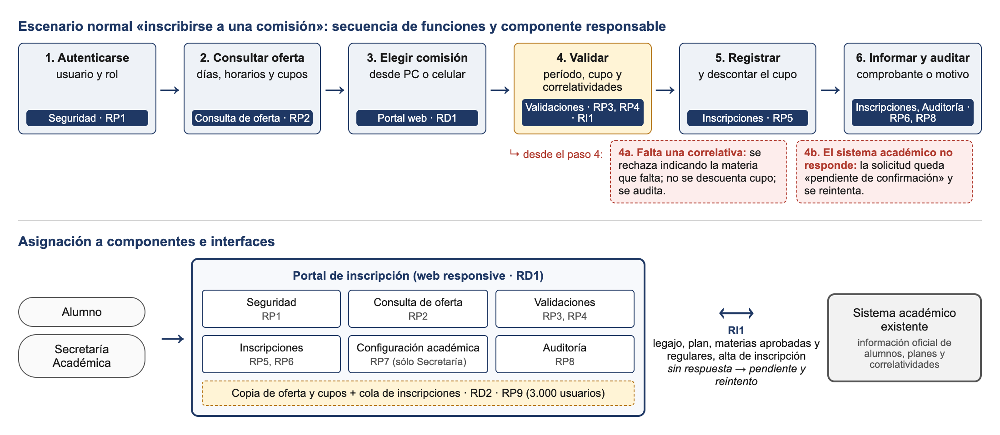

# Actividad RD y REQM — Inscripción universitaria

> Fuente de verdad del entregable. Se genera con
> `node scripts/build-docx.js materias/ISW/entregables/actividad-rd-reqm.md materias/ISW/entregables/actividad-rd-reqm.docx`.
> Enunciado: `fuentes/clases-2026/ICSW-2026 Actividad RD y REQM A.md` + entregables pedidos en
> Classroom: ficha de RC y RP (ID, enunciado, fuente, criterio de aceptación, prioridad, estado),
> diagrama de escenarios/funciones/componentes/interfaces, matriz de trazabilidad con ≥ 2 casos
> de prueba, registro de ambigüedad, conflicto, riesgo y solicitud de cambio. Límite: 5 páginas.
> El diagrama se genera desde HTML (scratchpad) a `../figs/actividad-rd-reqm-diagrama.png`.

---

## Grupo 34.584

**Integrantes:** Bonadeo Juan · Casermeiro Gonzalo · Conti Stéfano · Dana Agustín · Parmigiani Luis · Redaelli Martín

**Necesidad central:** que el alumno pueda inscribirse a materias en línea, dentro de las fechas oficiales, y sepa en el momento si quedó inscripto o por qué no.

## Parte A – Desarrollo de requisitos (área RD)

### SG1 · Interesados y necesidades

**Interesados:** Alumnos · Secretaría Académica · Docentes y responsables de cátedra · Área de Sistemas · Autoridades.

<!-- cols: 34,33,33 -->

| Lo que dijo el interesado | Necesidad real | Solución propuesta (no es requisito todavía) |
|---|---|---|
| "Quiero anotarme desde mi casa o el celular" | Inscribirse sin ir a la facultad | Portal web responsive |
| "Si la materia está llena, quiero quedar en lista de espera" | No perder un lugar que se libere | Lista de espera con notificaciones (no decidido para la 1ª versión) |
| "No duplicar datos sin definir cómo se sincronizan" | Que la información oficial siga en un solo lugar | Integración con el sistema académico existente |

### Ficha de requisitos del cliente (RC)

<!-- cols: 6,28,13,28,12,13 -->

| ID | Enunciado | Fuente | Criterio de aceptación | Prioridad | Estado |
|---|---|---|---|---|---|
| RC1 | El alumno debe poder solicitar su inscripción a una comisión desde cualquier dispositivo con internet, durante el período oficial, viendo antes días, horarios y cupos, y saber en la misma operación si fue aceptada o el motivo del rechazo | Alumnos, Secretaría Académica | Un alumno se inscribe desde PC y desde celular; antes de confirmar ve días, horarios y cupo; si se rechaza, el sistema indica el motivo (correlatividad, cupo o fecha) | Alta | Propuesto (falta definir "correlativa aprobada") |
| RC2 | Secretaría Académica debe poder configurar las fechas oficiales de inscripción y el cupo de cada comisión, y ninguna comisión debe superar su cupo | Secretaría Académica, Docentes | Secretaría carga un período y los cupos; fuera de ese período nadie puede inscribirse y ninguna comisión supera el cupo configurado | Alta | Aprobado |

**Preguntas pendientes:**

- ¿"Correlativa aprobada" significa final aprobado o regularidad? ¿Cambia según el plan de estudios? (Secretaría)
- ¿Qué excepciones de inscripción existen y quién las autoriza? (Secretaría)
- ¿Lista de espera, cambio de comisión y notificaciones entran en la primera versión? (Autoridades y Secretaría)
- ¿El sistema académico puede exponer una API? ¿En qué formato guarda los datos? (Sistemas)
- ¿La cifra de 3.000 alumnos simultáneos en los primeros 30 minutos está medida? (Sistemas)

### SG2 · Ficha de requisitos del producto (RP), de interfaz (RI) y derivados (RD)

<!-- cols: 6,28,10,32,12,12 -->

| ID | Enunciado | Fuente | Criterio de aceptación | Prioridad | Estado |
|---|---|---|---|---|---|
| RP1 | Autenticar al usuario y determinar su rol (alumno, Secretaría, docente) | RC1, RC2 | Credenciales inválidas → acceso denegado; un alumno no puede entrar a la configuración | Alta | Aprobado |
| RP2 | Mostrar las comisiones (materia, días, horarios y cupo disponible) sólo de las materias que el alumno puede cursar | RC1 | No aparece ninguna materia cuyas correlativas el alumno no cumple | Alta | Propuesto |
| RP3 | Validar las correlatividades según el plan de estudios del alumno | RC1 | Alumno sin la correlativa → rechazo indicando qué materia falta | Alta | Propuesto |
| RP4 | Validar que la solicitud esté dentro del período oficial y que la comisión tenga cupo | RC1, RC2 | Fuera de fecha o sin cupo → rechazo con el motivo | Alta | Aprobado |
| RP5 | Registrar la inscripción y descontar el cupo en una sola operación, sin sobrecupo aunque haya accesos simultáneos | RC1, RC2 | Dos solicitudes simultáneas por el último cupo → sólo una queda inscripta | Alta | Aprobado |
| RP6 | Informar el resultado: comprobante de inscripción o motivo del rechazo | RC1 | Toda solicitud aceptada genera un comprobante con número | Alta | Aprobado |
| RP7 | Alta, modificación y baja de períodos de inscripción y cupos por comisión (sólo Secretaría) | RC2 | Un cupo modificado se refleja en la oferta que ve el alumno | Alta | Aprobado |
| RP8 | Registrar cada solicitud: alumno, fecha y hora, validaciones realizadas y resultado | RC1 | Secretaría puede consultar cualquier solicitud con esos cuatro datos | Media | Aprobado |
| RP9 | Atender 3.000 usuarios simultáneos con respuesta menor a 3 segundos | RC1 | En una prueba de carga con 3.000 usuarios, el 95 % de las respuestas tarda menos de 3 s | Alta | Propuesto (valor a validar) |
| RI1 | Interfaz con el sistema académico: el portal consulta legajo, plan, materias aprobadas y regulares, y envía cada inscripción aceptada | RC1 | Si el sistema académico no responde en 10 s, la solicitud queda "pendiente de confirmación" y se reintenta; nunca se confirma sin validar | Alta | Propuesto (API no confirmada) |
| RD1 | El portal es web y responsive | Decisión técnica | Funciona en los navegadores de PC y celular sin instalar nada | Media | Aprobado |
| RD2 | El portal consulta una copia de la oferta y los cupos que se sincroniza periódicamente, y envía las inscripciones por una cola | Decisión técnica | Durante la apertura, el sistema académico no recibe consultas directas de la oferta | Media | Propuesto |

### SG3 · Escenarios, funciones y asignación a componentes e interfaces

**Validación con los interesados:** prototipo navegable de consulta e inscripción revisado con alumnos y Secretaría; revisión de las reglas de correlatividad con Secretaría usando casos reales de alumnos; piloto con una carrera antes de la apertura general.

## Parte B – Gestión de requisitos (área REQM)

### SP 1.1 · Entendimiento

<!-- cols: 12,48,40 -->

| RC | Quién aclara | Quién acepta |
|---|---|---|
| RC1 | Alumnos (por medio del centro de estudiantes) y Secretaría Académica (reglas de inscripción) | Secretaría Académica |
| RC2 | Secretaría Académica | Secretaría Académica y docentes (cupos de sus comisiones) |

- **Pregunta 1:** ¿"correlativa aprobada" es final aprobado o regularidad? **Respuesta a confirmar:** para cursar se exige regularidad y para rendir, final aprobado, según el plan. Confirma Secretaría.
- **Pregunta 2:** si el sistema académico no responde, ¿se confirma la inscripción? **Respuesta a confirmar:** no; queda pendiente y se confirma en menos de 1 hora. Confirman Secretaría y Sistemas.

### SP 1.2 · Compromiso

Deben acordar la implementación: **Secretaría Académica** (reglas y cupos), **Área de Sistemas** (integración e infraestructura), **líder del proyecto y equipo de desarrollo** (esfuerzo y plazo) y **Autoridades** (alcance y presupuesto). El acuerdo queda registrado en una minuta firmada.

**Impacto estimado:** RI1 es el de mayor **riesgo**, porque la API del sistema académico no está confirmada: Sistemas se compromete a exponer los servicios antes del inicio del desarrollo. RP5 y RP9 suman **esfuerzo** por la concurrencia y requieren pruebas de carga. En **plazo**, la primera versión llega al próximo cuatrimestre sólo si se deja afuera la lista de espera.

### SP 1.3 · Registro de ambigüedad, conflicto, riesgo y solicitud de cambio

<!-- cols: 14,34,52 -->

| Tipo | Descripción | Resolución argumentada |
|---|---|---|
| Ambigüedad | "Correlativa aprobada": algunos entienden final aprobado y otros regularidad de cursado (afecta RC1, RP2, RP3) | Se define con Secretaría por plan de estudios y la regla queda configurable. Argumento: si se fija en el código, cada cambio de plan obliga a modificar el sistema; mientras tanto RC1 y RP3 quedan en estado "propuesto" |
| Conflicto | Secretaría pide "no admitir inscripciones sin requisitos" pero también "poder autorizar excepciones" | La validación automática siempre se aplica y la excepción es un trámite manual de Secretaría, fuera del flujo automático. Argumento: respeta las dos voces sin que el sistema decida excepciones solo, como pidió la propia Secretaría |
| Riesgo | El sistema académico se demora o cae durante la apertura, con 3.000 alumnos a la vez (afecta RI1, RP9) | Mitigación: RD2 (copia de la oferta y cola de inscripciones), estado "pendiente de confirmación" y prueba de carga temprana sobre un prototipo. Argumento: se prioriza la consistencia sobre la confirmación inmediata, porque una inscripción confirmada sin validar es peor que una demora |
| Solicitud de cambio SC-01 | Centro de estudiantes: agregar lista de espera por comisión y notificar al alumno cuando se libere un cupo. Justificación: disminuir los reclamos en Secretaría, un objetivo de las Autoridades | **Impacto:** dos RP nuevos (gestionar la lista, notificar), modifica RP5, nueva interfaz con el servicio de correo, nuevos casos de prueba y unas 2 semanas más. **Decisión:** aprobada para la segunda versión (comité de cambios: Secretaría, Sistemas y líder del proyecto). Argumento: incluirla en la primera versión pone en riesgo el plazo del próximo cuatrimestre, que es la restricción fija de las Autoridades |

### SP 1.4 · Matriz de trazabilidad y casos de prueba

<!-- cols: 12,12,26,50 -->

| RC | RP / RI | Componente | Caso de prueba |
|---|---|---|---|
| RC1 | RP2 | Consulta de oferta | CP01: sólo se muestran comisiones de materias que el alumno puede cursar |
| RC1 | RP3 | Validaciones | CP02: alumno sin la correlativa → rechazo con la materia que falta |
| RC1, RC2 | RP5 | Inscripciones | CP03: dos alumnos piden el último cupo a la vez → sólo uno inscripto |
| RC2 | RP4, RP7 | Validaciones, Configuración académica | CP04: solicitud fuera del período configurado → rechazo |
| RC1 | RI1 | Inscripciones ⟷ sistema académico | CP05: el sistema académico no responde → solicitud pendiente |

**Casos de prueba asociados:**

<!-- cols: 8,13,28,21,30 -->

| ID | Verifica | Precondición | Entrada | Resultado esperado |
|---|---|---|---|---|
| CP02 | RP3 → RC1 | Período abierto; Análisis de Sistemas exige Algoritmos regular; el alumno 54.321 no tiene Algoritmos regular | Inscribirse en Análisis de Sistemas, comisión 2K1 | Rechazo: "Falta la correlativa Algoritmos y Estructuras de Datos"; el cupo no cambia; la solicitud queda auditada |
| CP03 | RP5 → RC1, RC2 | Comisión 2K1 con cupo 40 y 39 inscriptos; dos alumnos que cumplen todos los requisitos | Ambos confirman la inscripción en el mismo instante | Uno recibe comprobante y el otro "Sin cupo disponible"; la comisión queda con 40 inscriptos |

**Hacia adelante** (RC → RP → componente → caso de prueba) se comprueba que cada RC esté implementado y probado. **Hacia atrás**, si falla un caso de prueba se sigue la fila hasta el RC para saber qué requisito y qué interesado se ven afectados. Un RP sin RC de origen es funcionalidad que nadie pidió, y un RC sin caso de prueba queda sin verificar.

### SP 1.5 · Inconsistencias

**Inconsistencia inventada:** RC2 y RP7 establecen que Secretaría configura el cupo **por comisión**, pero en el diseño de la base de datos el cupo quedó guardado **por materia**, así que todas las comisiones de una materia comparten el mismo valor.

**Detección:** un caso de prueba que configura un cupo de 25 en una sola comisión e inscribe al alumno 26 falla, y la revisión de la matriz muestra que RP7 no tiene un componente que lo cumpla.

**Corrección:** se registra la inconsistencia, se corrige el diseño para guardar el cupo por comisión, se vuelven a ejecutar ese caso y CP03 como regresión, y se actualiza la matriz de trazabilidad.
