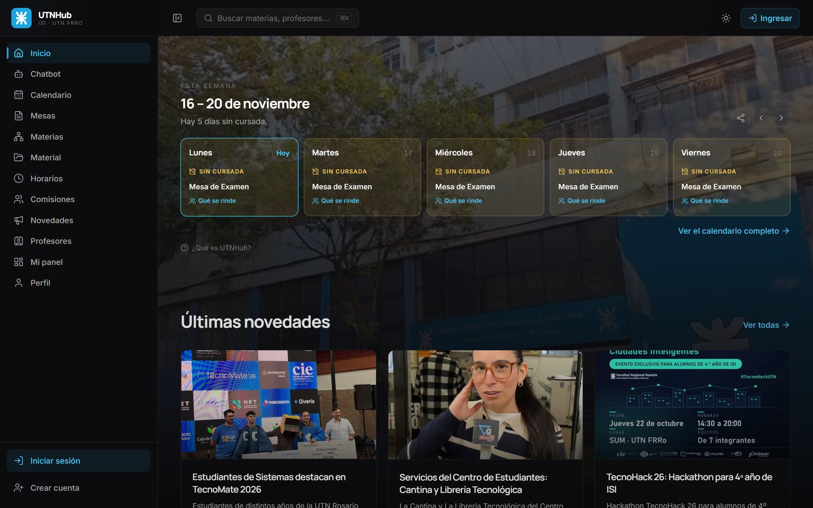
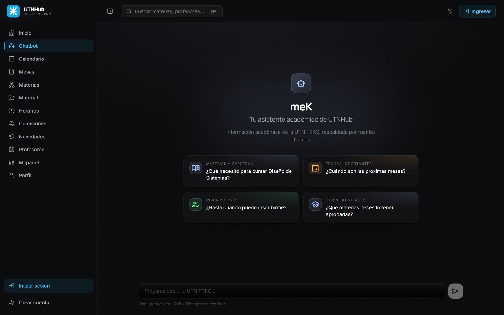
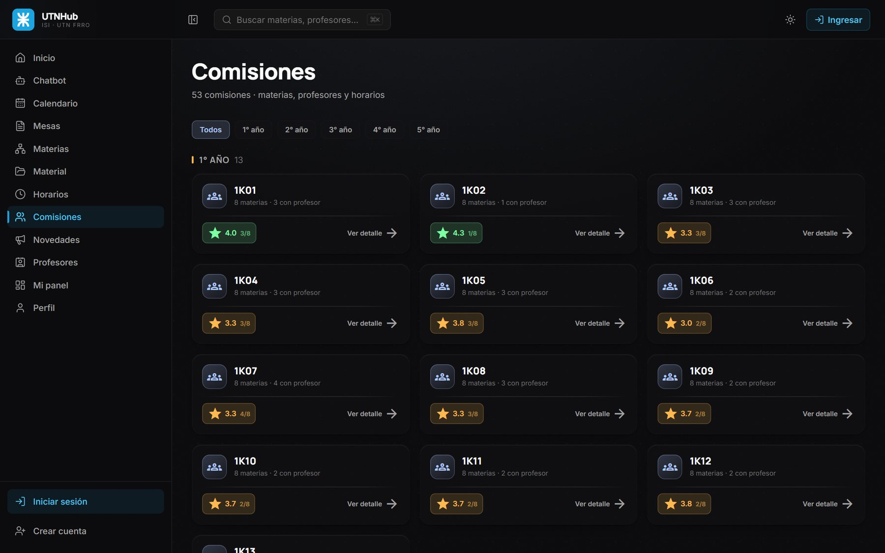
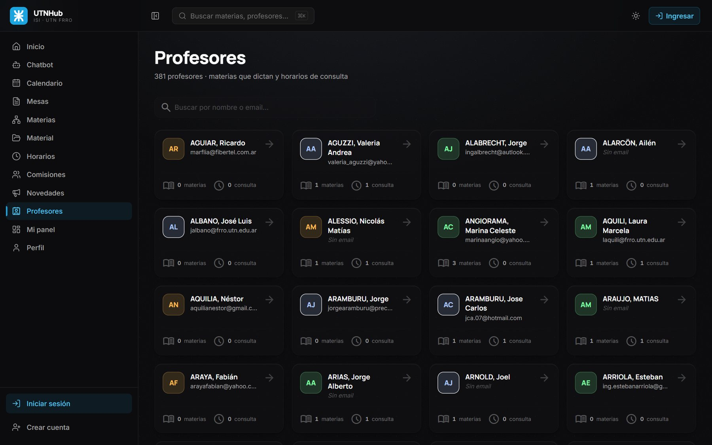
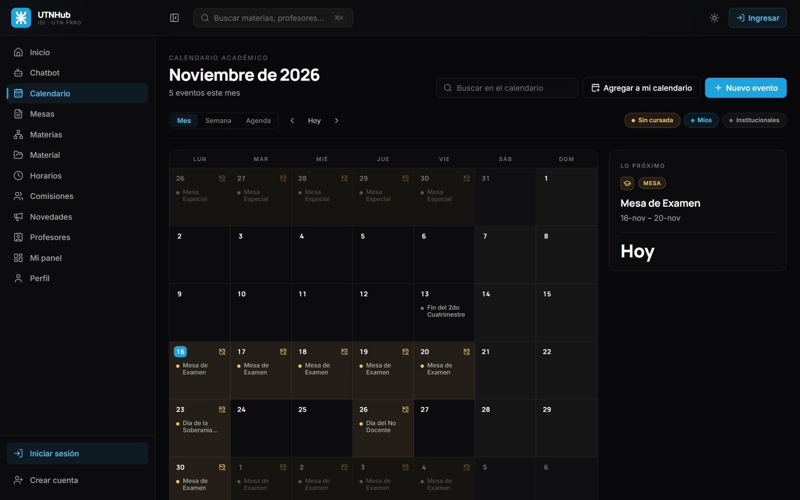
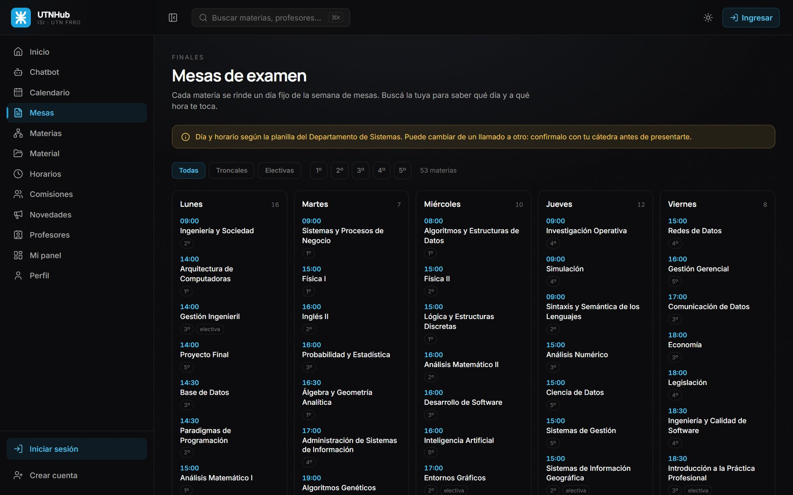
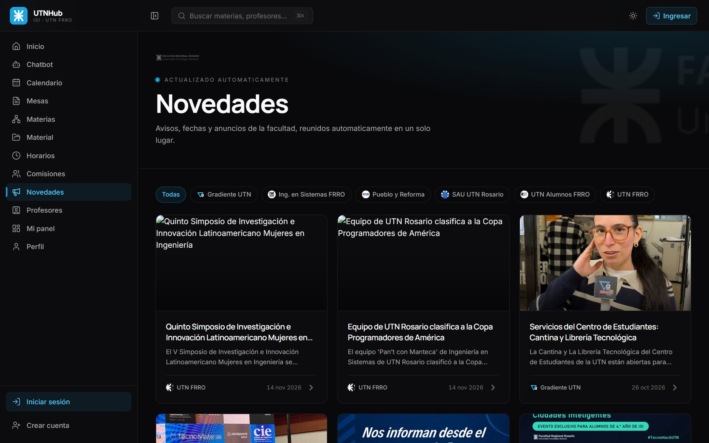

## Introducción

Un alumno de la UTN FRRO que quiere saber algo tan simple como qué materias puede cursar el cuatrimestre que viene tiene que recorrer cuatro o cinco lugares distintos. El plan de estudios y las correlativas están en un PDF. Los horarios de las comisiones salen en otra página del sitio. Los horarios de consulta de los profesores, en otra. Las fechas de mesas, en el calendario académico. Y los avisos importantes (un cambio de aula, una inscripción que cierra, un paro) muchas veces aparecen sólo en el Instagram de algún centro de estudiantes. Lo que no se encuentra se termina preguntando en un grupo de WhatsApp, donde la respuesta puede estar desactualizada.

**UTNHub** es nuestra respuesta a ese problema: una aplicación web que junta toda esa información en un solo lugar y le agrega dos cosas que ninguna de las fuentes originales tiene:

- **Un asistente con inteligencia artificial** al que se le pregunta en lenguaje natural ("¿qué necesito para cursar Diseño de Sistemas?", "¿cuándo es la próxima mesa de Redes?") y que responde **citando de dónde sacó cada dato**, consultando tanto documentos como la base de datos del sistema.
- **Un pipeline de ingesta automática** que recorre periódicamente el sitio de la facultad y las cuentas de Instagram de los centros de estudiantes, clasifica cada publicación con IA y publica sólo las que son novedades reales, de modo que el sistema se mantiene al día sin que nadie cargue nada a mano.

A eso se suma la parte académica personal: cada alumno carga su historial (o lo pega directo desde SYSACAD), ve un grafo de correlatividades con el estado de cada materia, calcula su promedio y su avance, arma su grilla de horarios con un optimizador, y se suscribe a un calendario que se actualiza solo en Google Calendar.

La aplicación está **desplegada y funcionando** en `utnhub.up.railway.app`, y el código completo está en el repositorio `github.com/augustobrizio/UTNHub`. Este documento describe qué construimos, cómo está armado por dentro y qué decisiones tomamos en el camino.

<div class="kpis">
<div class="kpi"><div class="v">56</div><div class="l">materias del plan ISI 2023, con sus correlatividades</div></div>
<div class="kpi"><div class="v">381</div><div class="l">profesores con cátedras y horarios de consulta</div></div>
<div class="kpi"><div class="v">10</div><div class="l">herramientas que usa el agente para responder</div></div>
<div class="kpi"><div class="v">332</div><div class="l">tests automáticos sobre las reglas de negocio</div></div>
</div>

### Objetivos

1. **Centralizar** la información académica e institucional dispersa: plan de estudios, comisiones, profesores, mesas, calendario y novedades.
2. Ofrecer un **asistente conversacional** que responda en lenguaje natural, mantenga el contexto de la conversación, **cite sus fuentes** y diga explícitamente cuando no tiene un dato en lugar de inventarlo.
3. **Mantener los datos actualizados solos**, con una ingesta periódica que no dependa de que alguien cargue información.
4. Dar a cada alumno **herramientas personales**: estado de sus materias, correlatividades, promedio, avance de la carrera, armado de horarios y calendario propio.
5. Cumplir las **condiciones de la cátedra**: Python, arquitectura en capas, ORM (SQLAlchemy) y reglas de negocio cubiertas con tests.

### Condiciones de la cátedra y cómo se cumplen

| Condición | Cómo la cumple UTNHub |
|---|---|
| Uso de Python | Todo el backend: FastAPI, SQLAlchemy, LangGraph, scrapers y tests (Python 3.12). |
| Arquitectura en capas | Presentación (`api/` y frontend), Negocio (`services/`, `agent/`, `rag/`) y Datos (`repositories/`, `db/`, `scrapers/`). Los endpoints no tocan la base: pasan por los servicios. |
| ORM | SQLAlchemy 2.0 con 23 modelos y 31 migraciones de Alembic. |
| Reglas de negocio con tests | 332 tests con pytest: correlatividades, inscripción, promedio, calendario, autenticación, novedades y más (capítulo 9). |
| Tag semanal y seguimiento | Repositorio en GitHub con 185 commits entre marzo y septiembre de 2026, ramas por feature y un documento vivo de pendientes. |

## Funcionalidades

La aplicación se puede recorrer **sin cuenta**: novedades, calendario, mesas, comisiones, profesores y el buscador son públicos. Las funciones personales (mis materias, horarios, panel, chat) piden iniciar sesión, con usuario y contraseña o con Google. La interfaz es oscura por defecto (también tiene modo claro), responsive, con una barra lateral de navegación personalizable y un **buscador global** que se abre con `Ctrl+K` y encuentra materias, profesores, comisiones y novedades aunque se escriban sin tildes.



### Asistente con IA (chatbot)

Es la funcionalidad central. El alumno escribe una pregunta y el asistente decide qué herramientas usar para responderla: buscar en los documentos de la facultad, consultar las correlativas de una materia, ver los horarios de una comisión, buscar a un profesor, listar las próximas mesas o revisar el progreso académico del propio alumno. La respuesta llega **en vivo, palabra por palabra**, y mientras tanto se muestran los pasos que el agente va dando ("buscando en documentos…", "revisando correlatividades…").

Cada respuesta trae las **fuentes** que la respaldan (página web, PDF o publicación, con su fecha), y cuando la pregunta es sobre una materia puntual se muestra además una **ficha** con su año, horas, correlativas y comisiones. Las conversaciones quedan guardadas: se pueden retomar, renombrar o borrar. Sobre cada respuesta se puede copiar, regenerar o marcar como útil o no útil, y el sistema sugiere preguntas de seguimiento.



### Materias, correlatividades y avance

La sección de materias muestra el plan completo como un **grafo**: cada materia es un nodo, las flechas son correlatividades, y el color indica si está aprobada, regular, cursando, disponible para cursar o bloqueada. Al tocar una materia se ve si el alumno puede cursarla y si puede rendirla, con el detalle de qué le falta.

El historial se carga materia por materia o, mucho más rápido, **pegando el "Estado académico" de SYSACAD**. El sistema reconoce cada materia por similitud de texto (aunque SYSACAD la escriba en mayúsculas o sin tildes), muestra una vista previa para corregir lo que haga falta y, si el texto dice "Cursa en 4K02", también deja elegida esa comisión. Con eso se calculan el **promedio general**, el **porcentaje de avance** de la carrera, la carga horaria aprobada y los créditos de electivas acumulados contra los 20 que exige el plan.

### Comisiones, horarios y profesores

Las 53 comisiones de la carrera se listan por año con sus materias, docentes y un **puntaje de la cátedra** que combina las encuestas públicas de UTNTAC con las reseñas que dejan los propios alumnos en UTNHub (de 1 a 5, con comentario opcional).

En **Horarios**, el alumno ve sólo las materias que puede cursar según sus correlativas y arma su grilla eligiendo comisiones. Un **optimizador** le propone las mejores combinaciones según el criterio que elija: la menor cantidad de horas muertas, la menor cantidad de días, un turno preferido (mañana, tarde o noche) o dejar un día libre.

El directorio de **profesores** reúne a 381 docentes con sus materias, cargo, mail y horarios de consulta, que el sistema obtiene del sitio de la facultad y de las planillas de UTNTAC.

<div class="dos">





</div>

### Calendario académico y mesas de examen

El calendario muestra en vista mensual, semanal o de agenda los eventos institucionales (inicio y fin de cuatrimestre, feriados, mesas, inscripciones), que se obtienen del sitio de la facultad, junto con los **eventos personales** que agrega cada alumno (entregas de TPs, parciales). Se puede filtrar por tipo y saber qué días se cursa y cuáles no.

Con un botón, el alumno se **suscribe desde Google Calendar, Apple Calendar u Outlook**: recibe una URL personal y desde ahí los cambios le aparecen solos, sin volver a importar nada. También puede descargar el archivo `.ics`.

La sección de **mesas de examen** responde a una pregunta muy concreta que no tiene respuesta clara en ningún otro lado: qué materias se rinden cada día de la semana y a qué hora.

<div class="dos">





</div>

### Novedades

Las novedades llegan solas desde el sitio de la facultad y desde las cuentas de Instagram de los centros de estudiantes (Gradiente, SAU, Ingeniería en Sistemas, UTN Alumnos y otras). Una IA decide qué publicaciones son novedades reales y cuáles no (un sorteo o una publicación política, por ejemplo, se descartan), les asigna una categoría (evento, aviso, noticia o general), redacta un título y un resumen, y detecta cuándo dos cuentas publicaron lo mismo para mostrarlo una sola vez con las dos fuentes. Un administrador puede moderar lo que la IA no publicó con suficiente confianza y elegir qué se destaca en la portada.



### Panel personal, perfil y notificaciones

Con la sesión iniciada, el **panel** (`/panel`) resume el día del alumno: su progreso en la carrera, las clases de hoy según las comisiones que eligió, los eventos próximos y las últimas novedades. La **campana** de la barra superior avisa de novedades nuevas desde la última visita y de las mesas de los próximos siete días. El **perfil** reúne los datos de la cuenta y las cátedras pendientes de calificar.

### Administración

Los usuarios con rol de administrador tienen funciones extra: moderar novedades y ordenar la portada, disparar las sincronizaciones de profesores, calendario y novedades, editar las mesas y los días sin clase, y consultar el **reporte de huecos del chatbot**: la lista, ordenada por frecuencia, de las preguntas que el asistente no pudo responder con datos o que los alumnos marcaron como inútiles. Así se sabe qué documento o qué herramienta conviene agregar.

## Requerimientos

Las tablas muestran cómo se implementó cada requerimiento planteado en la narrativa del proyecto.

### Requerimientos funcionales

| ID | Requerimiento | Cómo se implementó |
|---|---|---|
| RF-01 | Login con mail y contraseña, sesión persistente, roles | Registro y login con JWT en cookie httpOnly; roles alumno y admin. Se sumó login con Google. |
| RF-02 | Gestión de materias y correlatividades | Estado por materia, grafo, validación de correlativas al cursar y rendir, créditos de electivas, importación desde SYSACAD. |
| RF-03 | Calculadora de promedio y avance | Promedio general, porcentaje de avance, carga horaria y créditos de electivas. |
| RF-04 | Chat en lenguaje natural | Agente LangGraph con 10 herramientas y respuesta en streaming. |
| RF-05 | Contexto conversacional | Conversaciones persistidas; se envían los últimos 10 mensajes como historial. |
| RF-06 | Fuentes en cada respuesta | Fuentes con título, URL y fecha, guardadas con el mensaje y visibles en la interfaz. |
| RF-07 | Decir "no tengo esa información" | Instrucción explícita en el prompt; las respuestas sin datos alimentan el reporte de huecos. |
| RF-08 | Ingesta automática periódica | Dos funciones AWS Lambda disparadas por EventBridge (sitio y Instagram). |
| RF-09 | Novedades actualizadas solas | Clasificación con IA, deduplicación y publicación automática con umbral de confianza. |
| RF-10 | Calendario académico | Vistas mes/semana/agenda, filtros, eventos personales, exportación `.ics` y suscripción. |
| RF-11 | Perfil e historial | Perfil, panel personal e historial académico por materia. |
| RF-12 | Scrapers de las fuentes | Profesores, calendario, sitio, PDFs, Drive e Instagram, con deduplicación. El plan de estudios y sus correlatividades se cargan como dato curado (seed), porque cambian una vez por plan y son la base de todas las reglas. |

### Requerimientos no funcionales

| ID | Requerimiento | Cómo se implementó |
|---|---|---|
| RNF-01 | Usabilidad, responsive | Interfaz responsive, buscador global con `Ctrl+K`, navegación personalizable, modo oscuro y claro. |
| RNF-02 | Seguridad de credenciales | bcrypt con pre-hash SHA-256, JWT firmado, rate limit en el login, secretos sólo por variables de entorno. |
| RNF-03 | Escalabilidad | Índices en la base, índice vectorial HNSW, Postgres serverless que escala solo y render del lado del servidor con Next.js. |
| RNF-04 | Google OAuth restringido a `@frro.utn.edu.ar` | OAuth 2.0 con PKCE implementado y probado; el filtro por dominio se activa por configuración (ver 9.2). |
| RNF-05 | Expiración de sesión | Sesión con token JWT en cookie segura, vencimiento configurable (`JWT_EXPIRE_MINUTES`) y cierre de sesión manual. |
| RNF-06 | Control de acceso por rol | Dependencia `requerir_admin` en todos los endpoints que reescriben datos compartidos. |
| RNF-07 | Frecuencia de ingesta por fuente | Instagram cada 6 h, sitio cada 7 días en producción; configurable. |
| RNF-08 | Log de auditoría de la ingesta | Tabla `IngestaLog` con fuente, inicio, fin, ítems, tokens y errores de cada corrida. |
| RNF-09 | Pipeline de procesamiento RAG | Extracción (con OCR para PDFs escaneados), limpieza, chunks de 1000 caracteres con 150 de solapamiento, embeddings y metadata con hash. |
| RNF-10 | Arquitectura agéntica con tools | Ciclo agente ⇄ herramientas en LangGraph. |
| RNF-11 | Límite de tokens | Límites configurables al largo de la pregunta, al historial enviado y a las iteraciones del agente; el consumo de tokens se registra en cada mensaje. |
| RNF-12 | Respuestas fundamentadas | Prompt restrictivo, temperatura 0, citas obligatorias y reporte de huecos para detectar fallas. |
| RNF-13 | Evaluar embeddings en español | Se usa `gemini-embedding-001`, multilingüe, probado con consultas reales en español; el reporte de huecos mide qué preguntas no encuentran respuesta. |

## Arquitectura

UTNHub tiene tres piezas que se despliegan por separado: un **frontend** en Next.js, un **backend** en FastAPI organizado en capas, y un **pipeline de ingesta** que corre en AWS fuera del backend. Los tres comparten una única base de datos PostgreSQL alojada en Neon, que guarda tanto los datos relacionales como los embeddings del asistente.

{{diagrama:arquitectura|Arquitectura general: frontend, backend en capas, servicios externos e ingesta en AWS.}}

### Las tres capas del backend

**Presentación (`api/`).** Doce routers de FastAPI exponen la API REST y el canal de streaming del chat. Validan la entrada con esquemas Pydantic, resuelven quién es el usuario a partir del token y delegan todo lo demás en los servicios. Tres dependencias reutilizables definen el acceso: `UsuarioActual` (exige sesión), `UsuarioOpcional` (la acepta si existe, para las secciones públicas que mejoran con sesión) y `requerir_admin`.

**Negocio.** Acá vive todo lo que hace a UTNHub algo más que un CRUD:

- `services/` concentra las reglas del dominio: correlatividades, inscripción, promedio, optimizador de horarios, calendario, novedades, búsqueda y notificaciones.
- `agent/` contiene el agente de LangGraph, sus prompts y sus diez herramientas. Las herramientas no consultan la base por su cuenta: usan los mismos servicios que la API, así que el chatbot y la interfaz siempre dan la misma respuesta.
- `rag/` implementa la recuperación de documentos: fragmentación, embeddings y búsqueda por similitud.
- `ai/` tiene el clasificador de novedades, y `workers/` el planificador de tareas periódicas.

**Datos.** `repositories/` agrupa en nueve repositorios todas las consultas a la base; `db/models/` define los modelos de SQLAlchemy; Alembic versiona el esquema; y `scrapers/` obtiene la información de cada fuente externa.

La regla que respetamos es que **cada capa sólo conoce a la de abajo**: un endpoint llama a un servicio, el servicio a un repositorio, y el repositorio a los modelos. Eso permitió, por ejemplo, testear todas las reglas de negocio sobre una base SQLite en memoria sin levantar el servidor.

### Frontend

El frontend está hecho con **Next.js 15** (App Router) y **React 18**, con **Tailwind CSS** y componentes accesibles de Radix. Usa renderizado del lado del servidor: cada página pide sus datos al backend antes de llegar al navegador, lo que hace que cargue rápido y que la sesión se verifique en el servidor.

Una decisión de seguridad importante es que **el token de sesión nunca llega a JavaScript**. Al iniciar sesión, el frontend lo guarda en una cookie `httpOnly`, y todas las llamadas al backend pasan por un proxy propio (`/api/backend/*`) que adjunta el token del lado del servidor. Así, un script inyectado en la página no tiene forma de robar la sesión.

### Por qué estas tecnologías

| Tecnología | Por qué la elegimos |
|---|---|
| **FastAPI** | Python es obligatorio en la materia; FastAPI suma validación automática con Pydantic, documentación OpenAPI generada sola y buen soporte para streaming. |
| **PostgreSQL + pgvector (Neon)** | Una sola base para datos relacionales y vectores: no hace falta una base vectorial aparte (Pinecone, Chroma). Neon es Postgres serverless con plan gratuito y pgvector nativo. |
| **SQLAlchemy 2.0 + Alembic** | ORM pedido por la cátedra; Alembic deja cada cambio de esquema versionado y aplicable en cualquier entorno. |
| **LangGraph** | Modela al agente como un grafo explícito (agente ⇄ herramientas), con streaming de cada paso y límite de iteraciones. |
| **Google Gemini** | LLM y embeddings con plan gratuito, multilingües y con buen rendimiento en español. |
| **OpenAI gpt-4o-mini** | Para clasificar novedades: barato, con salida estructurada en JSON y capacidad de "ver" la imagen de cada publicación. |
| **Next.js + React + Tailwind** | Componentes reutilizables, render en el servidor y estilos consistentes. |
| **AWS Lambda + EventBridge + S3** | La ingesta corre aislada del backend, sólo cuando le toca, y sin costo fijo. |
| **Railway** | Despliegue de los dos servicios desde el repositorio, con migraciones automáticas antes de cada versión. |

## Modelo de dominio

El modelo tiene 23 entidades. Para que se pueda leer, lo dividimos en dos partes: el **núcleo académico** (plan de estudios, alumnos, comisiones y profesores) y el **contenido** (chat, novedades y corpus del asistente).

{{diagrama:dominio-academico|Modelo de dominio: núcleo académico. Las líneas grises son relaciones opcionales.}}

Los puntos centrales del núcleo académico son:

- **Materia** es el centro del modelo. Se identifica por su código del plan (por ejemplo, `E13`) y distingue troncales de electivas.
- **Correlatividad** es una relación de una materia consigo misma: "para cursar *A* hace falta *B* **regular**" o "**aprobada**". El tipo importa, porque el mismo dato se evalúa distinto para cursar y para rendir (capítulo 6).
- **UsuarioMateria** guarda la situación de cada alumno en cada materia (aprobada, regular, cursando o libre), con nota y año. Opcionalmente apunta a la **Cursada** que el alumno eligió, y de ahí sale su grilla de horarios.
- **Comision → Cursada → Horario** representa la oferta: cada comisión (`1K01`, `4EK02`…) dicta varias materias, y cada cursada tiene sus horarios y su docente.
- **Profesor** se relaciona con sus materias (**MateriaProfesor**), sus horarios de consulta y dos tipos de opinión: los votos agregados de UTNTAC (**ReviewCatedra**) y las reseñas de los alumnos de UTNHub (**ResenaAlumno**).
- **EventoCalendario** sirve tanto para eventos institucionales como personales: si `usuario_id` está vacío, el evento es de todos; si no, es sólo de ese alumno. Un `content_hash` único evita duplicar eventos al volver a sincronizar.

{{diagrama:dominio-contenido|Modelo de dominio: chat, novedades y corpus del asistente.}}

En la parte de contenido, cada **Mensaje** del chat guarda, además del texto, las fuentes que citó y las herramientas que usó, que es lo que después permite armar el reporte de huecos. Una **Novedad** puede tener varias **NovedadFuente**, porque la misma noticia puede haberla publicado más de una cuenta. **IngestaLog** es el registro de auditoría de cada corrida de la ingesta, y **RagChunk** guarda cada fragmento de documento con su embedding de 768 dimensiones.

## Reglas de negocio

Las reglas de negocio están en la capa de servicios y cada una tiene tests que fijan su comportamiento. Estas son las más importantes.

### Correlatividades: cursar y rendir no son lo mismo

Para **cursar** una materia, cada correlativa de tipo *regular* se cumple si el alumno la tiene regular **o** aprobada, y cada correlativa de tipo *aprobada* exige que esté aprobada. Para **rendir** el final, en cambio, **todas** las correlativas tienen que estar aprobadas. Es decir: el mismo dato (la correlatividad) se evalúa con dos umbrales distintos según la acción, y hay tests escritos específicamente para que nadie los unifique por error.

> **Ejemplo.** Si para cursar Diseño de Sistemas hace falta Análisis de Sistemas *regular*, un alumno con Análisis regular puede cursar Diseño. Pero no puede **rendir** Diseño hasta aprobar Análisis.

Proyecto Final tiene una regla propia: para rendirlo hace falta tener aprobadas todas las troncales.

### Registrar el estado de una materia

Al marcar una materia como **cursando** o **regular**, el sistema valida las correlativas. Al marcarla como **aprobada** o **libre**, no. Parece una inconsistencia, pero es deliberado: el caso de uso de esos estados es cargar el historial, y cuando un alumno carga materias aprobadas hace años no siempre lo hace en orden. Si se validara, no podría cargar su historial.

### Promedio y avance

- El **promedio general** es el promedio de las notas de las materias aprobadas, troncales y electivas.
- El **porcentaje de avance** cuenta las materias obligatorias aprobadas sobre el total, sin contar ADUSI, que no es obligatoria para recibirse en ISI.
- Los **créditos de electivas** se acumulan contra los 20 que exige el plan.

Las reglas fijas del plan (créditos de electivas, materias opcionales) están en un único archivo de datos curados, `core/plan.py`, para que el panel, el grafo y el chatbot usen exactamente la misma definición.

### Optimizador de horarios

Dadas las materias que el alumno quiere cursar, el optimizador busca la combinación de comisiones que no se superpone y que mejor cumple el criterio elegido: menos horas muertas, menos días de cursada, un turno preferido o un día libre. Usa *backtracking* con poda: descarta una rama apenas encuentra una superposición o cuando ya no puede mejorar la mejor solución encontrada, con un tope de tres millones de nodos para garantizar que siempre responde.

### Calendario exportable

El archivo `.ics` se genera a mano siguiendo el estándar RFC 5545, y eso obligó a resolver detalles que son fuente clásica de errores:

- **Día completo o con hora.** Los eventos institucionales son fechas, no horarios. Si se exportan con hora, un feriado le aparece al alumno como una cita a las 00:00. La regla quedó: si el evento está a medianoche, se exporta como día completo; si tiene hora, como instante.
- **El fin es exclusivo.** Un feriado del 1/9 se escribe del 1/9 al 2/9; si no, todo aparece un día más corto.
- **Zona horaria.** Las fechas de la base están en hora de Rosario y se convierten a UTC. Si no se convierten, todo se corre tres horas.
- **La URL de suscripción es la credencial.** Google Calendar refresca el calendario sin enviar cookies ni encabezados, así que no se puede usar el token de sesión. Cada alumno tiene un token propio, revocable y de 32 bytes. Un token inválido devuelve 404 y no 401, para no revelar si alguna vez existió.

### Publicación de novedades

Una publicación sólo se publica sola si la IA la clasifica como novedad con una **confianza de al menos 0,75**. Si no llega a ese umbral, queda pendiente para que la revise un administrador. Lo que el administrador modera a mano queda marcado y la ingesta no lo vuelve a pisar.

## Asistente con inteligencia artificial

### Cómo decide qué hacer

El asistente es un **agente**: un modelo de lenguaje que, en lugar de contestar de memoria, decide qué herramientas llamar, mira lo que le devuelven y recién entonces responde. Está modelado como un grafo de LangGraph con dos nodos, el agente y las herramientas, que se llaman en ciclo hasta que el modelo ya no necesita más información (con un máximo de 8 iteraciones).

{{diagrama:agente|Ciclo del agente: el modelo decide qué herramientas usar hasta tener lo necesario para responder.}}

El modelo es Google Gemini con temperatura 0, para que las respuestas sean estables. El prompt de sistema le indica que no invente, que cite las fuentes, que diga explícitamente cuando no tiene un dato y le inyecta la fecha del día, para que pueda interpretar preguntas como "¿cuándo es la próxima mesa?".

### Las diez herramientas

| Herramienta | Qué hace |
|---|---|
| `rag_search` | Busca por significado en el corpus de documentos (sitio de la facultad, reglamentos en PDF, Drive, centros de estudiantes). |
| `ficha_materia` | Devuelve la ficha estructurada de una materia, que el frontend muestra como tarjeta. |
| `buscar_correlativas` | Correlativas de una materia y, si hay sesión, si el alumno ya las cumple. |
| `buscar_horario_comision` | Comisiones y horarios en que se dicta una materia. |
| `buscar_profesor` | Busca un docente por nombre aproximado: materias, mail y horarios de consulta. |
| `mesas_de_examen` | Qué materias se rinden cada día de la semana. |
| `proximos_eventos` | Próximos eventos del calendario académico. |
| `ultimas_novedades` | Últimas novedades publicadas. |
| `mi_progreso_academico` | Materias aprobadas y pendientes, promedio y qué puede cursar el alumno ahora. |
| `plan_de_estudio` | Estructura del plan: troncales, electivas y requisitos. |

La mayoría de las preguntas de un alumno no se responden bien con búsqueda en documentos: "¿qué me falta para recibirme?" depende de *su* historial, y "¿quién da Simulación?" está en una tabla, no en un PDF. Por eso nueve de las diez herramientas consultan datos estructurados a través de los servicios, y sólo una (`rag_search`) busca en texto libre. Los nombres de materias y profesores se reconocen por similitud, así que el alumno no necesita escribirlos exactos.

### Recuperación de documentos (RAG)

El corpus del asistente se arma con un script de ingesta que, para cada fuente, extrae el texto (con **OCR** para los PDFs escaneados, como algunos reglamentos), lo limpia, lo divide en fragmentos de 1000 caracteres con 150 de solapamiento y calcula para cada fragmento un **embedding** de 768 dimensiones con `gemini-embedding-001`. Los fragmentos se guardan en la tabla `rag_chunk` de Postgres, con un índice HNSW que permite encontrar los 5 más parecidos a una pregunta en milisegundos. La ingesta es idempotente: volver a correrla sobre una fuente reemplaza sus fragmentos en lugar de duplicarlos.

### Streaming y fuentes

La respuesta se transmite con **Server-Sent Events** desde el backend, pasando por el proxy de Next.js, hasta el navegador. El flujo emite eventos de inicio, de cada paso (cada herramienta que se usa), de cada fragmento de texto y de fin, este último con las fuentes y las fichas de materia. Las fuentes se deduplican por título y URL, se guardan junto al mensaje y se muestran en la interfaz con su fecha, para que el alumno sepa si la información es reciente.

### Cómo mejora con el uso

Cada mensaje registra qué herramientas usó. Con eso, el **reporte de huecos** (sólo para administradores) agrupa las preguntas que el asistente respondió sin ninguna fuente ni herramienta estructurada, o que los alumnos marcaron como no útiles, y las ordena por frecuencia. El resultado es una lista priorizada de qué documento cargar o qué herramienta agregar.

## Ingesta de datos

### Fuentes

| Fuente | Qué se obtiene | Cómo se actualiza |
|---|---|---|
| Sitio de la FRRO (páginas seleccionadas) | Trámites, ingreso, alumnado, horarios | Script de ingesta del corpus |
| PDFs institucionales y Drive de la carrera | Reglamentos, resoluciones, material | Script de ingesta del corpus (con OCR) |
| Centro de estudiantes Gradiente (WordPress) | Información para alumnos | Script de ingesta del corpus |
| Notas curadas por el equipo | Respuestas a preguntas frecuentes | Script de ingesta del corpus |
| Calendario académico de ISI y tablas de mesas | Eventos, feriados, mesas | Sincronización de administrador |
| Horarios de consulta del Dpto. de Sistemas | Profesores y horarios | Sincronización de administrador |
| Planillas públicas de UTNTAC | Mails de docentes, cátedras y votos | Sincronización de administrador |
| Portada del sitio de la FRRO | Notas y fechas importantes | Lambda, cada 7 días |
| Instagram de los centros de estudiantes | Publicaciones | Lambda, cada 6 horas |

Las sincronizaciones de profesores y calendario reconocen a cada docente aunque cada fuente escriba su nombre distinto (con o sin segundo nombre, con tildes o sin ellas), comparando los nombres normalizados por similitud.

### Pipeline de novedades

{{diagrama:pipeline-novedades|Pipeline de ingesta y clasificación de novedades.}}

Algunos detalles de diseño que valen la pena:

- **El filtro barato va primero.** La deduplicación exacta y el corte por antigüedad se hacen *antes* de llamar al modelo, para no pagar por clasificar algo que ya se procesó.
- **La IA ve la imagen.** Muchas publicaciones de Instagram tienen toda la información en la imagen y casi nada en el texto, así que el clasificador recibe ambas.
- **Imágenes propias.** Las URLs de imágenes de Instagram vencen en horas o días, así que cada imagen se copia a un bucket de S3 y la novedad apunta a esa copia.
- **Instagram sin credenciales.** La primera versión iniciaba sesión con una cuenta, lo que traía bloqueos y una sesión que había que guardar. La versión final lee los perfiles públicos imitando la huella TLS de un navegador real, sin usuario ni contraseña.

### Por qué la ingesta corre en AWS Lambda

La ingesta de novedades corre en **dos funciones Lambda**, una por fuente, disparadas por EventBridge. Las separamos porque tienen riesgos distintos: si Instagram bloquea las consultas, la ingesta del sitio sigue funcionando. Se despliegan como **imágenes de contenedor** y no como un `.zip`, porque las dependencias superan el límite de 250 MB y porque algunas tienen partes en C que hay que compilar para el sistema operativo de Lambda. Cada función usa un subconjunto mínimo de dependencias y llama al mismo código que usa el backend, así que no hay lógica duplicada. Para desarrollo, el mismo pipeline puede correr dentro del backend con APScheduler.

## Seguridad y autenticación

### Dos formas de entrar

- **Usuario y contraseña.** Las contraseñas se guardan con bcrypt, con un pre-hash SHA-256 que evita el límite de 72 bytes de bcrypt. El login tiene un límite de 10 intentos fallidos cada 5 minutos por IP y mail. La sesión es un JWT firmado (HS256) con vencimiento a las 12 horas.
- **Google.** Se usa el flujo *authorization code* con `state` y **PKCE**. El backend valida la firma del `id_token` contra las claves públicas de Google y exige que el mail esté verificado. Si ya existía una cuenta con ese mail, se vincula a la de Google; eso es seguro justamente porque se exige el mail verificado.

### La decisión sobre el dominio institucional

RNF-04 pedía aceptar sólo cuentas `@frro.utn.edu.ar`. Lo implementamos y testeamos, pero **decidimos dejarlo apagado**: muchos alumnos no usan su cuenta institucional, y el registro con contraseña ya aceptaba cualquier mail. El filtro quedó detrás de una variable de configuración (`GOOGLE_DOMINIOS_PERMITIDOS`), de modo que activarlo no requiere tocar código.

### Endpoints protegidos

Revisando todos los endpoints que escriben datos encontramos **cinco sincronizaciones que estaban abiertas**, entre ellas la que dispara el pipeline de novedades. Cualquiera podía reescribir tablas compartidas o generar consumo del modelo de IA llamándolas en loop. Las cerramos con `requerir_admin` y escribimos tests que verifican tres casos para cada una (anónimo → 401, alumno → 403, admin → permitido) y que el control corta **antes** de ejecutar el servicio. Los endpoints personales (calendario propio, reseñas, materias) nunca reciben el usuario por parámetro: lo toman del token, así que un alumno no puede leer ni modificar datos de otro.

## Calidad y testing

El backend tiene **332 tests** escritos con pytest. Corren sobre una base SQLite en memoria creada desde los mismos modelos, así que no dependen de la base de producción ni de servicios externos.

| Área | Tests | Qué cubren |
|---|---|---|
| Autenticación y Google OAuth | 49 | Registro, login, hashing, JWT, rate limit, PKCE, validación del `id_token`, vinculación de cuentas, filtro de dominio. |
| Calendario, `.ics` y suscripción | 80 | Eventos públicos y personales, formato RFC 5545, zonas horarias, día completo, tokens de suscripción. |
| Núcleo académico | 57 | Correlatividades (cursar y rendir), registro de estados, promedio, avance y créditos de electivas. |
| Mesas de examen | 24 | Mesas por día y por materia, edición de administrador. |
| Novedades e Instagram | 37 | Clasificación, deduplicación, publicación por umbral, moderación, lectura de Instagram. |
| Búsqueda y notificaciones | 33 | Búsqueda sin tildes y aproximada, novedades nuevas, mesas próximas. |
| Profesores, cátedras y reseñas | 34 | Reconocimiento de nombres, votos de UTNTAC, reseñas de alumnos. |
| Importación de SYSACAD | 9 | Texto real pegado en mayúsculas, reconocimiento de comisión. |
| Autorización de endpoints | 9 | Sincronizaciones sólo para administradores. |

Dos ejemplos de por qué los tests valieron la pena:

- **La importación de SYSACAD acertaba 0 de 56 materias.** SYSACAD escribe los nombres en mayúsculas y el comparador no normalizaba el texto, así que con los nombres reales no reconocía ninguna. Los tests con el texto real lo hicieron evidente; con la corrección, el resultado pasó a 56 de 56 en todas las variantes (mayúsculas, minúsculas y sin tildes).
- **Dos servicios no coincidían sobre ADUSI.** El cálculo de avance la excluye porque no es obligatoria, pero la regla de Proyecto Final la exigía igual. Resultado: un alumno podía ver 100 % de avance y no poder rendir Proyecto Final. Como es una decisión de dominio y no un bug técnico, no la cambiamos a ciegas: la fijamos en un test con nombre explícito, de modo que el día que se decida, el test que se rompa marca dónde está el cambio.

## Despliegue e infraestructura

| Componente | Dónde corre | Detalle |
|---|---|---|
| Frontend | Railway | Imagen Docker multi-etapa (Node 22), salida `standalone` de Next.js; healthcheck sobre `/login`. |
| Backend | Railway | Imagen Python 3.12 con Tesseract para OCR; antes de cada versión corre `alembic upgrade head`; healthcheck sobre `/health`. |
| Base de datos | Neon | PostgreSQL serverless con pgvector; el mismo motor en desarrollo y producción. |
| Ingesta de novedades | AWS | Dos Lambdas en contenedor (ECR), EventBridge como disparador y S3 para imágenes. |

En desarrollo, el backend corre con `docker compose up` y el frontend con `npm run dev`. Toda la configuración (cadena de conexión, claves de los modelos, credenciales de Google y AWS) entra por variables de entorno: el repositorio sólo tiene un `.env.example` con los nombres, nunca valores.

## Organización del trabajo

El proyecto se desarrolló entre marzo y septiembre de 2026, con **185 commits** de los cuatro integrantes en el repositorio de GitHub.

| Etapa | Qué se construyó |
|---|---|
| Marzo – abril | Narrativa, requerimientos y estructura en capas del proyecto. |
| Mayo – junio | Grafo de materias y correlatividades, scrapers de profesores, comisiones y reseñas. |
| Julio | Pipeline de novedades con IA y su despliegue en AWS Lambda. |
| Agosto | Autenticación (contraseña y Google), despliegue en Railway, buscador global, notificaciones, importación de SYSACAD. |
| Septiembre | Asistente con IA (RAG, agente y streaming), exportación del calendario, panel personal, tests del núcleo académico. |

Algunas prácticas que nos ordenaron:

- **Ramas por feature** (`feat/chat-streaming`, `feat/novedades-ingesta-ia`, `feature/grafo-materias`…) que se integraban a `main` cuando estaban completas.
- **Especificaciones antes del código** para las funcionalidades más grandes (directorio de profesores, comisiones, reviews de cátedra y reseñas de alumnos), con spec-kit: requerimientos, plan y tareas por escrito antes de implementar.
- **Un documento vivo de pendientes** (`PENDIENTES.md`) que dividía el trabajo en *frentes*, cada uno con tareas, esfuerzo estimado, requerimientos que cubre, dependencias y criterio de aceptación. Las decisiones de equipo que bloqueaban trabajo (contraseña o Google, qué proveedor de IA, ICS o API de Google Calendar) se registraban ahí antes de codear.
- **Asistentes de IA para programar**, con instrucciones del proyecto versionadas (`CLAUDE.md`, `AGENTS.md`) que fijan la arquitectura en capas, el stack y lo que no se debe hacer, para que el código generado respete las mismas reglas que el escrito a mano.

## Conclusiones

UTNHub resuelve un problema que tenemos todos los alumnos de la facultad: que la información existe, pero está repartida en demasiados lugares. El resultado es una aplicación en producción que reúne el plan de estudios, la oferta de comisiones, los profesores, el calendario, las mesas y las novedades, y que además entiende la situación de cada alumno.

Lo que más aprendimos tiene que ver con **dónde poner la inteligencia artificial**. Al principio la pensábamos como el centro de todo; terminamos usándola en dos lugares bien delimitados (decidir qué herramienta usar para responder y clasificar publicaciones) y apoyándola siempre en datos estructurados, reglas de negocio testeadas y fuentes citadas. El chatbot es confiable no porque el modelo sepa mucho, sino porque casi nunca contesta de memoria.

También confirmamos el valor de las condiciones que pedía la cátedra. La **arquitectura en capas** hizo que el chatbot y la interfaz compartan exactamente las mismas reglas. El **ORM con migraciones** nos dejó cambiar el esquema más de treinta veces sin perder datos. Y los **tests de reglas de negocio** encontraron errores reales, como la importación de SYSACAD que no reconocía ninguna materia, que de otra forma habrían llegado a los usuarios.

## Anexo: cómo correr el proyecto

```
# 1. Clonar el repositorio
git clone https://github.com/augustobrizio/UTNHub.git
cd UTNHub

# 2. Backend (Docker). Completar DATABASE_URL y las claves en backend/.env
cp backend/.env.example backend/.env
docker compose up --build                            # API en http://localhost:8000
docker compose exec backend uv run alembic upgrade head
docker compose exec backend uv run pytest            # 332 tests

# 3. Frontend
cd frontend
npm install
npm run dev                                          # http://localhost:3000
```

La documentación interactiva de la API (OpenAPI) queda disponible en `http://localhost:8000/docs`.
