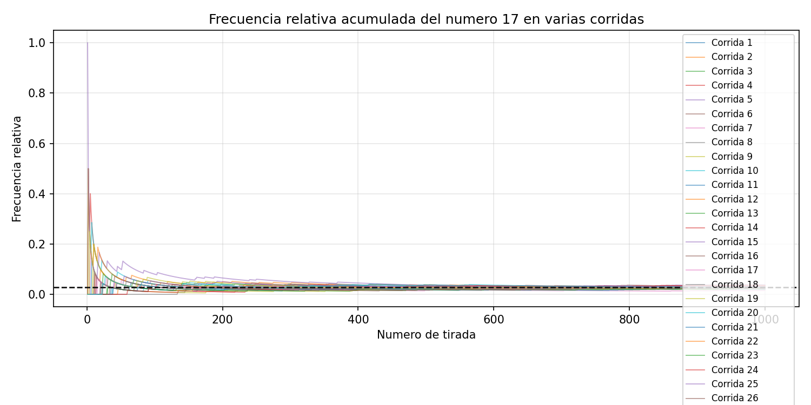
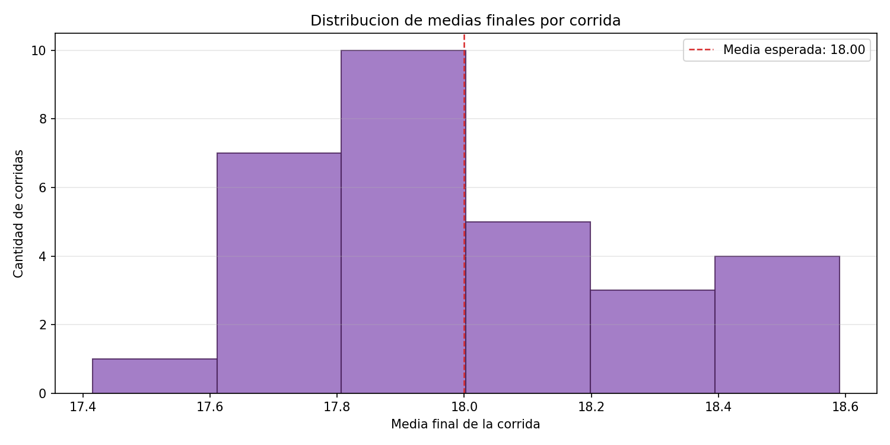
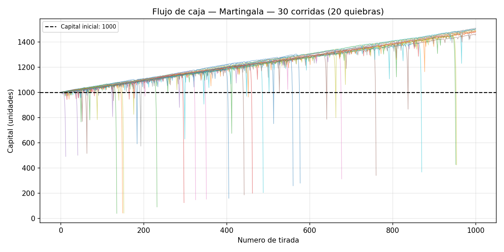
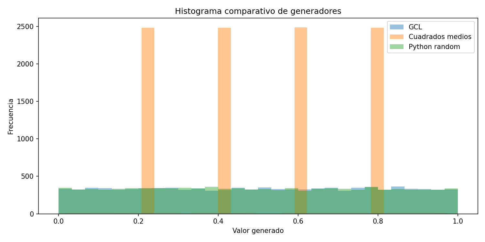
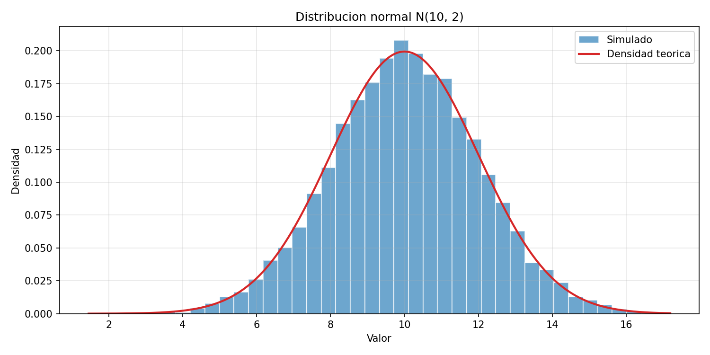
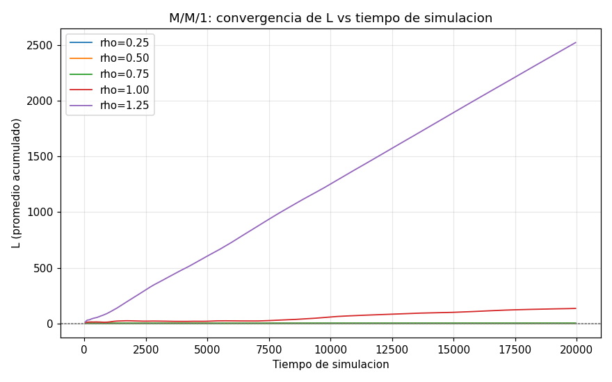
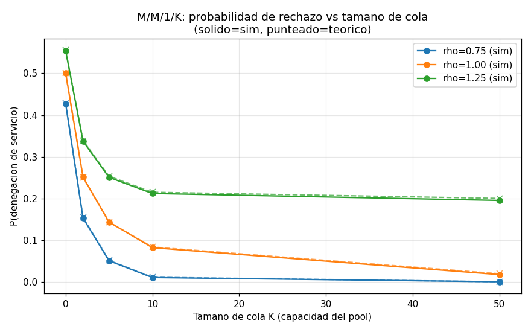
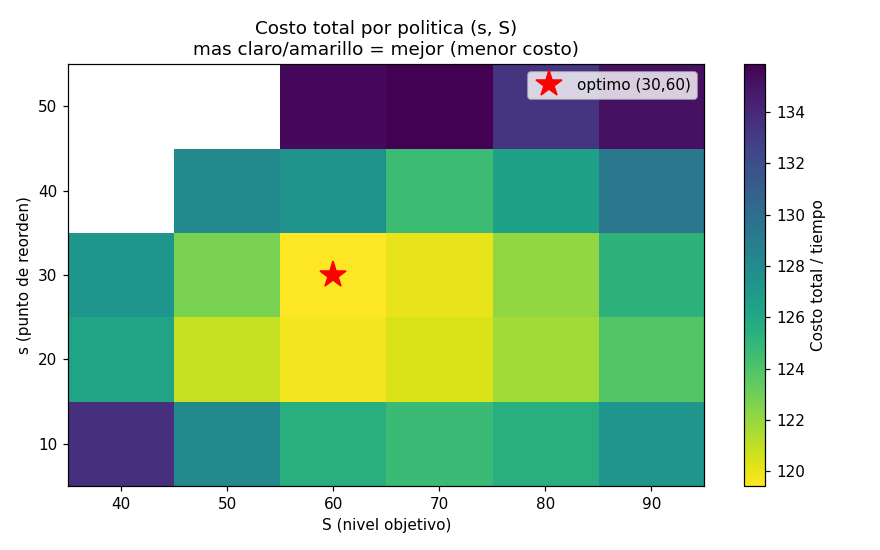
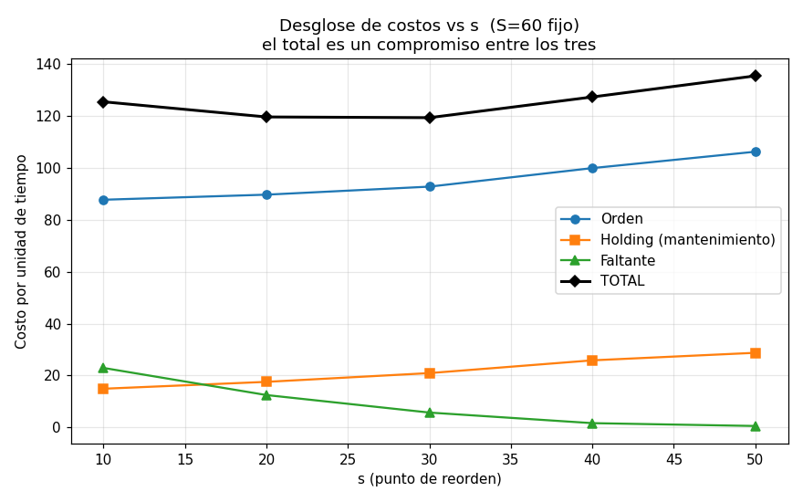

# TPs de Simulación — repaso para la exposición

**SIM · UTN FRRO · 2026 · TP 1.1, 1.2, 2.1, 2.2 y 3 (el TPI va aparte)**

**Grupo:** Brizio, Casermeiro, De la Rosa y Messina. En el TP 3 ya no está De la Rosa.

Cada TP arranca con un resumen **en criollo** (el recuadro) y lo que pedía la consigna. Después vienen el detalle de lo que se hizo, los números que hay que tener en la cabeza y qué gráfica mostrar. Al final de cada TP están los errores del informe y lo que la consigna pedía y el informe no muestra: conviene conocerlos antes de que los marquen. Cierran el documento las preguntas probables y los comandos para correr los programas en vivo.

Todo sale de los informes entregados (`entregables/TP1.1` … `entregables/TP3`) y de las consignas de la cátedra (`fuentes/tps-2026/`). Lo marcado *(conocimiento general)* no está en esos documentos: es contexto agregado para poder defenderlos.

## 0. El hilo que une los cinco TPs

Contados juntos, los cinco TPs son una sola historia. Primero se **simula el azar** con una ruleta. Después se **apuesta** sobre ella y se ve que la casa siempre gana. Después se aprende a **fabricar el azar** (generadores de U(0,1)) y a **darle forma** (distribuciones). Al final se usa todo eso para mover un **modelo de eventos discretos** (colas e inventario), que se valida contra la teoría.

| TP | Tema | Herramienta | Qué demuestra | Informe |
|---|---|---|---|---|
| 1.1 | Ruleta europea | Python + Matplotlib | Ley de los grandes números y teorema central del límite | 11/05 |
| 1.2 | Estrategias de apuesta | Python (+ web en Flask) | Ninguna estrategia cambia el valor esperado negativo (−1/37) | 21/05 |
| 2.1 | Generadores pseudoaleatorios | Python | Cómo se fabrica U(0,1) y cómo se valida (6 tests) | 04/06 |
| 2.2 | Variables aleatorias | Python | Cómo pasar de U(0,1) a 9 distribuciones distintas | 04/06 |
| 3 | M/M/1, M/M/1/K e inventario (s, S) | Python + AnyLogic | Eventos discretos validados contra teoría y entre herramientas | 10/07 |

Los cinco usan el mismo patrón: **simulado contra teórico, con varias corridas independientes**. Son 30 corridas en los 1.x, 10 000 valores por generador en los 2.x y al menos 10 réplicas con IC95 en el 3.

## 1. TP 1.1 — Simulación de una ruleta

> **En criollo.** Hicimos una ruleta en Python que tira números del 0 al 36 y fuimos mirando cómo se comportan las cuentas tirada a tirada. Al principio es un caos: el 17 sale dos veces seguidas o no sale nunca. Con mil tiradas todo se acomoda a lo que dice la teoría: cada número sale 1 de cada 37 veces y el promedio da 18. Y si repetís el experimento 30 veces, los 30 promedios quedan amontonados alrededor de 18, en forma de campana. Es la ley de los grandes números y el teorema central del límite, vistos con los ojos.

**Qué pedía la consigna.**

- Un programa en Python que se corra como `python programa.py -c XXX -n YYY -e ZZ` (corridas, tiradas y número elegido), usando listas, `for` y Matplotlib.
- Cuatro gráficas mínimas para una corrida, cada una contra su valor esperado: frecuencia relativa del número, promedio, **desvío** y varianza.
- Después, varias corridas (con la cantidad justificada) en gráficas simultáneas, con un mínimo de 8 gráficas en total.
- Justificar cada cosa con la teoría (TCL, estadísticos) y entregar un informe en LaTeX con formato de paper (plantilla arXiv).

**Qué se hizo.** Una ruleta europea tiene 37 casilleros (del 0 al 36). Cada tirada es una uniforme discreta, generada con `random.randint(0, 36)`. El programa recibe por consola las corridas (`-c`), las tiradas (`-n`) y el número a estudiar (`-e`); se corrió con c = 30, n = 1000 y e = 17. Calcula tirada a tirada, en forma acumulada, la frecuencia absoluta y relativa del número elegido, la media, la varianza (estimador poblacional, divisor i) y el desvío. No usa NumPy: son bucles explícitos.

| Estadístico | Valor teórico (la línea roja de las gráficas) |
|---|---|
| P(X = e) | 1/37 ≈ 0,027 |
| Media μ | 18 |
| Varianza σ² | (37² − 1)/12 ≈ 114,33 |
| Desvío σ | ≈ 10,69 |
| Error estándar de la media (n = 1000) | σ/√n ≈ 0,338 |

**Resultados clave.**

- **Dentro de cada corrida se ve la ley de los grandes números.** Los estadísticos arrancan muy volátiles: la frecuencia relativa llega a 0,14, la media arranca en ≈ 31 y la varianza pica en ≈ 190. Se estabilizan cerca del valor teórico a partir de las 300 o 400 tiradas.
- **Entre corridas se ve el teorema central del límite.** Las 30 medias finales caen en (17,4; 18,6), dentro del μ ± 2σ/√n = 18 ± 0,676 que predice el TCL, y el histograma tiene forma de campana.
- Sobre las 30 000 tiradas, los 37 números quedan entre 0,025 y 0,029: el generador de Python se comporta como uniforme.

**Qué mostrar:** el embudo de las 30 corridas, que arrancan muy dispersas y terminan todas pegadas a 1/37, y el histograma de las medias finales. Con esas dos gráficas se cuentan la ley de los grandes números y el TCL.

**Ojo:** el informe se contradice en el orden de convergencia. Dice que primero converge la media (n ≈ 200), después la frecuencia relativa (n ≈ 400) y "finalmente" la varianza, pero a la varianza le asigna n ≈ 300. En error relativo, el orden real es media → varianza → frecuencia relativa. Con n = 1000, la media tiene un error relativo de ≈ 1,9 %, la varianza de ≈ 2,8 % y la frecuencia de un número puntual de ≈ 19 %, porque p = 1/37 es muy chica *(conocimiento general)*.

**Ojo (consigna):** la consigna pide la gráfica del **desvío** contra n, y el informe no la tiene. Tiene las de frecuencia absoluta, frecuencia relativa, media y varianza. La fórmula del desvío sí está (σ ≈ 10,69). Si lo marcan: el desvío es la raíz de la varianza, así que converge igual que ella, a 10,69. El mínimo de 8 gráficas se cumple (hay 9).

## 2. TP 1.2 — Estrategias de apuesta

> **En criollo.** Agarramos la ruleta del 1.1 y nos pusimos a apostar con las "estrategias para ganarle al casino" que andan por internet: Martingala (duplicar cuando perdés), D'Alembert (subir de a uno), Fibonacci (seguir la sucesión) y la de Winograd, el argentino que hizo saltar la banca en Mar del Plata. Conclusión: ninguna le gana a la casa. Por culpa del cero, cada peso apostado pierde en promedio 2,7 centavos, y eso no lo cambia ninguna estrategia: solo cambia cuándo y cómo perdés. Con plata limitada, la Martingala te funde en 2 de cada 3 sesiones; la más "segura" fue Fibonacci.

**Qué pedía la consigna.**

- Simular las apuestas monitoreando el flujo de caja y explicar los pagos según lo que se apuesta (color, fila, número).
- Analizar Martingala, D'Alembert, Fibonacci y una estrategia elegida por el grupo, con las fuentes de cada una.
- Cada estrategia con capital infinito y con capital acotado; en el acotado, contar las bancarrotas.
- Dos parámetros nuevos: `-s` (m, d, f, **o** = otra) y `-a` (i, f).
- Gráficas mínimas: barras con la **frecuencia relativa de obtener la apuesta favorable** según n, y el flujo de caja contra el capital inicial. Después, varias corridas simultáneas, con al menos 3 gráficas por estrategia.

**Qué se hizo.** Se extendió el simulador del 1.1 para jugar cuatro estrategias, con capital infinito y con capital finito (C₀ = 1000, apuesta mínima 1). Se corrieron 30 corridas de 1000 tiradas con semilla 42.

- Martingala, D'Alembert y Fibonacci apuestan a chance simple: 18 números que pagan 1 a 1.
- Winograd pone una ficha a cada número del 22 al 36 en todas las tiradas.

Hay además una página web en Flask para correrlo desde el navegador.

**La idea central (lo que hay que decir sí o sí).** En chance simple, p(ganar) = 18/37 ≈ 0,4865 y p(perder) = 19/37 ≈ 0,5135. La ganancia esperada de una apuesta de a unidades es **E = a·18/37 − a·19/37 = −a/37 ≈ −0,027·a**. Cada apuesta pierde en promedio 1/37 de lo apostado, sea cual sea la estrategia. Las estrategias cambian **cuánto** y **cuándo** se apuesta, no el signo de la esperanza.

| Estrategia | Regla | Capital ∞ (media) | Capital finito (media) | Quiebras |
|---|---|---|---|---|
| Martingala | pierde → duplica; gana → vuelve a 1 | +472,07 | −342,60 | 20/30 (66,7 %) |
| D'Alembert | pierde → +1; gana → −1 | −737,87 | −501,53 | 17/30 (56,7 %) |
| Fibonacci | pierde → avanza 1 en la sucesión; gana → retrocede 2 | +167,57 | −17,00 | 5/30 (16,7 %) |
| Winograd | una ficha del 22 al 36 (15 por tirada) | −416,40 | −415,00 | 10/30 (33,3 %) |

**Resultados clave.**

- **Con capital finito, las quiebras siguen a la agresividad de la progresión.** De más a menos: Martingala (crece exponencial), D'Alembert (lineal), Winograd (apuesta fija) y Fibonacci.
- **Martingala con C₀ = 1000 aguanta solo 9 pérdidas seguidas.** Esas nueve suman 1 + 2 + … + 256 = 511 y la décima apuesta (512) ya no entra. En 1000 tiradas, una racha así es esperable.
- **Winograd valida el modelo.** La teoría da E = 21·15/37 − 15·22/37 = −15/37 ≈ −0,405 por tirada, o sea −405,4 en 1000 tiradas. La simulación dio −416,4.

**Qué mostrar:** la gráfica de Martingala con capital finito y la tabla. La escalera sube +1 por ciclo y cae a pique cuando llega la racha larga: esa sola gráfica resume el TP.

**Ojo:** el +472 de Martingala con capital infinito **no** quiere decir que la estrategia gane en esperanza. Con n = 1000 la esperanza ya es negativa, porque cada apuesta pierde a/37 en promedio. Lo que pasa es que el resultado es muy asimétrico:

- casi todas las corridas ganan ≈ +1 por ciclo completado, unas +480 en 1000 tiradas;
- una fracción minúscula pierde montos astronómicos: una racha de 20 pérdidas cuesta ≈ 2²⁰ ≈ 1 millón.

En 30 corridas ese caso casi nunca aparece, y por eso la media muestral sale positiva. El informe lo atribuye al "horizonte finito"; la explicación precisa es la asimetría *(conocimiento general)*. Lo mismo vale para el +167 de Fibonacci.

**Ojo (consigna):** hay tres diferencias menores con lo que se pidió.

- **La gráfica de barras no es la del boceto.** La consigna dibuja la frecuencia relativa de obtener la apuesta favorable (cuántas veces se gana); el informe muestra la ganancia o pérdida en plata de cada tirada. La idea es parecida, pero no es lo mismo.
- **La estrategia propia se elige con `-s w`**, no con `-s o` como dice la consigna.
- **Los pagos según la selección** (color, docena, columna, pleno) no se presentan como tabla. Solo aparecen los dos que se usan: chance simple 1 a 1 y pleno 35 a 1.

Lo central sí está: las cuatro estrategias, los dos tipos de capital, las bancarrotas y las 3 gráficas por estrategia.

## 3. TP 2.1 — Generadores pseudoaleatorios

> **En criollo.** La compu no puede tirar dados: los números "al azar" salen de una fórmula que, arrancando de una semilla, siempre da la misma secuencia. Programamos dos de esas fórmulas (el GCL y los cuadrados medios de von Neumann), las comparamos con la de Python y las pasamos por seis pruebas para ver si los números parecen azar de verdad. El GCL y el de Python aprueban todo. Cuadrados medios, al rato de arrancar, se queda trabado repitiendo los mismos cuatro números, y las pruebas lo agarran.

**Qué pedía la consigna.** Investigar generadores reales y pseudoaleatorios, y los tests para evaluarlos. Programar al menos dos generadores, entre ellos un GCL, y testear el GCL con al menos cuatro pruebas. Compararlos con otros, incluido el de Python, idealmente en una tabla de resultados.

**Qué se hizo.** Se programaron dos generadores y se compararon con el de Python, generando n = 10 000 valores con semilla fija:

- **GCL** (congruencial lineal mixto): Xᵢ₊₁ = (a·Xᵢ + c) mod m y Uᵢ = Xᵢ/m, con a = 1 103 515 245, c = 12 345, m = 2³¹ y X₀ = 5731.
- **Cuadrados medios** (von Neumann): se eleva al cuadrado y se toman los 4 dígitos centrales, con X₀ = 5731.
- **Python** `random.random()` (Mersenne Twister), como referencia.

Se aplicaron seis tests con α = 0,05: media, varianza, χ² con 10 intervalos (crítico 16,919), Kolmogorov-Smirnov (crítico 1,36/√n = 0,0136), corridas arriba y abajo de 0,5, y autocorrelación de lag 1.

| Test (criterio) | GCL | Cuadrados medios | Python |
|---|---|---|---|
| Media (Z < 1,96) | 0,044 ✓ | 3,32 ✗ | 0,886 ✓ |
| Varianza (Z < 1,96) | 0,017 ✓ | 27,99 ✗ | 0,240 ✓ |
| χ² (< 16,919) | 3,15 ✓ | 14 795,75 ✗ | 4,70 ✓ |
| KS (< 0,0136) | 0,0049 ✓ | 0,2078 ✗ | 0,0090 ✓ |
| Corridas (Z < 1,96) | 0,997 ✓ | 0,060 ✓ | 0,434 ✓ |
| Autocorrelación (Z < 1,96) | 1,259 ✓ | 0,182 ✓ | 0,121 ✓ |

**Resultado:** el GCL y Python pasan los seis tests. Cuadrados medios falla los cuatro que miran la distribución.

**Qué mostrar:** el histograma. Las cuatro barras naranjas son el TP.

**Lo que el informe no dice y conviene saber (verificado corriendo el código).** Con semilla 5731, cuadrados medios cae en el paso 71 en el ciclo **6100 → 2100 → 4100 → 8100 → 6100** y no sale más. De los 10 000 valores, solo 75 son distintos; el resto repite 0,61 / 0,21 / 0,41 / 0,81. Eso explica toda la tabla:

- **χ² y KS enormes:** el 99 % de los valores cae en 4 de los 10 intervalos.
- **Media rechazada:** el ciclo promedia 0,51 en vez de 0,50.
- **Por qué pasa corridas y autocorrelación.** El ciclo queda arriba, abajo, abajo, arriba de 0,5: corridas de largo 2, que es justo lo que se espera de una secuencia aleatoria. Y la autocorrelación de lag 1 del ciclo da exactamente 0. Cada test mira una sola propiedad, y por eso se aplica una batería y no un test suelto.

**Por qué el GCL anda** *(conocimiento general; el teorema está en la Unidad 7.4 de la wiki)*: con m = 2³¹, c impar y a − 1 múltiplo de 4 se cumple el teorema del GCL mixto, así que el período es completo (2³¹). Son los parámetros del `rand()` de ANSI C. Su debilidad conocida es que los bits bajos tienen período corto y que, en varias dimensiones, los puntos caen sobre hiperplanos.

**Consigna:** cumplida de punta a punta, y con más de lo pedido: tres generadores y seis tests donde se pedían dos y cuatro.

## 4. TP 2.2 — Variables aleatorias de 9 distribuciones

> **En criollo.** El generador te da números entre 0 y 1, todos con la misma chance. Pero para simular necesitás otras formas de azar: tiempos entre llegadas (exponencial), medidas que se amontonan en el medio (normal), cuántos clientes llegan en una hora (Poisson). Este TP es el recetario para transformar esos uniformes en nueve distribuciones distintas, siguiendo el libro de Naylor, y comprobar que lo que sale tiene la media, la varianza y la forma que tiene que tener. Las nueve dieron bien.

**Qué pedía la consigna.**

- Para cada distribución: la teoría (parámetros, función de probabilidad, gráficas), el paso a paso de la acumulada y su inversa, un programa en Python y un test.
- El código tenía que ir dentro del informe.
- Una tabla guía de la cátedra marcaba qué hacer con cada una: transformada inversa para las 9, **método de rechazo para la uniforme, la exponencial y la normal**, y test al menos para uniforme, exponencial, normal, binomial, Poisson y empírica.

**Qué se hizo.** A partir de U(0,1) (`random.random()`, semilla 42) se generaron 10 000 valores de nueve distribuciones. Cada una se validó contra la teoría con la media, la varianza y una prueba de ajuste: Kolmogorov-Smirnov para las continuas y χ² para las discretas.

| Distribución (parámetros) | Método | Media obs / teo | Var obs / teo | Ajuste |
|---|---|---|---|---|
| Uniforme (a = 2, b = 8) | Inversa: X = a + (b − a)·U | 5,002 / 5 | 2,98 / 3 | KS 0,006 ✓ |
| Exponencial (λ = 1,5) | Inversa: X = −ln(1 − U)/λ | 0,670 / 0,667 | 0,435 / 0,444 | KS 0,010 ✓ |
| Gamma/Erlang (k = 3, λ = 1,2) | Suma de k exponenciales | 2,488 / 2,5 | 2,061 / 2,083 | KS 0,010 ✓ |
| Normal (μ = 10, σ = 2) | Box-Muller | 10,028 / 10 | 3,996 / 4 | KS 0,010 ✓ |
| Pascal (r = 4, p = 0,35) | Bernoulli hasta r éxitos, cuenta fallas | 7,423 / 7,429 | 20,91 / 21,22 | χ² 31,2 < 40,1 ✓ |
| Binomial (m = 12, p = 0,4) | Cuenta éxitos en m Bernoulli | 4,772 / 4,8 | 2,839 / 2,88 | χ² 8,8 < 18,3 ✓ |
| Hipergeométrica (N = 50, K = 18, n = 10) | Extracción sin reemplazo | 3,604 / 3,6 | 1,902 / 1,881 | χ² 4,7 < 15,5 ✓ |
| Poisson (λ = 4) | Multiplicativo: producto de U hasta < e^(−λ) | 4,005 / 4 | 3,976 / 4 | χ² 13,1 < 21,0 ✓ |
| Empírica (1…5 con 0,10/0,20/0,35/0,25/0,10) | Inversa discreta con acumuladas | 3,056 / 3,05 | 1,245 / 1,248 | χ² 2,6 < 9,5 ✓ |

**Resultado:** las nueve pasan. Las medias quedan a menos del 1 % de la teórica y las varianzas a menos del 2,5 %; la mayor diferencia es la de la exponencial.

**Qué mostrar:** una continua (la normal por Box-Muller) y el método de cada distribución. La idea fuerte es que **no hay un único método**; cada distribución pide el suyo:

- **Inversa:** cuando F tiene inversa cerrada (uniforme, exponencial, empírica).
- **Suma de exponenciales:** para la gamma con k entero (Erlang), porque su F no se invierte en forma cerrada.
- **Box-Muller:** para la normal, porque Φ no tiene inversa elemental. Dos uniformes dan dos normales independientes.
- **Simular el experimento:** para Pascal, binomial e hipergeométrica, con ensayos de Bernoulli con o sin reemplazo.
- **Método multiplicativo:** para Poisson. Cuenta cuántos arribos de un proceso de Poisson caen en un intervalo de largo 1; multiplicar uniformes equivale a sumar −ln U, que son tiempos exponenciales.

Esto es la Unidad 7.6–7.7 de la wiki (Naylor cap. 4).

**Ojo (consigna):** la tabla guía pedía el **método de rechazo** para la uniforme, la exponencial y la normal. El informe lo explica en general (sección 2.1), pero no lo aplica a ninguna de las tres. Es la diferencia más visible con la consigna. Si preguntan:

- Se priorizaron los métodos directos, que son más simples y no descartan números.
- Cómo sería con rechazo para una densidad acotada en (a, b): se sortea x = a + (b − a)·U₁ y se acepta si U₂ ≤ f(x)/máx f; si no, se repite. Para la exponencial y la normal hay que truncar el soporte, porque no es acotado. Es la Unidad 7.6 B de la wiki.

Lo demás se cumplió, y con más de lo pedido: se testearon las nueve y el código de las nueve está en el informe.

**Ojo:** la fuente uniforme es `random.random()` y no el GCL del TP 2.1. Es defendible, porque el 2.1 mostró que los dos pasan los tests, pero conviene tener la respuesta pensada.

## 5. TP 3 — M/M/1, M/M/1/K e inventario (s, S)

> **En criollo.** Juntamos todo en dos modelos clásicos y los programamos dos veces, en Python y en AnyLogic.
>
> El primero es una cola con un solo cajero (M/M/1): cuánta gente hay, cuánto espera y qué tan ocupado está el cajero, comparado con las fórmulas. Mientras lleguen menos de los que se atienden, la simulación clava la teoría. Si llegan igual o más, la cola crece sin parar. Con sala de espera limitada, a algunos los rebotan; y si llegan más de los que se atienden, agrandar la sala no sirve: igual rebotás el 20 %.
>
> El segundo es un depósito con política (s, S): cuando el stock baja de s, se pide lo que falta para llegar a S. Probamos 27 combinaciones y la más barata fue pedir cuando quedan 30 o menos, hasta completar 60. Python y AnyLogic dan lo mismo.

**Qué pedía la consigna.**

- **M/M/1:** L, Lq, W, Wq, utilización, probabilidad de n clientes **en cola** y probabilidad de denegación con cola de 0, 2, 5, 10 y 50. Todo como valor final **y en función del tiempo de simulación**.
- **Tasas de arribo:** al menos 25, 50, 75, 100 y 125 % de la de servicio.
- **Inventario:** costos de orden, mantenimiento, faltante y total, finales y en función del tiempo. Parámetros libres pero justificados.
- **En los dos modelos:** al menos 10 corridas por experimento, marco teórico con fórmulas, comparación de tres fuentes (teoría, Python, AnyLogic) y parámetros fáciles de cambiar para mostrar en clase.
- La cátedra sugiere una calculadora M/M/1 online para chequear la teoría.

**Qué se hizo.** Dos simuladores de eventos discretos en Python, con avance al próximo evento, y los mismos modelos en AnyLogic (`TP_Colas.alp`). Se comparan tres fuentes: teoría, Python y AnyLogic.

- Cada experimento tiene al menos 10 réplicas y se reporta media ± IC95 (1,96·s/√n).
- Las métricas ponderadas en el tiempo se calculan como área bajo la curva sobre el tiempo simulado.
- Los parámetros entran por línea de comando para poder **cambiarlos en vivo en la defensa**.

### 5.1 M/M/1 (cola infinita)

μ = 1 fijo y λ = 0,25 / 0,50 / 0,75 / 1,00 / 1,25, de modo que ρ = λ/μ va del 25 % al 125 %. Diez corridas de 20 000 unidades de tiempo por punto.

Fórmulas: L = ρ/(1−ρ), Lq = ρ²/(1−ρ), W = 1/(μ−λ), Wq = ρ/(μ−λ), U = ρ, P(n) = (1−ρ)·ρⁿ. Se cumple la ley de Little: L = λW y Lq = λWq.

| ρ | L sim / teo | Lq sim / teo | W sim / teo | U sim / teo |
|---|---|---|---|---|
| 0,25 | 0,329 / 0,333 | 0,083 / 0,083 | 1,313 / 1,333 | 0,249 / 0,250 |
| 0,50 | 1,006 / 1,000 | 0,500 / 0,500 | 2,012 / 2,000 | 0,505 / 0,500 |
| 0,75 | 2,863 / 3,000 | 2,113 / 2,250 | 3,838 / 4,000 | 0,748 / 0,750 |
| 1,00 | 106,9 ± 40 / ∞ | — / ∞ | 106,9 / ∞ | ≈ 1 |
| 1,25 | 2486 ± 55 / ∞ | — / ∞ | 2000 / ∞ | ≈ 1 |

**Resultados clave.** Con ρ < 1, la simulación coincide con la teoría, y la distribución P(n) simulada reproduce la geométrica: el simulador captura la distribución completa, no solo los promedios. Con ρ ≥ 1 no hay estado estacionario: L no converge y crece con el tiempo simulado.

### 5.2 M/M/1/K (cola finita): probabilidad de denegación

La capacidad del sistema es C = K + 1. Las fórmulas son P₀ = (1−ρ)/(1−ρ^(C+1)), Pₙ = P₀·ρⁿ y P(denegación) = P_C. El sistema es estable siempre, incluso con ρ ≥ 1. Con K = 0 es un sistema de pérdida pura: Pb = ρ/(1+ρ).

| K | ρ = 0,75 (Py / teo / AL) | ρ = 1,00 (Py / teo / AL) | ρ = 1,25 (Py / teo / AL) |
|---|---|---|---|
| 0 | 0,426 / 0,429 / 0,431 | 0,499 / 0,500 / 0,494 | 0,557 / 0,556 / 0,560 |
| 2 | 0,152 / 0,154 / 0,151 | 0,250 / 0,250 / 0,244 | 0,338 / 0,339 / 0,338 |
| 5 | 0,050 / 0,051 / 0,053 | 0,140 / 0,143 / 0,143 | 0,251 / 0,253 / 0,246 |
| 10 | 0,011 / 0,011 / 0,010 | 0,081 / 0,083 / 0,080 | 0,213 / 0,215 / 0,221 |
| 50 | 0,000 / 0,000 / 0,000 | 0,017 / 0,019 / 0,021 | 0,195 / 0,200 / 0,191 |

**El hallazgo del TP.** Con ρ < 1, agrandar la cola elimina el rechazo. Con ρ > 1 no: Pb tiende a 1 − 1/ρ (0,20 para ρ = 1,25) por más grande que sea K. El problema es de capacidad de servicio, no de tamaño de cola.

### 5.3 Inventario (s, S) con revisión periódica

Se usan los parámetros de Law & Kelton:

- **Demanda:** Poisson de tasa 10 por unidad de tiempo, con tamaño {1, 2, 3, 4} y probabilidades {1/6, 1/3, 1/3, 1/6} (media 2,5).
- **Costos:** orden 32 fijo + 3 por unidad; mantenimiento h = 1 y faltante p = 5, ambos por unidad y por unidad de tiempo.
- **Lag de entrega:** Uniforme(0,5; 1).
- **Faltantes:** quedan como backorder (inventario negativo).
- **Grilla:** s ∈ {10…50} × S ∈ {40…90}, con 10 réplicas por política.

Los costos se calculan por unidad de tiempo: orden = Σ(K + c·Q)/T, mantenimiento = h·∫max(I, 0)/T y faltante = p·∫max(−I, 0)/T.

**Resultado:** la política óptima es **(s = 30, S = 60)**, con un costo total de ≈ 119,4. No hay fórmula cerrada para el óptimo, así que acá la comparación es Python contra AnyLogic.

| Costo con (30, 60) | Python | AnyLogic |
|---|---|---|
| Orden | 92,8 | 93,0 |
| Mantenimiento | 20,9 | 20,9 |
| Faltante | 5,7 | 5,4 |
| **Total** | **119,4** | **119,3** |

**Qué mostrar:** el mapa de calor, que muestra dónde está el óptimo, y el desglose, que explica por qué está ahí. Subir s baja el faltante pero sube el mantenimiento y la orden.

### 5.4 Las tres fuentes juntas (ρ = 0,75)

| Métrica | Teórico | Python | AnyLogic |
|---|---|---|---|
| L | 3,000 | 2,863 | 3,104 |
| Lq | 2,250 | 2,113 | 2,347 |
| W | 4,000 | 3,838 | 4,068 |
| U | 0,750 | 0,748 | 0,757 |
| Pb (K = 5) | 0,051 | 0,050 | 0,053 |

**Ojo:** las conclusiones del informe dicen "error inferior al 5 % en todas las métricas", pero Lq con ρ = 0,75 da 2,113 contra 2,250: un **6,1 %** (L da 4,6 % y W 4,1 %). Si lo marcan: con ρ = 0,75 los valores consecutivos están muy correlacionados, y 10 corridas de 20 000 quedan justas; con más corridas o más horizonte la diferencia se cierra. Una corrida suelta de 20 000 con semilla 1 da L = 3,003.

**Ojo (consigna):** de lo que pide la consigna del M/M/1, tres cosas no aparecen como tales en el informe.

- **Wq (tiempo promedio en cola) no está en las tablas de resultados.** La fórmula está, pero las tablas traen L, Lq, W y U. Si lo piden, sale por Little: Wq = Lq/λ. Con ρ = 0,75 da 2,113/0,75 = 2,82 en Python y 2,347/0,75 = 3,13 en AnyLogic, contra 3,00 teórico. Con ρ = 0,25 y 0,50 da 0,33 y 1,00, igual que la teoría.
- **La probabilidad de n clientes "en cola".** El informe grafica P(N = n) en el **sistema** y da la fórmula para la cola, P(Nq = 0) = P₀ + P₁ y P(Nq = n) = (1 − ρ)·ρⁿ⁺¹, pero no la grafica. Si preguntan: es la misma distribución corrida un lugar, porque con el servidor ocupado los que esperan son N − 1.
- **"En función del tiempo de simulación".** Solo hay gráfica de convergencia para L y para el costo total del inventario, no para cada medida. Las demás se comportan igual. Para mostrarlo en vivo alcanza con correr `experimentos_mm1.py`.

Lo demás se cumplió: las cinco tasas de arribo, los cinco tamaños de cola, al menos 10 corridas, el marco teórico, los parámetros justificados del inventario, las tres fuentes y los parámetros por línea de comando.

## 6. Correr en vivo

Esta compu tiene Python 3.12 con numpy, matplotlib y Flask. Los comandos se corren desde la carpeta de cada TP, en el repo (`D:\Utn\4° Año\Simulacion\simulacion-UTN-2026\TP*`) o en `entregables/TP*/` del brain.

| TP | Comando | Ojo |
|---|---|---|
| 1.1 | `python simulacion_ruleta.py -c 30 -n 1000 -e 17` | genera las 9 gráficas en `graficas/` |
| 1.2 | `python apuestas.py -c 30 -n 1000 -s m -a f --capital 1000 --semilla 42` | `--capital` por defecto es **100**: sin el flag los números no coinciden con el informe. `-s` m/d/f/w, `-a` i/f |
| 1.2 web | `python app.py` y abrir localhost:5000 | necesita `apuestas.py` y `templates/` al lado || 2.1 | `python tp2_1_simulacion.py` | imprime la tabla de los 6 tests |
| 2.2 | `python tp2_2_simulacion.py` | gráficas + `resultados_tp22.csv` |
| 3, una corrida | `python simulacion_mm1.py --lambda 0.75 --mu 1 --tiempo 20000` | `--cola 5` para M/M/1/K |
| 3, inventario | `python simulacion_inventario.py --s 30 --S 60 --tiempo 1200` | |
| 3, estudio completo | `python experimentos_mm1.py --corridas 10 --tiempo 20000` | tarda y regenera las gráficas |

El 1.2 importa la ruleta del 1.1, así que la carpeta `TP1.1` tiene que estar al lado de `TP1.2`. Así quedaron en el repo y en el brain.

Estas corridas están probadas en esta compu:

- **TP 1.2:** con los parámetros del informe reproduce los números exactos. Martingala con capital finito da −342,60 y 20 quiebras; Fibonacci da −17,00 y 5 quiebras.
- **TP 3, M/M/1:** una corrida con ρ = 0,75 da L = 3,003.
- **TP 3, M/M/1/K:** ρ = 1,25 con K = 5 da Pb = 0,257 (teórico 0,253).
- **TP 3, inventario:** la política (30, 60) da un total de 119,9 (informe: 119,4).

## 7. Preguntas probables

**1) ¿Por qué 30 corridas y no una sola muy larga?**

Una corrida larga muestra la convergencia (ley de los grandes números). Varias corridas independientes muestran la variabilidad entre réplicas y permiten armar un intervalo de confianza (TCL). El TP 3 sigue el mismo criterio, con al menos 10 réplicas e IC95.

**2) ¿Por qué Martingala "gana" con capital infinito?**

Porque la media de 30 corridas no ve la cola de la distribución. La esperanza es negativa (cada apuesta pierde a/37), pero la pérdida se concentra en rachas largas rarísimas y carísimas. Casi todas las corridas terminan en ≈ +480, una de cada muchas pierde millones, y con 30 corridas esa casi nunca sale.

**3) ¿Por qué D'Alembert pierde más con capital infinito que con finito?**

Con capital finito la corrida se corta al quebrar, así que la pérdida queda acotada por los 1000 iniciales. Con capital infinito sigue apostando montos crecientes y la pérdida no tiene techo.

**4) Si cuadrados medios pasa corridas y autocorrelación, ¿por qué se descarta?**

Porque cae en un ciclo de 4 valores (6100 → 2100 → 4100 → 8100) en el paso 71. Esos dos tests miran el orden de los valores y el ciclo, por casualidad, alterna bien alrededor de 0,5. Pero la distribución está destruida: solo 75 valores distintos en 10 000.

**5) ¿Qué hace que el GCL tenga período completo?**

El teorema del GCL mixto (Unidad 7.4 de la wiki): c y m coprimos, a − 1 divisible por todos los primos de m y por 4 si 4 divide a m. Con m = 2³¹, c impar y a − 1 múltiplo de 4, el período es 2³¹.

**6) ¿Por qué Box-Muller y no la transformada inversa para la normal?**

Porque la acumulada de la normal no tiene inversa elemental. Box-Muller transforma dos uniformes en dos normales independientes con una fórmula cerrada: Z = √(−2·ln U₁)·cos(2π·U₂).

**7) ¿Por qué KS para las continuas y χ² para las discretas?**

KS compara acumuladas y supone F continua. χ² trabaja por categorías, que es lo natural para una variable discreta. Para χ² se agrupan las categorías con frecuencia esperada menor a 5, y por eso cada distribución tiene sus propios grados de libertad (Pascal 27, Poisson 12, etc.).

**8) Si con ρ = 1 llegan tantos como se atienden, ¿por qué el sistema es inestable?**

Porque la variabilidad no se compensa. Cada rato en que el servidor queda ocioso es capacidad perdida para siempre, y la cola se comporta como un paseo al azar sin deriva que se aleja del cero. Los números del informe cierran con eso *(conocimiento general)*:

- con ρ = 1, L crece como √t, y el promedio esperado a T = 20 000 es ≈ 106 (dio 106,9);
- con ρ = 1,25, la cola crece a razón de λ − μ = 0,25 por unidad de tiempo, así que el promedio es ≈ 0,25·20 000/2 = 2500 (dio 2486).

**9) ¿Por qué con ρ = 1,25 el rechazo no baja del 20 % aunque K = 50?**

Con la cola llena, el servidor atiende a μ = 1 y llegan λ = 1,25. El excedente, (λ − μ)/λ = 1 − 1/ρ = 0,20, se rechaza sí o sí: agrandar la sala de espera solo demora el rechazo.

**10) ¿Usaron período de calentamiento (warm-up)?**

No en la versión entregada. El borrador del 8/7 descartaba 1000 unidades de tiempo; la versión final lo sacó y se apoya en un horizonte largo (20 000) frente a un transitorio corto, como muestra la gráfica de convergencia. Es la Unidad 9.7 de la wiki (condiciones iniciales).

**11) ¿Por qué el costo de orden es el más grande del inventario?**

Porque incluye la compra de la mercadería: 3 por unidad × 25 unidades demandadas por unidad de tiempo = 75, que no depende de la política. Lo que se juega la política es el costo fijo de pedir (≈ 18 con (30, 60), unos 0,57 pedidos por unidad de tiempo a 32 cada uno), el mantenimiento y el faltante *(conocimiento general, cuenta sobre los parámetros del informe)*.

**12) ¿(30, 60) es realmente mejor que (20, 60)?**

Están prácticamente empatadas: ≈ 119,4 contra ≈ 119,7 en el desglose, y AnyLogic dio 120,0 para (20, 60) en una prueba previa. Con 10 réplicas, la diferencia cae dentro del ruido. Para afirmarlo haría falta un intervalo de confianza de la diferencia (t apareado con números aleatorios comunes, Unidad 10 de la wiki). Lo honesto es decir: "(30, 60) fue la de menor costo medio de la grilla; el valle está en s = 20–30, S = 60–70".

**13) ¿Dónde está el tiempo promedio en cola (Wq)?**

No quedó en las tablas, pero sale de las que están. Por Little, Wq = Lq/λ: con ρ = 0,75 da 2,82 en Python y 3,13 en AnyLogic, contra 3,00 teórico. También se puede sacar como W − 1/μ, que da 2,84 en Python.
