# Simulación — Resumen para el Parcial 1

> **SIM · UTN-ISI · parcial integrado (teórico-práctico) · sábado 7/11/2026, 8:00 h**
>
> Este resumen junta todo lo que entra, en el orden en que conviene estudiarlo. Cada modelo viene con un dibujo que muestra cómo funciona. Al lado de cada tema dice de qué apunte sale. Las trampas típicas del multiple choice están marcadas con **Ojo**.
>
> Para practicar: `banco-preguntas.md`. Para el desarrollo largo de un tema: la wiki (`SIM.md`) y los resúmenes por tema (`resumen-colas.md`, `resumen-inventario.md`, `resumen-probabilidad.md`).

## 0. Qué entra y cómo se toma

### El alcance oficial

Guillermo Leale lo publicó en el Classroom el 31/10. El parcial es **integrado, teórico-práctico**.

| Apunte | Qué entra | Dónde está en este resumen |
|---|---|---|
| **Weitz** (apunte de cátedra) | Todo hasta antes del *Chapter 9: Output data analysis*. Es decir: Law cap. 1 (cola simple e inventario), el cap. 1 en castellano (elementos y 10 pasos) y el cap. 13 de colas completo | §1 a §7 |
| **Ross**, *Simulación* | Desde el principio hasta el **proceso de Poisson no homogéneo** (cap. 2) | §8 |
| **Naylor**, cap. 4 | Lo visto en la práctica (TP 2.2): métodos de generación y las 9 distribuciones | §9 |
| **AnyLogic in Three Days** | Los tres paradigmas y los modelos del libro | §10 |
| **The Art of Process-Centric Modeling** | Colas modeladas como procesos en AnyLogic | §10 |
| **Gordon** | Mencionado, pero **no está subido al Classroom**. Las únicas páginas que tenemos (320 a 332) son de análisis de resultados | §10 |
| **Referencias de los TP** | Ruleta (TCL y frecuencias), generadores, random.org, LaTeX | §9 y §10 |

**No entra**: el análisis de datos de salida (cap. 9 de Weitz) ni la comparación de sistemas (cap. 10). Se evalúan en la entrega final del TPI.

### Cómo se toma: lo que muestra el parcial 2025

El parcial 2025 tuvo tres partes:

- 15 preguntas de opción múltiple, con opciones de la A a la E.
- 17 de verdadero/falso o de selección múltiple.
- Un ejercicio numérico de inventario.

Como el parcial es teórico-práctico, también puede caer una **traza a mano de la cola simple**. La plantilla está en las diapositivas de clase (§4.5).

**Siete reglas para el multiple choice**, sacadas de los errores del 2025:

1. **"A y B son correctas" casi nunca es la respuesta.** En 2025 fue correcta en 3 de 15 preguntas. Antes de marcarla, comprobá que **B sea verdadera sola**.
2. **Las palabras absolutas** (*siempre, solo, totalmente, asegura, nunca*) suelen hacer falsa la frase.
3. **"Según el texto"** quiere decir que la opción correcta es la **definición textual** del libro.
4. **Un dato de entrada no es una medida de rendimiento**, y **un cambio de estado no es un evento**.
5. **En selección múltiple, marcar de menos también resta.** Evaluá cada opción por separado.
6. **Leé cada palabra.** En 2025 una pregunta cambiaba "cociente" por "suma" y con eso la frase pasaba a ser falsa.
7. **Cuidado con la doble negación.** "La POO **no** es imprescindible" es **verdadero**.

## 1. Qué es simular

*Fuentes: Law cap. 1 (Weitz), diapositivas de la clase 1 y AnyLogic in 3 Days.*

### 1.1 Las cuatro definiciones base

**Sistema.** Es una colección de **entidades** (personas, máquinas) que **actúan e interactúan** hacia el logro de algún **fin lógico**. El sistema no viene dado por la realidad: **lo define el objetivo del estudio**. Un mismo supermercado puede ser "la línea de cajas" o "la cadena de abastecimiento", según la pregunta que queramos responder.

**Estado del sistema.** Es el conjunto de variables necesarias para describir el sistema en un instante, **en relación con los objetivos** del estudio. Por ejemplo: cuántos clientes hay en la cola y si el cajero está libre.

**Modelo.** Es un conjunto de **supuestos**, expresados como relaciones matemáticas, lógicas y simbólicas, que representan el comportamiento del sistema. Siempre es una **abstracción**: incluye lo que creemos importante y deja afuera el resto. Por eso **siempre es menos complejo que el sistema real**.

**Simulación.** Es la imitación de la operación de un sistema real **a lo largo del tiempo**. Genera una **historia artificial** del sistema y la observa para **inferir** sus características. Técnicamente, usa la computadora para **evaluar numéricamente** un modelo y **estimar** las medidas que nos interesan.

> **Ojo:** las cuatro se confunden a propósito en el multiple choice. "Un conjunto de ecuaciones que describen un proceso" es un **modelo**. "Un programa que imita al sistema" es una **simulación**. La única que es **sistema** es "colección de entidades que interactúan hacia un fin lógico".

### 1.2 Formas de estudiar un sistema

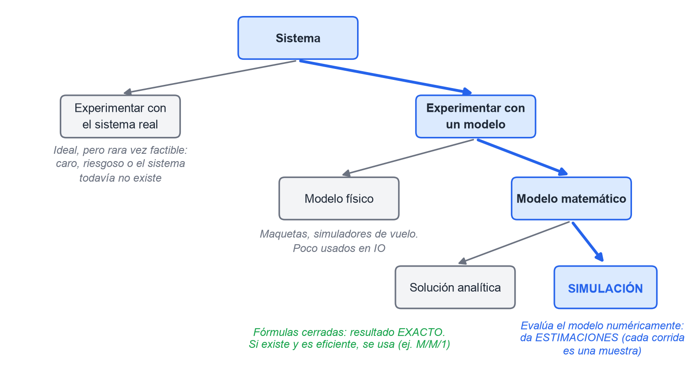
*Figura 1. El camino que lleva a simular. Cada bifurcación es una pregunta posible.*

El árbol responde tres preguntas, una por bifurcación:

1. **¿Sistema real o modelo?** Experimentar con el sistema real sería ideal, pero rara vez se puede: cuesta mucho, es riesgoso o el sistema todavía no existe. Por eso se construye un modelo.
2. **¿Modelo físico o matemático?** Los físicos (maquetas, simuladores de vuelo) se usan poco en investigación operativa. Los matemáticos representan el sistema con relaciones lógicas y cuantitativas.
3. **¿Solución analítica o simulación?** Si el modelo es simple, se resuelve con fórmulas y el resultado es **exacto**. Si es demasiado complejo, se simula, y el resultado es una **estimación**.

> **Ojo:** "la solución analítica es exacta" es **verdadero**. "La simulación reemplaza a la solución analítica" es **falso**: si existe una solución analítica eficiente, **se usa esa**. Las dos son **complementarias**. La simulación puede verificar los supuestos de un modelo analítico, y un modelo analítico puede sugerir alternativas que después se simulan.

### 1.3 Clasificación de los modelos de simulación

Hay tres ejes independientes. Un modelo puede ser, por ejemplo, dinámico, estocástico y discreto a la vez:

| Eje | Una punta | La otra punta |
|---|---|---|
| **Tiempo** | **Estático**: un instante, o el tiempo no importa (Montecarlo) | **Dinámico**: el sistema evoluciona en el tiempo |
| **Azar** | **Determinístico**: sin variables aleatorias; fijadas las entradas, la salida queda determinada | **Estocástico**: con variables aleatorias; **la salida es una estimación** y cambia entre corridas |
| **Cambio de estado** | **Continuo**: las variables cambian continuamente (fluidos, la posición de un avión) | **Discreto**: las variables cambian en instantes puntuales (colas) |

Los modelos de la materia (la cola y el inventario) son **dinámicos, estocásticos y discretos**.

> **Ojo:** un modelo discreto **no** tiene por qué representar un sistema discreto. Se elige uno u otro según los **objetivos** del estudio.

### 1.4 Cuándo conviene simular y cuándo no

| Conviene simular | No hace falta simular |
|---|---|
| La complejidad impide una solución analítica | Hay solución analítica disponible (por ejemplo M/M/1) |
| No se puede experimentar con el sistema real (costo, riesgo) | Otros enfoques de modelado alcanzan |
| Se necesita control experimental | El problema no tiene variabilidad significativa |
| El sistema todavía no existe (etapa de diseño) | |

**Ventajas**:

- Probar diseños, reglas y flujos nuevos sin comprometer recursos reales.
- Estimar el rendimiento bajo condiciones nuevas.
- Encontrar cuellos de botella.
- Responder preguntas del tipo "¿qué pasaría si…?" sin riesgo.
- Comunicar los resultados con animaciones.

AnyLogic in 3 Days agrega dos más: el modelo **refleja naturalmente la estructura del sistema**, y una vez elegido el nivel de abstracción **suele ser más fácil de construir que un modelo analítico**.

**Desventajas**:

1. **Cada corrida da solo una estimación, no un resultado exacto.** Por eso hacen falta varias corridas.
2. Desarrollar el modelo cuesta caro y lleva tiempo.
3. Se puede usar sin el rigor necesario y terminar confiando en un modelo que no es válido.
4. Requiere experiencia: es tanto un arte como una ciencia.

Además, para **optimizar** es mejor un buen modelo analítico.

**Riesgos que hacen fracasar un estudio** (Law):

- objetivos mal definidos;
- un nivel de detalle inadecuado;
- tratar el estudio como "solo programar";
- no recolectar buenos datos;
- usar distribuciones arbitrarias;
- no definir un período de calentamiento;
- **sacar conclusiones de una sola corrida**.

**Para simular hace falta información de la realidad, o al menos estimaciones.** En cambio, **no hace falta**:

- que el modelo esté "totalmente testeado";
- usar computadora para todo modelo (hay modelos físicos);
- la programación orientada a objetos.

## 2. Los elementos de la simulación

*Fuentes: el cap. 1 en castellano del apunte de Weitz y las diapositivas "Pasos de la simulación". Las definiciones van con la redacción del profe.*

| Elemento | Definición de la cátedra | Ejemplo en un banco |
|---|---|---|
| **Sistema** | Conjunto de elementos. **Define el alcance** | el banco |
| **Estado del sistema** | Condición del sistema en un momento determinado | 3 en cola, cajero ocupado |
| **Evento** | Cambio en el estado actual del sistema | llega un cliente |
| **Entidad** | Elemento **responsable de que cambie el estado** del sistema | el cliente |
| **Localizaciones** | Lugares donde las entidades pueden detenerse (son **estáticas**) | la fila, la sala de espera |
| **Recursos** | Dispositivos para llevar a cabo un evento (son **dinámicos**) | el cajero |
| **Atributo** | Característica de una entidad | el tipo de trámite del cliente |
| **Variables** | Condiciones cuyos valores se modifican | el tiempo entre llegadas |
| **Reloj de la simulación** | Registra el tiempo **simulado**, que no tiene relación con el tiempo de CPU | |

Las diapositivas de la clase 1 dan tres ejemplos:

| | Entidades | Recursos | Variable | Medida de rendimiento |
|---|---|---|---|---|
| Banco | clientes | cajeros | tiempo entre llegadas | tiempo de espera |
| Fábrica | productos | máquinas | tiempos de proceso | productividad |
| Red de computadoras | paquetes | routers | llegada de paquetes | latencia, *throughput* |

**Los tres tipos de variables**, en el vocabulario de la práctica:

| Tipo | Qué son | En la cola simple |
|---|---|---|
| **Exógenas** | Variables aleatorias que **entran** al modelo; hay que conocer su distribución | tiempo entre arribos, tiempo de servicio |
| **De estado** | Describen el sistema en cada instante | servidor libre u ocupado, nº en cola |
| **Endógenas** (de respuesta) | Las **medidas de rendimiento** que **salen** del modelo | $d(n)$, $q(n)$, $u(n)$ |

> **Ojo:** el profe define el evento como "**cambio** en el estado". Law es más preciso: un evento es una ocurrencia instantánea que **puede** cambiar el estado, y a veces solo sirve para **terminar** la simulación o para **programar decisiones**. Si la opción dice que "**siempre** cambia el estado", desconfiá.

## 3. Simulación a eventos discretos (DES)

*Fuentes: Law §1.3 (Weitz) y diapositivas de la clase 2.*

En una DES las variables de estado cambian **solo en un número contable de instantes**, y en cada uno de esos instantes ocurre un evento. Entre dos eventos no pasa nada: el estado se mantiene constante. Por eso **el reloj no necesita avanzar de a poco**: puede **saltar** de un evento al siguiente.

### 3.1 Dos formas de avanzar el reloj

| | **Próximo evento** (*next-event*) | **Incremento fijo** (*fixed-increment*) |
|---|---|---|
| Cómo avanza | **Salta** al instante del evento más próximo | Avanza de a $\Delta t$ y en cada paso revisa qué pasó |
| Períodos de inactividad | **Los salta**. Es la ventaja principal: ahorra cómputo | Los recorre igual |
| Error | Ninguno por discretizar | Los eventos se procesan **al final** del intervalo, lo que introduce error y obliga a desempatar |
| Uso | Casi todo el software comercial | Datos que existen solo por período (por ejemplo, anuales) |

> **Ojo:** la ventaja del *next-event* **no** es ser "más fácil de programar" ni "más preciso en los cálculos". Es **saltear la inactividad**.

### 3.2 El motor de cualquier simulador DES

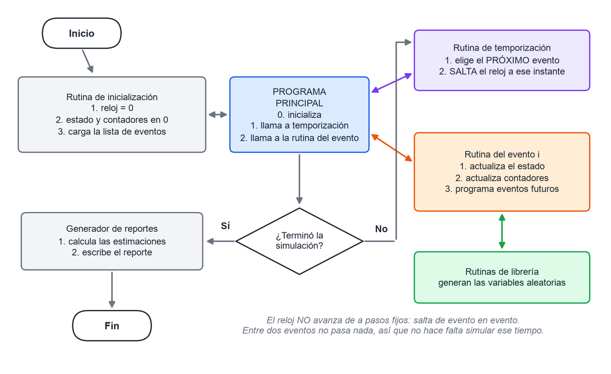
*Figura 2. El esqueleto de todo simulador de eventos discretos (Law, fig. 1.2, que también está en las diapositivas).*

Los componentes que se toman de memoria:

- **Estado del sistema.**
- **Reloj.**
- **Lista de eventos**: el próximo instante de cada tipo de evento.
- **Contadores estadísticos.**
- **Rutina de inicialización**: arranca todo en $t = 0$.
- **Rutina de temporización**: elige el próximo evento y salta el reloj.
- **Rutinas de evento**: una por tipo de evento.
- **Rutinas de librería**: generan las variables aleatorias.
- **Generador de reportes.**
- **Programa principal**: coordina el ciclo y revisa si hay que terminar.

## 4. Modelo de cola con un servidor

*Fuentes: Law §1.4 (Weitz), diapositivas "Cola simple e inventarios" y "Simulación de eventos discretos: traza paso a paso".*

### 4.1 El modelo

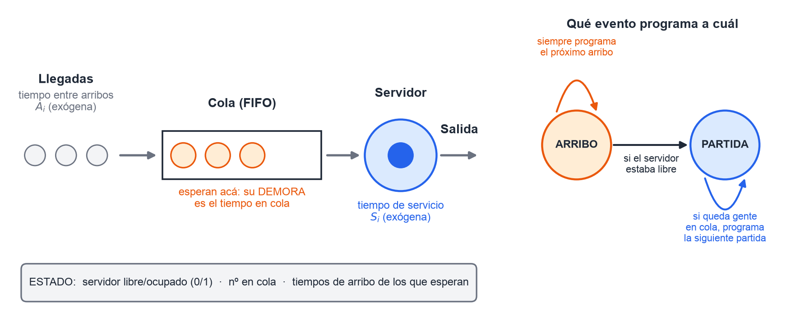
*Figura 3. A la izquierda, la cola. A la derecha, el diagrama de desencadenamiento de eventos.*

Los clientes llegan con tiempos entre arribos $A_1, A_2, \dots$ i.i.d. Si el servidor está libre los atiende enseguida; si no, hacen cola FIFO. Cada servicio dura $S_1, S_2, \dots$ i.i.d. La simulación **termina cuando $n$ clientes completaron su demora** en cola.

- **Variables de estado**:
  - el estado del servidor (libre u ocupado);
  - el número de clientes en cola;
  - el tiempo de arribo de cada cliente que espera, que hace falta para calcular su demora.
- **Eventos: solo dos**, el **arribo** y la **partida** (fin de servicio).
  - "Poner el servidor ocupado" **no es un evento**: es un **cambio de estado** que producen esos dos eventos.
  - "Inicio" tampoco es un evento: es la rutina de inicialización.

**Qué programa cada evento:**

- **Arribo**:
  - siempre programa el próximo arribo;
  - si el servidor estaba libre, además programa la partida de ese cliente.
- **Partida**:
  - si queda gente en cola, programa la partida del siguiente;
  - si no, deja el servidor libre.

### 4.2 Las tres medidas de rendimiento

| Medida | Qué mide | Fórmula | Promedia sobre |
|---|---|---|---|
| **$d(n)$** | demora promedio **en cola** | $\hat d(n) = \dfrac{\sum_{i=1}^{n} D_i}{n}$ | **clientes** |
| **$q(n)$** | número promedio de clientes **en cola** | $\hat q(n) = \dfrac{\int_0^{T(n)} Q(t)\,dt}{T(n)}$ | **tiempo** |
| **$u(n)$** | utilización del servidor | $\hat u(n) = \dfrac{\int_0^{T(n)} B(t)\,dt}{T(n)}$ | **tiempo** |

Las tres son medidas **muestrales**: una corrida es una muestra de tamaño $n$.

- **La demora es el tiempo en cola y no incluye el servicio.** Los $D_i = 0$ también se promedian.
- $q(n)$ es el **área bajo $Q(t)$** dividida por el tiempo total.
- $u(n)$ es la **proporción del tiempo** en que el servidor estuvo ocupado ($B(t) = 1$).

> **Ojo:** las tres medidas de Law son demora **en cola**, número **en cola** y utilización. "Tiempo promedio de servicio" es un **dato de entrada**, y "número en el **sistema**" es otra medida. Las dos son trampas del 2025.

### 4.3 La traza de Law, dibujada

Datos de la traza: $A = 0{,}4;\ 1{,}2;\ 0{,}5;\ 1{,}7;\ 0{,}2;\ 1{,}6;\ 0{,}2;\ 1{,}4$ y $S = 2{,}0;\ 0{,}7;\ 0{,}2;\ 1{,}1;\ 3{,}7;\ 0{,}6$, con $n = 6$.

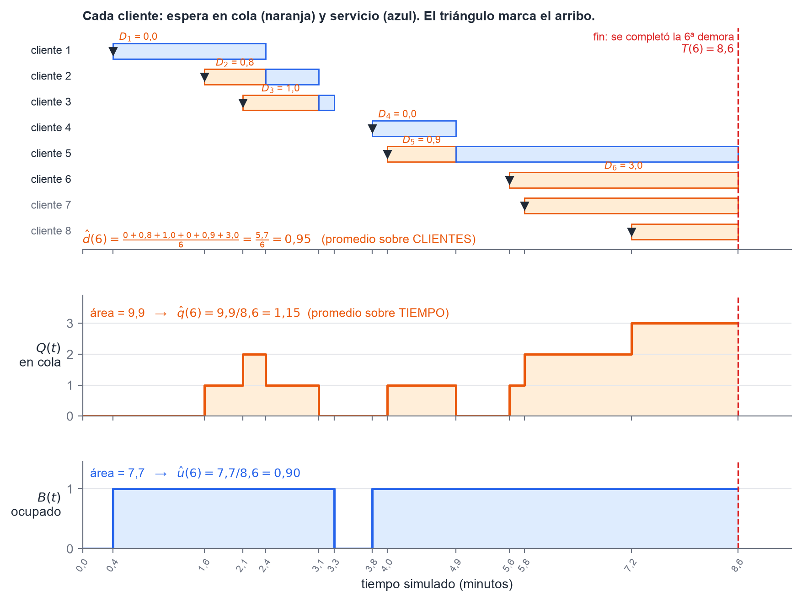
*Figura 4. Arriba, cada cliente: la parte naranja es su demora y la azul su servicio. En el medio, Q(t), cuya área da q(6). Abajo, B(t), cuya área da u(6).*

Cómo leer la figura:

- **$d(6)$ se lee arriba**: es el promedio de los seis tramos naranjas, $5{,}7/6 = 0{,}95$.
- **$q(6)$ se lee en el medio**: es el área naranja (9,9) dividida por la duración de la corrida (8,6), y da 1,15.
- **$u(6)$ se lee abajo**: el servidor estuvo ocupado 7,7 de los 8,6 minutos, o sea 0,90. Los únicos huecos son antes del primer arribo y entre 3,3 y 3,8.

La corrida termina en $T(6) = 8{,}6$, cuando el cliente 6 **empieza** su servicio: en ese momento se completa la sexta demora. **No** termina cuando sale el sexto cliente.

### 4.4 La salida de la simulación

Law simuló 1000 clientes con media entre arribos de 1 minuto y media de servicio de 0,5 minutos. Obtuvo:

- demora promedio en cola: 0,430 min;
- número promedio en cola: 0,418;
- utilización: 0,460;
- duración de la corrida: 1027,9 min.

Son **estimaciones de una sola corrida**: con otros números aleatorios saldrían otros valores.

### 4.5 La plantilla para la traza a mano

Las diapositivas de clase usan una plantilla con cinco bloques. Si toman una traza, es este formato:

| Bloque | Qué se anota |
|---|---|
| **Estado del sistema** | estado del servidor (1/0), cantidad en cola, tiempos de arribo de los que esperan |
| **Reloj** | el instante actual |
| **Lista de eventos** | próximo arribo (A) y próxima partida (D). Con el servidor libre, D vale $\infty$ |
| **Contadores estadísticos** | cantidad de demoras completadas, demora total, área bajo $Q(t)$, área bajo $B(t)$ |
| **Números generados** | las listas de $A_i$ y $S_i$ que se van consumiendo |

En cada evento se hacen siempre los mismos cuatro pasos:

1. Se **acumulan las áreas con el valor viejo**: `área += (reloj − tiempo del último evento) × valor anterior`.
2. Se actualiza el estado.
3. Se programan los eventos futuros.
4. Se salta al próximo evento.

## 5. Modelo de inventario (s, S)

*Fuentes: Law §1.5 completo (Weitz, hojas 23 a 28 del PDF) y diapositivas "Simulación – Inventarios". Es el tema del ejercicio numérico.*

### 5.1 El planteo

Una empresa vende **un solo producto** y quiere decidir cuántas unidades tener en stock durante los próximos $n$ meses.

- Las demandas llegan con **tiempos entre demandas exponenciales**. En Law la media es 0,1 mes.
- El **tamaño de cada demanda** $D$ es una variable discreta. En Law vale 1, 2, 3 o 4, con probabilidades 1/6, 1/3, 1/3 y 1/6, y se genera con la **distribución empírica** (§9.2).
- El inventario se **revisa al principio de cada mes**. Es una **revisión periódica**.
- El pedido no llega enseguida: tarda una **demora** $L$, que en Law es uniforme entre 0,5 y 1 mes.

**La política (s, S):** al revisar, se mira el nivel $I$ y se aplica

$$Z = \begin{cases} S - I & \text{si } I < s \\ 0 & \text{si } I \ge s \end{cases}$$

Es decir: si el inventario está por debajo de $s$, se pide **lo que falta para llegar a $S$**. Si no, no se pide nada.

> **Ojo:** la política **no** asegura que el inventario quede entre $s$ y $S$. Entre dos revisiones puede caer muy por debajo de $s$, e incluso **volverse negativo**. Tampoco se piden "$s$ unidades" ni "$S$ unidades": se pide $Z = S - I$.

### 5.2 El nivel de inventario y el backlog

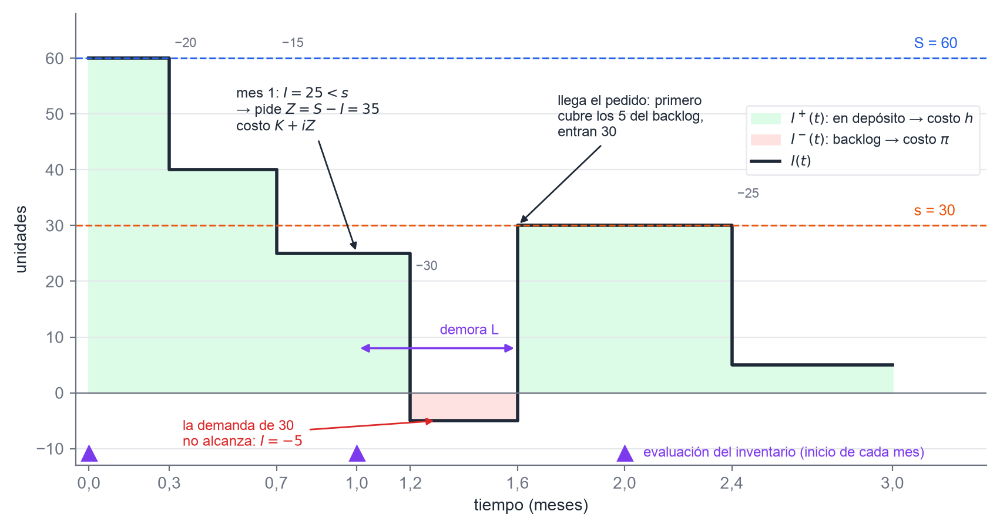
*Figura 5. Una realización con s = 30, S = 60 y I(0) = 60. En verde, lo que hay en depósito; en rojo, lo que se debe.*

Cuando una demanda supera el stock, **no se pierde**: queda **pendiente** (*backlog*) y el inventario se vuelve negativo. Cuando llega el pedido, **primero cubre el backlog** y el resto va al depósito. Por eso se usan tres niveles:

- $I(t)$ es el nivel neto, que puede ser negativo.
- $I^+(t) = \max\{I(t), 0\}$ es lo que hay **en depósito**.
- $I^-(t) = \max\{-I(t), 0\}$ es lo que **se debe**.

**Diferencia con Investigación Operativa.** En IO el control es **continuo**: se pide apenas el stock toca el punto de reorden. Acá el control es **periódico**: solo se mira al inicio de cada mes. Por eso puede aparecer backlog.

### 5.3 Los costos

| Costo | Cuánto vale | Se paga |
|---|---|---|
| **Pedido** | $K + iZ$: $K$ es el costo fijo de preparación (*setup*) e $i$ el costo **unitario** | solo si $Z > 0$. Si no se pide, no se paga ni siquiera $K$ |
| **Mantenimiento** (*holding*) | $h$ por unidad y por mes, aplicado a $\bar I^+ = \frac{1}{n}\int_0^n I^+(t)\,dt$ | por lo que hay **en depósito** |
| **Faltante** (*shortage*) | $\pi$ por unidad y por mes, aplicado a $\bar I^- = \frac{1}{n}\int_0^n I^-(t)\,dt$ | por lo que **se debe** |

$$\boxed{\ \text{costo total promedio mensual} = \frac{\sum (K + iZ)}{n} + h\,\bar I^+ + \pi\,\bar I^-\ }$$

En las diapositivas el profe lo escribe como $C = iZ + k + pI^- + hI^+$.

> **Ojo:** $h$ va con $I^+$ y $\pi$ va con $I^-$. En $K + iZ$, $i$ es el costo por unidad y $Z$ la cantidad pedida. Un parcial resuelto de 2021 los tiene invertidos.

### 5.4 Los cuatro eventos

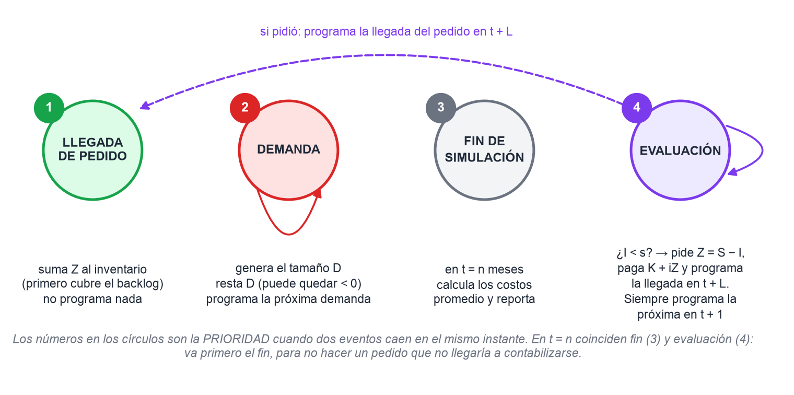
*Figura 6. Los cuatro eventos. El número es la prioridad cuando dos eventos caen en el mismo instante.*

| Prioridad | Evento | Qué hace |
|---|---|---|
| 1 | **Llegada de pedido** | suma $Z$ al inventario (si había backlog, lo cubre primero). No programa nada |
| 2 | **Demanda** | genera el tamaño $D$ y lo resta (puede quedar negativo). Programa la próxima demanda |
| 3 | **Fin de simulación** | en $t = n$ calcula los costos y reporta |
| 4 | **Evaluación** | si $I < s$, pide $Z = S - I$, paga $K + iZ$ y programa la llegada en $t + L$. Siempre programa la próxima evaluación en $t + 1$ |

Además hay una rutina que **no es evento**: la que actualiza las áreas bajo $I^+$ e $I^-$. Se llama antes de cada evento y mira el signo de $I$ **en el intervalo anterior**:

- si fue negativo, suma al área de $I^-$;
- si fue positivo, suma al área de $I^+$;
- si fue cero, no suma nada.

### 5.5 La salida y la discusión de Law (§1.5.6)

Law simuló **9 políticas durante 120 meses**, con $I(0) = 60$, $K = 32$, $i = 3$, $h = 1$ y $\pi = 5$. Esta tabla está en las diapositivas del profe:

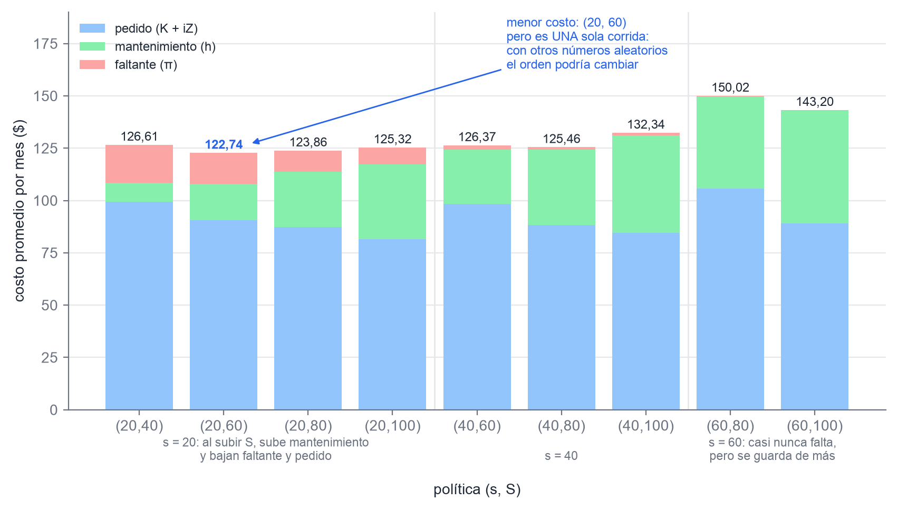
*Figura 7. Costo promedio por mes de cada política, separado en sus tres componentes. Datos de Law, fig. 1.90.*

De ese informe Law saca cinco conclusiones. Se pueden tomar como verdadero/falso:

1. **Con $s = 20$ fijo, al subir $S$ de 40 a 100:**
   - **sube el mantenimiento** (de 9,25 a 36,00): se guarda más;
   - **baja el faltante** (de 18,10 a 7,95);
   - **baja el costo de pedido** (de 99,26 a 81,37): se piden lotes más grandes, menos veces, y se paga menos veces el fijo $K$.
2. **Con $S = 100$ fijo, al subir $s$ de 20 a 60:**
   - **baja el faltante** (de 7,95 a 0,24);
   - **sube el mantenimiento** (de 36,00 a 53,91): un $s$ más alto deja caer menos el inventario.
3. **La dirección** en que se mueve cada componente se podía prever sin simular, pero **la magnitud no**. Y como los componentes van en sentidos opuestos, **sin simular no se sabe ni para dónde va el total**.
4. **(20, 60) parece la mejor**, con **122,74 por mes**. Pero cada número es la estimación de **una sola corrida** (una muestra de tamaño 1) y tiene mucha varianza. Con otros números aleatorios, **el orden de las políticas podría cambiar**.
5. **Conclusión**: si la duración de la corrida está fijada por el problema (acá, 10 años), **una sola corrida por política no alcanza**. Cuántas hacen falta lo resuelve el cap. 9, que este año no entra.

Un dato más que puede caer: aun usando el mismo generador de números aleatorios, los resultados **cambiaron un poco entre lenguajes, compiladores y computadoras** (Law, apéndice 1C).

### 5.6 El ejercicio numérico

**Consigna tipo** (2024 y 2025): "Determine el costo total promedio mensual para un sistema de inventario con la política vista en clase", con los datos y cinco números aleatorios.

1. **Armá los tres generadores** por transformada inversa (§9.2):
   - tiempo entre demandas: $-\text{media}\cdot\ln r$;
   - tamaño de la demanda: tramos de la acumulada;
   - demora: $a + (b-a)\,r$.
2. **Hacé una tabla de cada número $r$ en sus tres usos.** Todavía no sabés para qué se va a usar cada uno.
3. **Corré los eventos en orden.** En cada uno, acumulá las áreas con el **nivel anterior** y después actualizá.
4. **Cerrá con la fórmula** del recuadro de §5.3, dividiendo por la cantidad de **meses** y no por la cantidad de eventos.

> **Ojo:** en el enunciado de 2025, con los cinco números en orden, la corrida no llega a terminar el primer mes. `banco-preguntas.md` (Parte 3) lo resuelve con los dos supuestos posibles. Si te pasa algo así, **escribí el supuesto** que usás.

## 6. Los pasos de un estudio de simulación

*Fuentes: el cap. 1 en castellano del apunte de Weitz y las diapositivas "Pasos de la simulación".*

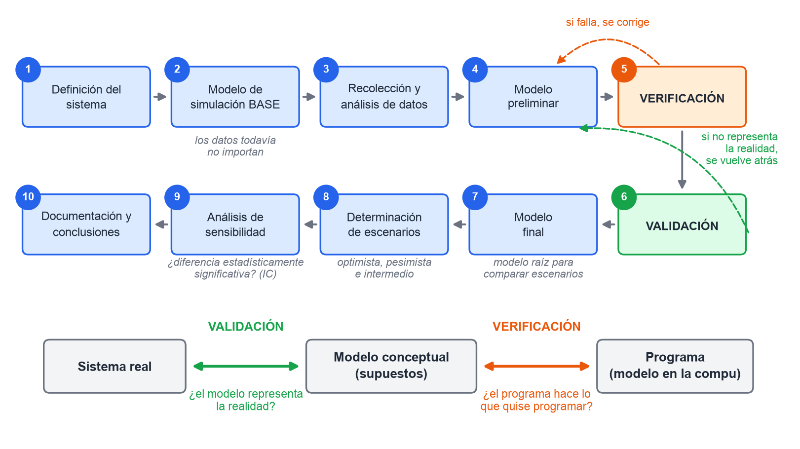
*Figura 8. Arriba, los 10 pasos de Weitz. Abajo, qué compara la validación y qué compara la verificación.*

Lo que el profe agrega en las diapositivas:

1. **Definición del sistema bajo estudio.**
   - Qué entra y qué queda afuera (el alcance).
   - Cuál es el problema concreto.
   - Los supuestos y las interacciones entre los elementos.
2. **Generación del modelo de simulación base.**
   - Relaciones, gráficos e indicadores de salida.
   - **Los datos todavía no importan en esta etapa.**
3. **Recolección y análisis de datos.**
   - Cómo se comportan las variables y qué distribuciones siguen.
4. **Generación del modelo preliminar.**
   - Integra los pasos anteriores.
   - Debe representar lo mejor posible el estado habitual del sistema.
5. **Verificación.**
   - ¿El programa funciona?
   - ¿Los parámetros son correctos?
   - ¿Se completa una corrida sin problemas?
6. **Validación.**
   - A entradas similares, ¿da salidas similares a la realidad?
   - Se hace junto con el cliente.
7. **Generación del modelo final.**
   - Es el escenario **raíz** contra el que se comparan los demás.
8. **Determinación de los escenarios.**
   - Ideas nuevas, cambios sugeridos.
   - Versiones **optimista, pesimista e intermedia**.
9. **Análisis de sensibilidad.**
   - ¿Hay **diferencia estadísticamente significativa** entre escenarios? Se responde con intervalos de confianza.
10. **Documentación, sugerencias y conclusiones.**
    - "Documentar todo, todo, todo."

**Law tiene otra lista de 10 pasos**:

1. Formular el problema.
2. **Recopilar datos y definir el modelo.**
3. **Validar el documento de supuestos.**
4. Programar y **verificar**.
5. Corridas piloto.
6. **Validar el modelo programado.**
7. Diseñar experimentos.
8. Corridas de producción.
9. Analizar las salidas.
10. Documentar.

> **Ojo:** si preguntan "el segundo paso", las opciones usan el vocabulario de Weitz, así que la respuesta es **"generación del modelo de simulación base"**. "Recolección de datos" es el paso 3 de Weitz (y parte del paso 2 de Law).
>
> **Verificar** es comprobar que el programa hace lo que quise programar: es *debugging*. **Validar** es comprobar que el modelo representa la realidad. En Weitz se verifica (5) antes de validar (6). En Law, en cambio, hay una validación **antes** de programar (el documento de supuestos, paso 3).

## 7. Modelos analíticos de colas

*Fuente: Weitz cap. 13 (Rardin) completo y diapositivas "Teoría de colas".*

### 7.1 Las características de un sistema de colas

**Población de clientes.**

- **Infinita**: la tasa de llegadas no cambia, sin importar cuántos clientes hayan llegado.
- **Finita**: **la tasa de llegadas disminuye a medida que aumenta el número de clientes en el sistema**, porque quedan menos clientes afuera que puedan llegar. Ejemplo: 100 telares que pueden romperse. La tasa depende del **estado** del sistema, no del reloj.

**Proceso de llegada.** Puede ser determinístico o probabilístico. Lo habitual es suponer un proceso de Poisson, es decir, tiempos entre llegadas exponenciales.

**Proceso de colas.** Tiene tres características:

- cuántas colas hay (una o varias);
- la capacidad (finita o infinita);
- la disciplina: FIFO (o PEPS), LIFO o por prioridad. En la materia se ve **FIFO**.

**Proceso de servicio.** Tiene tres características:

- uno o varios servidores en paralelo;
- servidores **idénticos** (todos atienden a la misma velocidad) o no;
- atención de a uno o en lotes.

**Fases.** Todo sistema pasa primero por una fase **transitoria**, que depende de las condiciones iniciales, y después llega al **estado estable**. **Las fórmulas analíticas valen solo en estado estable.**

### 7.2 Notación de Kendall

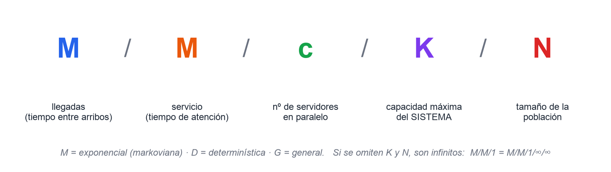
*Figura 9. Cada letra describe una parte del sistema.*

> **Ojo:** la segunda letra es el tiempo de **servicio**, no el de llegadas. Y K es la capacidad del **sistema** (los que esperan más los que están siendo atendidos), no solo la de la cola.

### 7.3 Medidas de rendimiento y ley de Little

| Símbolo | Medida |
|---|---|
| $L$ | número promedio de clientes **en el sistema** |
| $L_q$ | número promedio **en cola** |
| $W$ | tiempo promedio **en el sistema** |
| $W_q$ | tiempo promedio de espera **en cola** |
| $P_0$, $P_n$ | probabilidad de que haya 0 o $n$ clientes |
| $p_w$ | probabilidad de que un cliente que llega tenga que esperar |
| $U$ | utilización del servidor |
| $\rho = \lambda/\mu$ | **intensidad de tráfico**: tasa de llegadas sobre tasa de servicio (con $c$ servidores, $\lambda/(c\mu)$) |
| — | probabilidad de **negación de servicio** (en colas con capacidad limitada) |

**Relaciones universales**, que valen en estado estable para cualquier modelo:

$$L = \lambda W \qquad L_q = \lambda W_q \qquad W = W_q + \frac{1}{\mu}$$

Las dos primeras son la **ley de Little**. Con una medida y las relaciones, salen todas las demás.

### 7.4 M/M/1

**Supuestos**:

- población **infinita**;
- llegadas **Poisson** de tasa $\lambda$;
- **una sola cola**, infinita, FIFO;
- **un servidor** con servicio **exponencial** de tasa $\mu$.

**Condición de estado estable: $\mu > \lambda$**, o sea $\rho < 1$.

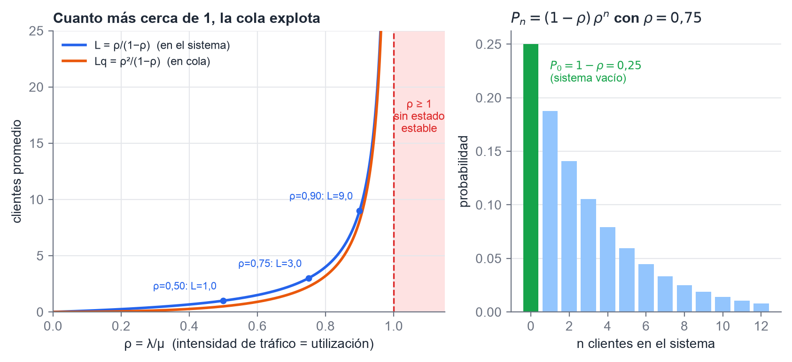
*Figura 10. A la izquierda, por qué hace falta ρ < 1: cerca de 1 la cola se dispara. A la derecha, la probabilidad de cada estado con ρ = 0,75.*

| | |
|---|---|
| $P_0 = 1 - \rho$ | $P_n = (1-\rho)\,\rho^n$ |
| $L_q = \dfrac{\rho^2}{1-\rho}$ | $L = \dfrac{\rho}{1-\rho}$ |
| $W_q = L_q/\lambda$ | $W = W_q + 1/\mu$ |
| $U = \rho$ | $p_w = \rho$ |

> **Ojo:** con $\lambda > \mu$ **sí se puede simular**: la cola crece sin límite y se ve el servidor ocupado casi el 100% del tiempo. Lo que no existe es el estado estable, y por eso no hay solución analítica. Y con $\lambda < \mu$ **sí hay** solución analítica. Las dos preguntas salieron en 2025. Además, el resumen de alumnos de 2025 dice "población **finita**" para M/M/1: **está mal, es infinita**.

### 7.5 Otros modelos

- **M/M/c**: $c$ servidores idénticos en paralelo y **una sola cola**. Es estable si $\lambda < c\mu$. Hay que entender cómo funciona; **las fórmulas no se piden**.
- **Población finita** (M/M/c/K con K = tamaño de la población): la tasa de llegadas baja a medida que hay más clientes adentro. Se resuelve con software.
- **Capacidad de espera limitada** (M/M/c/K con K = capacidad máxima): los que llegan con el sistema lleno **se pierden**. La **probabilidad de negación de servicio** es la de encontrar el sistema lleno, y se calcula por complemento: $1 - (P_0 + \dots + P_K)$.
- **M/G/c**: el servicio tiene una distribución **general**, no exponencial. Hace falta conocer la **media y el desvío estándar** del tiempo de servicio. Un desvío de 0 corresponde a un servicio **determinístico**. Se resuelve con software (en el libro, STORM).

**Análisis económico (13.5).** El costo total es

$$c_s \cdot c + c_w \cdot L$$

o sea, costo por servidor por número de servidores, más costo de espera por clientes en el sistema. Con capacidad limitada se suma el **costo de negación**: costo por cliente perdido × tasa de llegadas × probabilidad de negación. Se elige el $c$ que **minimiza** el total.

## 8. Elementos de probabilidad

*Fuente: Ross caps. 1 y 2, hasta el proceso de Poisson no homogéneo. Lo que el profe dijo que no entra: §2.10 y las variables gamma.*

### 8.1 Esperanza y varianza

**Propiedades.** Las tres primeras pueden pedirse con demostración:

- $E[aX + b] = a\,E[X] + b$
- $\mathrm{Var}(aX + b) = a^2\,\mathrm{Var}(X)$: **sumar una constante no cambia la dispersión**.
- $\mathrm{Var}(X + Y) = \mathrm{Var}(X) + \mathrm{Var}(Y) + 2\,\mathrm{Cov}(X, Y)$. Si son independientes, la covarianza es 0.
- $\mathrm{Var}(X) = E[X^2] - E[X]^2$
- $E\left[\sum X_i\right] = \sum E[X_i]$ vale **siempre**. Para la varianza de la suma hace falta **independencia**.

### 8.2 Desigualdades y leyes de los grandes números

| Resultado | Enunciado | Cómo se demuestra |
|---|---|---|
| **Markov** | si $X \ge 0$ y $a > 0$: $P\{X \ge a\} \le \dfrac{E[X]}{a}$ | |
| **Chebyshev** | $P\{\lvert X - \mu \rvert \ge k\sigma\} \le \dfrac{1}{k^2}$ | Markov aplicado a $(X-\mu)^2/\sigma^2$, que tiene esperanza 1, con $a = k^2$ |
| **Ley débil** | $P\{\lvert \bar X_n - \mu \rvert > \varepsilon\} \to 0$ cuando $n \to \infty$ | con $\mathrm{Var}(\bar X) = \sigma^2/n$, que **necesita independencia**, y Chebyshev: la cota $\sigma^2/(n\varepsilon^2) \to 0$ |
| **Ley fuerte** | $\bar X_n \to \mu$ con probabilidad 1 | lo que tiende a infinito es **$n$**, la cantidad de variables, no el tiempo |

### 8.3 Variables discretas

| Variable | Qué cuenta | $P\{X = i\}$ | $E$ | $\mathrm{Var}$ |
|---|---|---|---|---|
| **Bernoulli** | éxito (1) o fracaso (0) en un intento | $p$ / $1-p$ | $p$ | $p(1-p)$ |
| **Binomial** | éxitos en $n$ intentos independientes. Es la **suma de $n$ Bernoulli** | $\binom{n}{i} p^i (1-p)^{n-i}$ | $np$ | $np(1-p)$ |
| **Poisson** | eventos en un intervalo | $e^{-\lambda} \lambda^i / i!$ | $\lambda$ | $\lambda$ |
| **Geométrica** | **número del intento** del primer éxito | $(1-p)^{i-1} p$ | $1/p$ | $(1-p)/p^2$ |
| **Binomial negativa** (Pascal) | intentos hasta el $r$-ésimo éxito | $\binom{i-1}{r-1} p^r (1-p)^{i-r}$ | $r/p$ | $r(1-p)/p^2$ |
| **Hipergeométrica** | claras en $n$ extracciones **sin reposición**, de $N$ claras y $M$ oscuras | $\binom{N}{i}\binom{M}{n-i} / \binom{N+M}{n}$ | $np$ con $p = \frac{N}{N+M}$ | $np(1-p)\frac{N+M-n}{N+M-1}$ |

Tres cosas que se toman:

- **De binomial a Poisson.** Con $n$ grande y $p$ chico, la binomial se aproxima por una Poisson con $\lambda = np$. Ross no da umbrales numéricos, así que una opción que diga "**solo** si $n > 100$" es falsa.
- **Fórmulas de recurrencia.**
  - Binomial: $P_{i+1} = \frac{n-i}{i+1}\cdot\frac{p}{1-p}\,P_i$.
  - Poisson: $P_{i+1} = \frac{\lambda}{i+1}\,P_i$.
  
  Existen porque la fórmula directa (factoriales y potencias) es cara de calcular, y es lo que usa AnyLogic. Hay que saber para qué sirven; la demostración no se pide.
- La **Poisson** es la única de la tabla con $E = \mathrm{Var}$.

### 8.4 Variables continuas y el TCL

| Variable | Densidad | $E$ | $\mathrm{Var}$ | Para recordar |
|---|---|---|---|---|
| **Uniforme** $(a, b)$ | $\frac{1}{b-a}$ | $\frac{a+b}{2}$ | $\frac{(b-a)^2}{12}$ | es la base de todo generador |
| **Normal** $(\mu, \sigma^2)$ | campana simétrica | $\mu$ | $\sigma^2$ | $aX + b$ sigue siendo normal; $Z = \frac{X-\mu}{\sigma}$ es $N(0, 1)$ |
| **Exponencial** (tasa $\lambda$) | $\lambda e^{-\lambda x}$ | $\frac{1}{\lambda}$ | $\frac{1}{\lambda^2}$ | $F(x) = 1 - e^{-\lambda x}$ |

**La exponencial**:

- **No tiene memoria**: $P\{X > s + t \mid X > s\} = P\{X > t\}$. Es la **única continua** con esta propiedad.
- Si $X$ es exponencial de tasa $\lambda$, $cX$ es exponencial de tasa $\lambda/c$.
- El mínimo de exponenciales independientes es exponencial, con tasa igual a la **suma de las tasas**.
- En colas se usa para el servicio **por conveniencia matemática**, porque da soluciones cerradas, no porque sea realista.

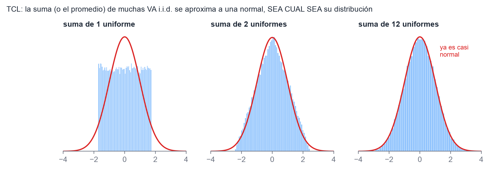
*Figura 11. El teorema central del límite en acción. Una uniforme sola es chata; sumando 12 ya es casi una normal.*

**Teorema central del límite.** Si $X_1, X_2, \dots$ son i.i.d. con media $\mu$ y varianza $\sigma^2$ finitas, entonces para $n$ grande

$$\frac{\bar X_n - \mu}{\sigma/\sqrt{n}}\ \text{es aproximadamente}\ N(0, 1)$$

**sea cual sea** la distribución de las $X_i$. El profe dijo que es "muy importante". Ojo con dos trampas: la normal que se obtiene es **aproximada**, no exacta, y el teorema **no** exige que las $X_i$ sean normales.

### 8.5 El proceso de Poisson

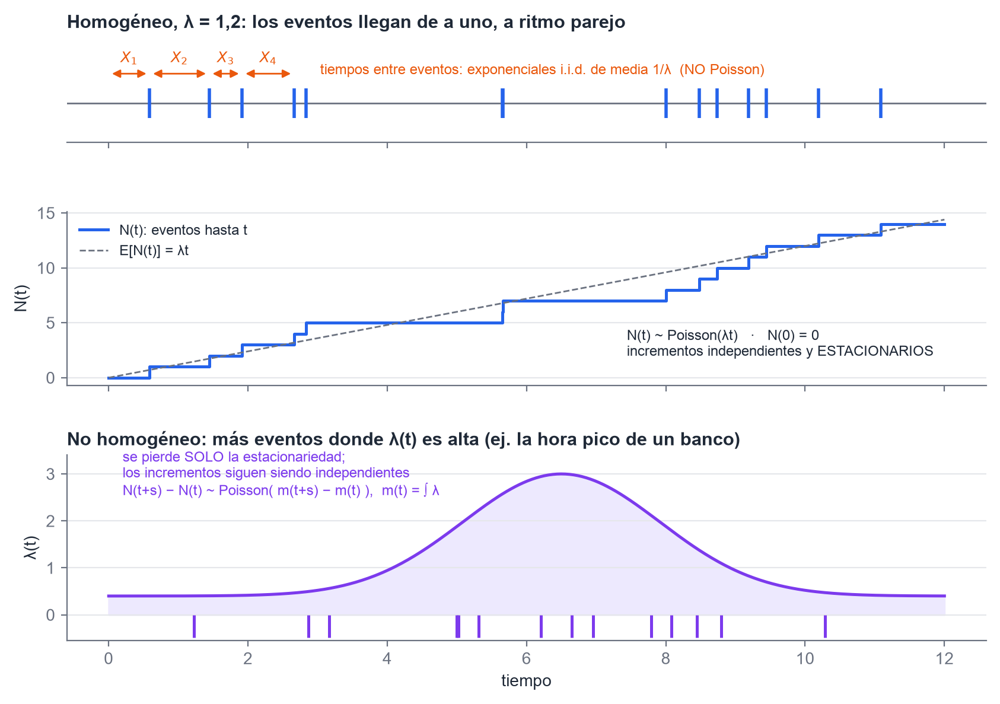
*Figura 12. Arriba y al medio, el proceso homogéneo. Abajo, el no homogéneo: los eventos se amontonan donde λ(t) es alta.*

**Homogéneo, de tasa $\lambda > 0$.** $N(t)$ cuenta los eventos ocurridos en $[0, t]$, y se cumplen cinco condiciones:

1. $N(0) = 0$.
2. **Incrementos independientes**: lo que pasa en intervalos que no se superponen es independiente.
3. **Incrementos estacionarios**: la distribución del número de eventos en un intervalo depende **solo de su longitud**, no de dónde está.
4. $\lim_{h \to 0} P\{N(h) = 1\}/h = \lambda$: en un intervalo chico, la probabilidad de un evento es aproximadamente $\lambda h$.
5. $\lim_{h \to 0} P\{N(h) \ge 2\}/h = 0$: los eventos ocurren **de a uno**.

**Lo que se deduce de las cinco condiciones:**

- $N(t)$ tiene distribución **Poisson de media $\lambda t$**.
- Los **tiempos entre eventos** son **exponenciales i.i.d. de media $1/\lambda$**.

> **Ojo:** "los tiempos entre arribos siguen una distribución de Poisson" es **falso**, y es el error más repetido en los parciales viejos. La Poisson cuenta **cuántos** eventos hay (es discreta). La exponencial mide **cuánto tiempo pasa entre** eventos (es continua).

**No homogéneo, con intensidad $\lambda(t)$.** La tasa **varía con el tiempo**. Ejemplo: a un banco no llega la misma gente a las 10 que a las 15.

- Se pierde **solo** la condición 3, la estacionariedad.
- Los incrementos **siguen siendo independientes**.
- Con $m(t) = \int_0^t \lambda(y)\,dy$, el número de eventos en $(t, t+s]$ es Poisson de media $m(t+s) - m(t)$.

> **Ojo:** "en el no homogéneo no se mantienen los incrementos independientes" es **falso**. Lo que lo distingue del homogéneo es que **$\lambda$ varía con el tiempo**.

## 9. Números aleatorios y generación de variables

*Fuentes: TP 2.1 (generadores), TP 2.2 (Naylor cap. 4), el capítulo de números pseudoaleatorios que citan los TP y random.org.*

### 9.1 Generar números aleatorios

**Para qué sirven.** Son la base de toda simulación estocástica. A partir de una $U(0, 1)$ se genera **cualquier** distribución, y con eso se simulan las ocurrencias del modelo.

| | Verdaderos | Pseudoaleatorios |
|---|---|---|
| Origen | una fuente **física**: cuántica (teóricamente impredecible) o caótica (prácticamente impredecible). Ejemplos: random.org, que usa ruido atmosférico; ERNIE; la tabla de RAND de 1955 | un **algoritmo determinístico** que los genera de a uno, en secuencia |
| ¿Reproducibles? | **No** | **Sí**: la **semilla** determina toda la sucesión |
| Velocidad y costo | lentos y caros; **menos prácticos** | **rápidos**, poca memoria, cualquier computadora |
| En simulación | no se prefieren | **se prefieren**: permiten repetir una corrida y comparar escenarios en las mismas condiciones |

Los pseudoaleatorios buscan **comportarse como** los verdaderos, es decir, imitar sus propiedades estadísticas. Un pseudoaleatorio se define por una **semilla**, una **función de transición** y una **función de salida**.

**Un buen generador** produce números:

- uniformes en $(0, 1)$;
- independientes, sin patrones;
- reproducibles;
- con **período largo**;
- rápidos de calcular;
- con poco uso de memoria.

**Métodos y generadores conocidos**:

| Método | Qué hay que saber |
|---|---|
| **Cuadrados centrales** (von Neumann, 1946) | Se eleva al cuadrado y se toman los dígitos del medio. **No está vigente**: cae en ciclos cortos y, si aparece un cero, se queda en cero para siempre |
| **Generador congruencial lineal (GCL)** | $Z_i = (aZ_{i-1} + c) \bmod m$, con $U_i = Z_i/m$. Es **mixto** si $c > 0$ y **multiplicativo** si $c = 0$. Período máximo: $m$ |
| **RANDU** (IBM, años 60 y 70) | Un GCL **malo**: las ternas de números consecutivos caen en **pocos planos** (correlación). Todo GCL tiene ese defecto en dimensiones altas |
| **Mersenne Twister** (Matsumoto y Nishimura, 1997) | Período $2^{19937} - 1$, buena distribución en muchas dimensiones, pasa los tests. Es el de Python, R, Ruby, C++, Excel y Matlab. **Es el estándar actual** |

**Período completo** quiere decir $p = m$: el generador recorre **todos** los valores posibles antes de repetirse. No es "repetir siempre el mismo número", que sería una degeneración.

**Teorema de Hull–Dobell**, para el GCL mixto. Tiene período completo si y solo si se cumplen **las tres**:

1. $m$ y $c$ son primos relativos.
2. Todo primo que divide a $m$ divide también a $a - 1$.
3. Si 4 divide a $m$, 4 divide a $a - 1$.

**Pruebas de aleatoriedad.** Hay **dos tipos**:

- **empíricas**: se aplican a los números generados (chi-cuadrado, series, corridas, póker, Kolmogórov-Smirnov);
- **teóricas**: se aplican a los parámetros del generador, sin generar ningún número.

Hay que **testear el generador antes de usarlo**. El ojo humano no distingue bien qué es aleatorio.

### 9.2 Generar variables aleatorias

**Transformada inversa.** Si $U \sim U(0, 1)$, entonces $X = F^{-1}(U)$ tiene distribución $F$.

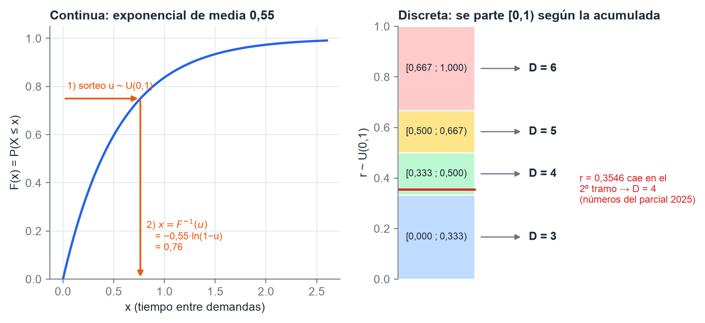
*Figura 13. A la izquierda, se sortea u en el eje vertical y se baja al eje x. A la derecha, el caso discreto: [0, 1) se parte según la acumulada y se mira en qué tramo cae r.*

- **Exponencial de media $m$**: $x = -m\,\ln(1 - u)$. Como $1 - U$ tiene la misma distribución que $U$, también vale $x = -m\,\ln u$, que es lo que se usa en el ejercicio de inventario.
- **Uniforme en $(a, b)$**: $x = a + (b - a)\,u$.
- **Discreta**: $X = x_j$ si $F(x_{j-1}) \le u < F(x_j)$.

**Los tres métodos de Naylor:**

| Método | Idea | Cuándo se usa |
|---|---|---|
| **Transformada inversa** | $X = F^{-1}(U)$ | cuando la inversa de la acumulada es **fácil de obtener** |
| **Rechazo** | se generan candidatos y se aceptan o rechazan según la densidad objetivo | cuando la inversa **no tiene forma cerrada** |
| **Composición** | se combinan (mezclan) distribuciones más simples | cuando la densidad es una mezcla |

**Las 9 distribuciones del TP 2.2:**

| Distribución | Tipo | Cómo se genera |
|---|---|---|
| Uniforme | continua | inversa: $a + (b-a)u$ |
| Exponencial | continua | inversa: $-m\ln u$ |
| Gamma (Erlang $k$) | continua | **suma de $k$ exponenciales** |
| Normal | continua | **TCL** (sumar 12 uniformes y restar 6) o **Box-Muller** (exacto). **No** por inversa, porque no tiene forma cerrada |
| Pascal | discreta | suma de geométricas: contar intentos hasta el $r$-ésimo éxito |
| Binomial | discreta | **suma de $n$ Bernoulli** |
| Hipergeométrica | discreta | simular las $n$ extracciones **sin reposición** |
| Poisson | discreta | contar cuántos tiempos exponenciales entran en una unidad de tiempo (o multiplicar uniformes hasta bajar de $e^{-\lambda}$) |
| Empírica discreta | discreta | inversa discreta con la tabla de frecuencias. Es la que usa el modelo de inventario |

## 10. AnyLogic y lo que hay alrededor

*Fuentes: AnyLogic in Three Days, The Art of Process-Centric Modeling, los tutoriales entregados y las consignas de los TP.*

### 10.1 Los tres paradigmas

AnyLogic es **multimétodo**: permite combinar los tres paradigmas en un mismo modelo. El libro aclara que **cada método sirve para un rango de niveles de abstracción**.

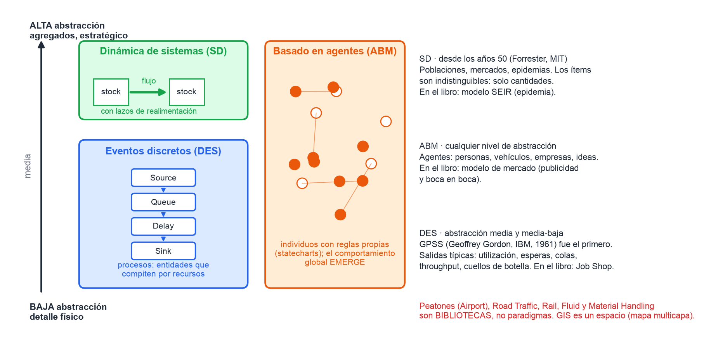
*Figura 14. Dinámica de sistemas arriba (alta abstracción), eventos discretos en el medio y abajo, agentes en todo el rango.*

| Paradigma | Cómo ve al sistema | Elementos | Modelo del libro |
|---|---|---|---|
| **Dinámica de sistemas** (Forrester, MIT, años 50) | como **agregados**: los ítems no se distinguen, solo importan las cantidades. Se usa para modelos estratégicos de largo plazo | **stocks** (acumulaciones: la memoria del sistema), **flujos** (tasas de cambio), lazos de **realimentación** | **SEIR**: una epidemia con susceptibles, expuestos, infectados y recuperados |
| **Eventos discretos** (GPSS, de Geoffrey Gordon en IBM, 1961) | como un **proceso**: entidades que pasan por operaciones y **compiten por recursos limitados**, así que casi siempre hay colas | diagrama de flujo de bloques: Source, Queue, Delay, Seize/Release, Sink | **Job Shop**: un taller con recepción, almacenamiento, máquinas y camiones |
| **Basado en agentes** | como **individuos** con comportamiento propio (a menudo con *statecharts*). El **comportamiento global emerge** de las interacciones | agentes, statecharts, entorno | **Mercado**: cómo se adopta un producto por publicidad y boca en boca |

El libro tiene un cuarto capítulo, **Peatones** (modelo *Airport*), pero **no es un paradigma**: es una biblioteca. Tampoco son paradigmas Road Traffic, Rail, Fluid, Material Handling ni GIS.

En la práctica entregamos tres modelos del libro (**SEIR, Job Shop y Airport**) y tres tutoriales de la ayuda:

- Supply Chain GIS;
- Subway Entrance Hall (peatones);
- Intersection (tránsito).

Detalles del libro que pueden caer:

- **Los agentes no tienen por qué ser personas**: pueden ser vehículos, máquinas, proyectos, ideas o empresas.
- Las salidas típicas de un modelo de eventos discretos son:
  - utilización de recursos;
  - tiempo en el sistema;
  - esperas;
  - largo de las colas;
  - *throughput*;
  - cuellos de botella.
- **El primer software de eventos discretos fue GPSS (1961), de Geoffrey Gordon.** Es el mismo Gordon de la bibliografía.

### 10.2 M/M/1 en AnyLogic (Process-Centric Modeling)

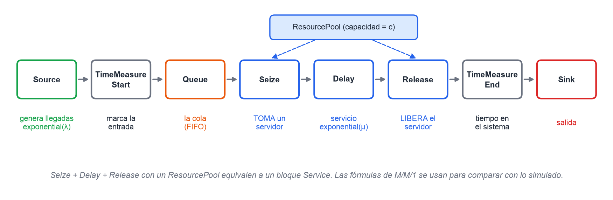
*Figura 15. La cola simple armada con la Process Modeling Library, como en el TP 3.*

| Bloque | Qué hace |
|---|---|
| **Source** | genera las llegadas, con `exponential(λ)`: es un proceso de Poisson |
| **Queue** | la cola |
| **Seize** | **toma** un recurso (el servidor) |
| **Delay** | el tiempo de servicio, con `exponential(μ)` |
| **Release** | **libera** el recurso |
| **ResourcePool** | el conjunto de servidores; define la capacidad $c$ |
| **Sink** | la salida del sistema |
| **TimeMeasureStart / End** | miden el tiempo en el sistema (o en la cola) |

Los promedios de clientes en el sistema y en la cola se llevan con objetos *Statistics*. El libro presenta las fórmulas de M/M/1 **para compararlas con lo simulado**.

Del cap. 2 del libro también conviene saber dos cosas:

- La diferencia entre simulaciones **terminales** (horizonte finito) y **no terminales** (estado estable, con un **período de calentamiento** que se descarta).
- Que la **ley de Little** vale también para estimar medidas a partir de la simulación.

### 10.3 Cultura de cátedra

Son preguntas que en 2025 fueron 5 de 32:

- **GIS** (Sistema de Información Geográfica) es **multicapa**: superpone capas de datos sobre un mapa. "Monocapa" es **falso**. En AnyLogic es un espacio donde se ubican agentes sobre mapas reales.
- **LaTeX** es un sistema de composición de textos de alta calidad tipográfica, muy usado en artículos científicos con matemática. Los informes de los TP se hicieron en LaTeX, con la plantilla de Cornell en Overleaf.
- **La POO no es imprescindible para simular.** Ayuda a modelar entidades y agentes, pero se simula también en FORTRAN, en C o en una planilla. Law aclara que la mayoría de los paquetes de simulación no son realmente orientados a objetos.
- **Historia.** La simulación por computadora existe desde los **años 40** (Montecarlo y el Proyecto Manhattan). **No** "surgió en los últimos 30 años". GPSS es de 1961 y la dinámica de sistemas de los años 50.
- **Montecarlo** se asocia con la simulación de procesos **estocásticos**, aunque en su origen también se usó para problemas determinísticos. Un modelo de Montecarlo es **estático**.
- **Los TP de clase** (cola e inventario) son modelos simples que **se pueden simular y además tienen solución analítica**. Lo simulado se **compara** con lo analítico y da **parecido**. Para simular no hace falta conocer la solución analítica.

**Estadística básica** (del TP 1.1, la ruleta), que se tomó en 2025:

- **Media aritmética**: medida de tendencia central; es "el promedio".
- **Frecuencia absoluta** $f_i$: cuántas veces aparece un valor o evento en la muestra.
- **Frecuencia relativa**: el **cociente** $f_i / N$. Si el enunciado dice "suma", es **falso**.
- En la ruleta, la frecuencia relativa de un número **converge** a $1/37$ a medida que crecen las tiradas. Es la ley de los grandes números vista en la práctica.

## 11. Las 25 trampas, una por línea

1. **Sistema**, **modelo** y **simulación** son cosas distintas.
2. La solución analítica es **exacta**. La simulación **no la reemplaza**: la complementa.
3. Para simular hacen falta datos o estimaciones. No hacen falta POO ni computadora para todo modelo.
4. Un modelo **no** tiene que estar "totalmente testeado" para usarse.
5. La ventaja del *next-event* es **saltear la inactividad**.
6. Los eventos de la cola son **arribo y partida**. "Servidor ocupado" es un estado.
7. Las medidas de Law son demora **en cola**, número **en cola** y **utilización**.
8. La demora **no incluye** el tiempo de servicio.
9. La política (s, S) **no** garantiza que $I$ quede entre $s$ y $S$, porque puede ser negativo.
10. $h$ va con $I^+$ y $\pi$ con $I^-$. Si no se pide, **no se paga $K$**.
11. Al subir $S$ sube el mantenimiento y bajan el faltante y el pedido. Una sola corrida **no alcanza** para elegir la política.
12. **Paso 2 de Weitz**: modelo de simulación **base**. Recolección de datos es el paso 3.
13. Verificar es comprobar el **programa**. Validar es comparar con la **realidad**.
14. Con **población finita**, la tasa de llegadas **baja** cuando sube el número de clientes en el sistema.
15. $\rho = \lambda/\mu$. **Estable si $\mu > \lambda$.** $P_0 = 1 - \rho$.
16. En Kendall la segunda letra es el **servicio**, y K es la capacidad del **sistema**.
17. La **suma de Bernoulli** es binomial. La **geométrica** cuenta el número del intento del primer éxito: $E = 1/p$.
18. De binomial a Poisson con $\lambda = np$, **sin umbrales fijos**.
19. $\mathrm{Var}(aX + b) = a^2\,\mathrm{Var}(X)$. $\mathrm{Var}(\bar X) = \sigma^2/n$ **necesita independencia**.
20. En la ley de los grandes números lo que crece es **$n$**, no el tiempo.
21. **Los tiempos entre arribos son exponenciales.** La cantidad de arribos es Poisson.
22. **Poisson no homogéneo**: $\lambda(t)$ varía; los incrementos siguen **independientes** pero dejan de ser **estacionarios**.
23. **Período completo** quiere decir $p = m$. Los cuadrados centrales **no están vigentes**. Los pseudoaleatorios se prefieren por velocidad y reproducibilidad.
24. Hay **dos tipos** de prueba de aleatoriedad: empíricas y teóricas. Chi-cuadrado o póker son pruebas, no tipos.
25. Los paradigmas de AnyLogic son **tres**: agentes, dinámica de sistemas y eventos discretos. Peatones y GIS no lo son. GIS es **multicapa**.

## Fuentes

- **Classroom 2026** (`fuentes/classroom-2026/`):
  - diapositivas de teoría (clase 1, clase 2, cola simple e inventarios, inventarios, pasos y teoría de colas, traza paso a paso);
  - Ross, en castellano y en inglés;
  - AnyLogic in Three Days;
  - The Art of Process-Centric Modeling;
  - Naylor cap. 4.
- **Apunte de Weitz** (`fuentes/apuntes-catedra/`): Law cap. 1, cap. 1 en castellano y cap. 13. Las transcripciones están en `fuentes/txt/`.
- **Alcance**: aviso de Guillermo Leale del 31/10 en el Classroom, y la clase del 14/10 (`estudio/parcial1-alcance-2026.md`).
- **Parcial 2025 y resumen de alumnos 2025**: `estudio/banco-preguntas.md` y `fuentes/resumenes/Resumen Simulación 2025 (con preguntas de parcial).docx`.
- **Consignas de los TP 2026**: `fuentes/tps-2026/`.
- Las figuras se generan con `scripts/sim-figs-parcial1.py`.
